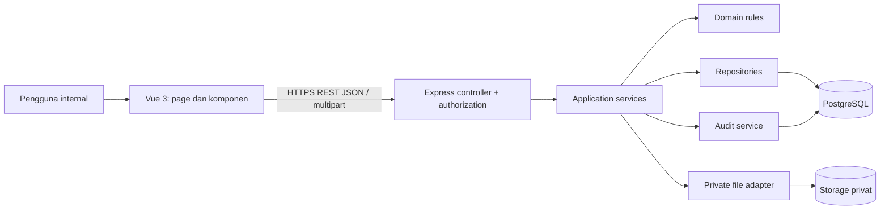
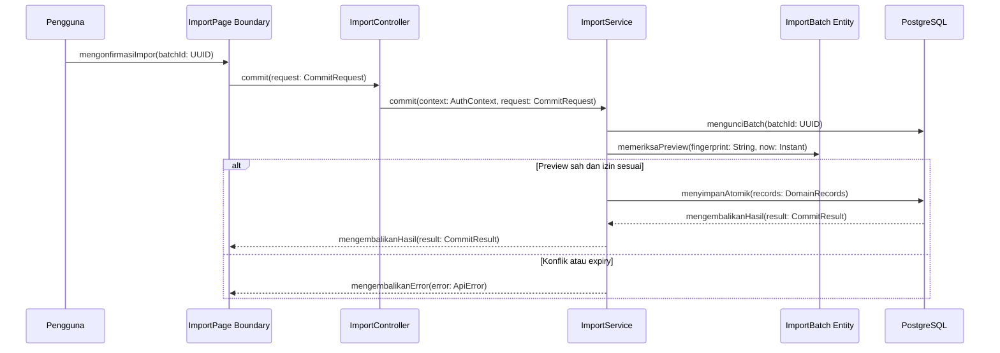

# Arsitektur Perangkat Lunak dan Desain Terperinci

## Identitas dan kendali dokumen

| Atribut | Nilai |
| --- | --- |
| Document ID | DOC-06 |
| Nama proyek | SIRIS — Capstone Project Kelompok 42 |
| Mitra | Warehouse PT Harina Chemicals Industry |
| Versi | 0.2.0 |
| Status dokumen | PROPOSED — NEEDS REVIEW |
| Tanggal penyusunan | 2026-11-10 |
| Pemilik dokumen | Software Architect |
| Tujuan dokumen | Menjelaskan pembagian tanggung jawab komponen dan aliran data. |
| Ruang lingkup | Website pendamping Erasoft; Supplier Inbound Reliability dan Inventory Accuracy & Reconciliation. |

Ketentuan pengguna diberi rujukan **SRC-01**. Desain baru berstatus **PROPOSED**, bukan BASELINE APPROVED. Belum ada aplikasi, hasil pengujian runtime, evaluasi stakeholder, atau persetujuan rilis yang dibuktikan dalam workspace ini. Semua contoh adalah **UJI**.

## Daftar isi

1. Identitas dan kendali dokumen
2. Referensi
3. Keputusan arsitektur dan alasan
4. Arsitektur logis dan batas keamanan
5. Struktur modul dan tanggung jawab
6. Interaksi autentikasi dan otorisasi
7. Desain proses impor
8. Rekonsiliasi, metrik, WO, dan audit
9. Model kelas terintegrasi PROPOSED
10. Error, deployment, dan tradeoff
11. Definisi metrik dari SRC-09 dan batas verifikasi
12. Dependencies
13. Open issues
14. Riwayat revisi

## Referensi

SRC-01: master prompt pengguna pada sesi penyusunan; SRC-02: `../AGENTS.md`. SRC-09: `../design.md` v1.0.0, kontrak desain untuk ditinjau yang tersedia pada pemeriksaan akhir; snapshot visual disertakan pada DOC-10. Register sumber lengkap, hierarki, dan sumber eksternal terdapat pada [DOC-00](00_MASTER_DOCUMENTATION_INDEX.md). Rujukan antardokumen: [DOC-00](00_MASTER_DOCUMENTATION_INDEX.md), [DOC-05](05_BUSINESS_RULES_RBAC.md), [DOC-07](07_DATABASE_DESIGN.md), [DOC-08](08_DATA_CONTRACT_IMPORT_SPECIFICATION.md), [DOC-09](09_API_SPECIFICATION.md), [DOC-10](10_UI_UX_PROTOTYPE_SPECIFICATION.md), [DOC-16](16_SECURITY_RISK_NFR.md), [DOC-17](17_DEPLOYMENT_OPERATIONAL_GUIDE.md).

## Keputusan arsitektur dan alasan

**PROPOSED:** modular monolith Express.js dengan client Vue 3, satu PostgreSQL, dan file storage privat. Pemisahan modul mengurangi coupling tanpa kebutuhan microservices untuk tim empat anggota. Stack web client–server adalah baseline SRC-01; pilihan modular monolith belum disetujui. Tidak ada konektor database/API Erasoft. Library, ORM, autentikasi dan hosting tetap OD-07.

## Arsitektur logis dan batas keamanan

Browser adalah batas tidak tepercaya. PostgreSQL dan storage tidak diakses langsung oleh browser. API menerapkan proyeksi response sesuai role. File disajikan melalui endpoint terotorisasi; tidak mengirim key storage. Diagram disediakan sebagai source Mermaid; belum dirender.

## Struktur modul dan tanggung jawab

| Lapisan / usulan direktori | Tanggung jawab | Larangan |
| --- | --- | --- |
| frontend/src/pages | Komposisi Screen SCR-01–SCR-15 dan state | Tidak menghitung ulang status final sebagai otoritas |
| frontend/src/components | Form, table, preview, status; token DOC-10 | Tidak mengunci izin hanya di UI |
| frontend/src/api | DTO dan penanganan error DOC-09 | Tidak menyimpan secret server |
| backend/src/controllers | Parse request, status HTTP, delegasi | Tidak memuat rumus bisnis/SQL |
| backend/src/services | Transaksi import/reconciliation/evidence; scope | Tidak melewati domain validation |
| backend/src/domain | Eligibility, status, fingerprint, pairing | Tidak bergantung pada UI/storage vendor |
| backend/src/repositories | SQL parameterized, FK, locking | Tidak mengakses dataset tanpa scope |
| backend/src/storage | Objek privat, hash, ukuran dan MIME | Tidak membuat bucket publik |
| backend/src/audit | Event aman, korelasi, redaksi | Tidak mencatat raw/credential |

## Interaksi autentikasi dan otorisasi

Rekomendasi PROPOSED: sesi server dengan cookie HttpOnly/Secure/SameSite, perlindungan CSRF untuk mutasi, dan invalidasi logout. Alternatif serta library hanya diputuskan melalui OD-07. Akun diprovisikan secara internal; tidak ada registrasi publik. Controller membentuk AuthContext dari sesi, memuat izin gudang, lalu memanggil service. Service mengecek izin objek dan aksi kembali ketika melakukan mutasi. Route autentikasi tidak ditetapkan sebelum mekanisme disetujui dan tidak menambah UC.

## Desain proses impor

ImportService memilih adaptor berdasarkan kind dan contract_version; adaptor menghasilkan staging_rows tanpa mengubah domain. Validator menjalankan UC-16; PreviewPolicy menghitung fingerprint/expiry. CommitService mengikuti transaksi DOC-08. Data mentah tetap privat, normalized ditelusuri ke source_row_id. Parsing file besar memerlukan batas resource yang disetujui OD-09; jangan mengasumsikan semuanya aman dimuat ke memori.

Sequence di atas adalah desain teknis gabungan untuk impor, bukan pengganti 16 diagram sequence baseline. Tipe CommitRequest/CommitResult/ApiError didefinisikan DOC-09; AuthContext berasal sesi, DomainRecords adalah baris domain sesuai kind, UUID/String/Instant memakai tipe logical.
## Rekonsiliasi, metrik, WO, dan audit

ReconciliationService memuat input immutable dari snapshot dan sesi, memeriksa konteks, lalu menerapkan tabel keputusan DOC-08. Run dan semua lines disimpan dalam satu transaksi; hasil lama immutable. MetricsService menggunakan query yang sama scope-nya dengan detail. **PROPOSED:** inventory match rate = jumlah MATCHED / jumlah (MATCHED + DISCREPANCY); denominator nol → value=null dan NO_ELIGIBLE_DATA. Definisi akhir dan rumus tampilan supplier mengikuti SRC-09 §6.6; eligibility final menunggu OD-06; tidak ada ranking/analitik tambahan. Final inbound membutuhkan closing marker sah, bukan jumlah yang telah cukup.

WO dibaca dari wo_references yang sumber pengisiannya belum ditetapkan. Tidak menambah impor keenam. Notices dibentuk sebagai view read-only dari kondisi inbound; aturan konten/frekuensi OD-06, tanpa kanal eksternal atau workflow corrective action. Audit sukses satu transaksi dengan domain; audit gagal sesudah rollback; outage total menghasilkan log aman untuk tindak lanjut. Tidak ada klaim audit tersimpan jika medianya gagal.

## Model kelas terintegrasi PROPOSED

Diagram ini memodelkan tanggung jawab service dan entitas inti, bukan salinan ERD. Tabel pendukung yang hanya merupakan detail persistence tidak semuanya menjadi kelas. Diagram final sumber tetap SOURCE REQUIRED.

```mermaid
classDiagram
    class ImportService {
        +validate(batchId: UUID) ValidationReport
        +commit(context: AuthContext, request: CommitRequest) CommitResult
    }
    class ImportBatch {
        +UUID id
        +String kind
        +String state
        +Instant expires_at
        +memeriksaPreview(fingerprint: String, now: Instant) Boolean
    }
    class InboundReference {
        +UUID id
        +Date requested_date
        +Decimal expected_quantity
    }
    class CommitmentEvent {
        +String event_type
        +Date promised_date
    }
    class ReceivingEvent {
        +Decimal received_quantity
        +Boolean is_closing
    }
    class StockSnapshot {
        +UUID id
        +UUID cutoff_id
    }
    class CountSession {
        +UUID id
        +UUID cutoff_id
    }
    class ReconciliationService {
        +execute(context: AuthContext, request: ReconciliationRequest) ReconciliationRun
    }
    class ReconciliationRun {
        +UUID id
        +String rule_version
    }
    class ReconciliationLine {
        +String status
        +Decimal variance
    }
    class EvidenceService {
        +archive(context: AuthContext, request: EvidenceRequest) Evidence
    }
    class Evidence {
        +UUID stock_line_id
        +Integer size_bytes
    }
    class QueryService {
        +read(context: AuthContext, filter: QueryFilter) QueryResult
    }
    class WoReference {
        +String source_ref
        +Decimal required_quantity
    }
    class AuditService {
        +record(event: AuditEvent) UUID
    }
    class AuditEvent {
        +String outcome
        +UUID correlation_id
    }
    ImportService --> ImportBatch
    ImportService --> InboundReference
    ImportService --> StockSnapshot
    ImportService --> CountSession
    InboundReference "1" --> "0..*" CommitmentEvent
    InboundReference "1" --> "0..*" ReceivingEvent
    ReconciliationService --> StockSnapshot
    ReconciliationService --> CountSession
    ReconciliationService --> ReconciliationRun
    ReconciliationRun "1" --> "0..*" ReconciliationLine
    EvidenceService --> Evidence
    QueryService --> InboundReference
    QueryService --> WoReference
    QueryService --> ReconciliationRun
    QueryService --> AuditEvent
    ImportService --> AuditService
    ReconciliationService --> AuditService
    EvidenceService --> AuditService
    AuditService --> AuditEvent
```

Decimal variance pada ReconciliationLine bersifat nullable menurut DOC-07. Relasi Evidence ke stock_lines ditegakkan pada database; target masih OD-08. Semua parameter DTO mengikuti DOC-09. Tidak ada login sebagai UC.

## Error, deployment, dan tradeoff

| Keputusan PROPOSED | Manfaat | Risiko / tindak lanjut |
| --- | --- | --- |
| Modular monolith | Transaksi dan debugging lebih sederhana | Jaga batas modul; tidak memecah layanan tanpa kebutuhan |
| PostgreSQL sebagai transaksi domain | Atomicity dan integritas referensi | File storage perlu cleanup terpisah |
| Session cookie | Token tidak perlu dibaca JavaScript | CSRF, expiry dan hosting perlu diputuskan |
| DTO khusus per role | Membatasi paparan raw/storage key | Tes proyeksi dan audit endpoint wajib |
| Reverse proxy HTTPS → static Vue / Express → PostgreSQL privat | Batas jaringan jelas | Hosting, backup dan versi runtime OD-07 |

## Definisi metrik dari SRC-09 dan batas verifikasi

SRC-09 §6.6 menyediakan enam metrik supplier dan empat metrik persediaan. Definisi ini menggantikan pernyataan bahwa tidak ada definisi metrik sama sekali; statusnya **bersumber dari kontrak desain untuk ditinjau**, bukan pengganti SRS/analisis fitur final. Sumber analisis yang dirujuk SRC-09 masih SOURCE REQUIRED.

| Metrik | Definisi tampilan dan batas |
| --- | --- |
| OTD-R | Final tepat waktu terhadap requested date / final eligible untuk R ×100% |
| OTD-C | Final tepat waktu terhadap janji terakhir yang sah sebelum completion / final eligible untuk C ×100% |
| Quantity Mismatch Rate | Final dengan total received ≠ expected / final eligible untuk quantity ×100% |
| S-FILL | Σmin(received,expected)/Σexpected ×100%, per supplier+material+UOM |
| S-LEAD | Rata-rata hari kalender completion−release untuk record eligible |
| S-CHANGE | Jumlah event CHANGE yang termasuk cakupan |
| I-VAR | Physical quantity−system quantity per pasangan valid |
| I-EXACT | Matched/valid pairs ×100% |
| I-COVER | Valid pairs/snapshot items in scope ×100% |
| I-REPEAT | Jumlah item discrepancy pada sedikitnya dua cutoff berbeda dalam periode |

Eligibility final, bukti completion/release, kebijakan interval tanggal, koreksi event dan tie-break latest run tetap OD-06. Denominator nol unavailable, tidak 0%; S-FILL tidak menggabungkan material/UOM; I-REPEAT memerlukan konteks beberapa cutoff. Target performa numerik pada SRC-09 §7.3 adalah target desain sumber, bukan 14 NFR baseline yang telah disetujui. Jangan membuat threshold baru atau menyatakan target tersebut tercapai.

## Dependencies

| Dependensi | Kegunaan |
| --- | --- |
| [DOC-00](00_MASTER_DOCUMENTATION_INDEX.md) | Indeks Induk Dokumentasi Pengembangan |
| [DOC-05](05_BUSINESS_RULES_RBAC.md) | Spesifikasi Aturan Bisnis dan RBAC |
| [DOC-07](07_DATABASE_DESIGN.md) | Desain Database, ERD, IRD, dan Kamus Data |
| [DOC-08](08_DATA_CONTRACT_IMPORT_SPECIFICATION.md) | Kontrak Data, Pemetaan Impor, dan Validasi |
| [DOC-09](09_API_SPECIFICATION.md) | Spesifikasi REST API |
| [DOC-10](10_UI_UX_PROTOTYPE_SPECIFICATION.md) | Spesifikasi Prototipe UI/UX |
| [DOC-16](16_SECURITY_RISK_NFR.md) | Keamanan, Risiko, dan Verifikasi NFR |
| [DOC-17](17_DEPLOYMENT_OPERATIONAL_GUIDE.md) | Panduan Deployment dan Operasional |

## Open issues

Rincian baseline final belum tersedia; lihat register sumber dan keputusan terbuka pada DOC-00.

## Riwayat revisi

| Versi | Tanggal | Perubahan | Persetujuan |
| --- | --- | --- | --- |
| 0.1.0 | 2026-11-10 | Penyusunan berdasarkan SRC-01; celah sumber dicatat dan desain ditandai PROPOSED. | Belum ada bukti persetujuan |
| 0.2.0 | 2026-11-10 | Integrasi SRC-09 design.md: route, role, token, layar pendukung, metrik dan konflik desain; tetap NEEDS REVIEW. | Belum ada bukti persetujuan |
