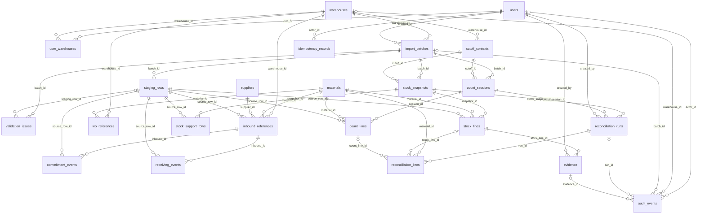

# Desain Database, ERD, IRD, dan Kamus Data

## Identitas dan kendali dokumen

| Atribut | Nilai |
| --- | --- |
| Document ID | DOC-07 |
| Nama proyek | SIRIS — Capstone Project Kelompok 42 |
| Mitra | Warehouse PT Harina Chemicals Industry |
| Versi | 0.2.0 |
| Status dokumen | PROPOSED — NEEDS REVIEW |
| Tanggal penyusunan | 2026-11-10 |
| Pemilik dokumen | Database Architect |
| Tujuan dokumen | Menyediakan rancangan penyimpanan dan integritas data untuk ditinjau. |
| Ruang lingkup | Website pendamping Erasoft; Supplier Inbound Reliability dan Inventory Accuracy & Reconciliation. |

Ketentuan pengguna diberi rujukan **SRC-01**. Desain baru berstatus **PROPOSED**, bukan BASELINE APPROVED. Belum ada aplikasi, hasil pengujian runtime, evaluasi stakeholder, atau persetujuan rilis yang dibuktikan dalam workspace ini. Semua contoh adalah **UJI**.

## Daftar isi

1. Identitas dan kendali dokumen
2. Referensi
3. Status rancangan dan model konseptual
4. ERD dan pemetaan relasional
5. Konvensi fisik dan asal data
6. Tabel `users`
7. Tabel `warehouses`
8. Tabel `user_warehouses`
9. Tabel `materials`
10. Tabel `suppliers`
11. Tabel `cutoff_contexts`
12. Tabel `import_batches`
13. Tabel `staging_rows`
14. Tabel `validation_issues`
15. Tabel `idempotency_records`
16. Tabel `inbound_references`
17. Tabel `commitment_events`
18. Tabel `receiving_events`
19. Tabel `wo_references`
20. Tabel `stock_snapshots`
21. Tabel `stock_lines`
22. Tabel `stock_support_rows`
23. Tabel `count_sessions`
24. Tabel `count_lines`
25. Tabel `reconciliation_runs`
26. Tabel `reconciliation_lines`
27. Tabel `evidence`
28. Tabel `audit_events`
29. Integritas lintas tabel dan batas transaksi
30. Indeks, migrasi, dan pemulihan
31. Integritas status hasil dan grain pasangan
32. Keputusan domain yang ditahan setelah SRC-09 tersedia
33. Dependencies
34. Open issues
35. Riwayat revisi

## Referensi

SRC-01: master prompt pengguna pada sesi penyusunan; SRC-02: `../AGENTS.md`. SRC-09: `../design.md` v1.0.0, kontrak desain untuk ditinjau yang tersedia pada pemeriksaan akhir; snapshot visual disertakan pada DOC-10. Register sumber lengkap, hierarki, dan sumber eksternal terdapat pada [DOC-00](00_MASTER_DOCUMENTATION_INDEX.md). Rujukan antardokumen: [DOC-00](00_MASTER_DOCUMENTATION_INDEX.md), [DOC-05](05_BUSINESS_RULES_RBAC.md), [DOC-06](06_SOFTWARE_ARCHITECTURE_DESIGN.md), [DOC-08](08_DATA_CONTRACT_IMPORT_SPECIFICATION.md), [DOC-09](09_API_SPECIFICATION.md), [DOC-15](15_REQUIREMENTS_TRACEABILITY.md), [DOC-17](17_DEPLOYMENT_OPERATIONAL_GUIDE.md).

## Status rancangan dan model konseptual

Seluruh model dalam dokumen ini **PROPOSED**. Entity, key bisnis, precision dan target evidence belum menjadi keputusan final. Konsep utama: pengguna memiliki izin gudang; batch memiliki baris staging dan laporan; domain menunjuk baris sumber; snapshot dan sesi hitung menunjuk cutoff; run rekonsiliasi menyimpan versi hasil; evidence mengikat target; audit menghubungkan proses. Model tidak menyediakan tabel PO baru, stock adjustment, ataupun akun Supplier.

## ERD dan pemetaan relasional

Diagram Mermaid berikut adalah spesifikasi diagram teks; rendering visual belum diverifikasi. Seluruh kardinalitas adalah rancangan, bukan kutipan diagram final.

IRD: setiap entitas berikut dipetakan menjadi satu tabel PostgreSQL dengan PK `id`. FK memakai `ON DELETE RESTRICT`; penghapusan histori tidak disediakan. Relasi users–warehouses diuraikan menjadi user_warehouses. Keterkaitan polimorfik result_id idempotency divalidasi service sesuai operation; bukan FK semu.
## Konvensi fisik dan asal data

Semua tipe, nullable, default dan key dinyatakan pada kamus di bawah. Tanda — pada default berarti aplikasi wajib mengirim nilai; UUID dibuat aplikasi dengan generator aman, library OPEN DECISION. `numeric(20,6)` adalah usulan; nilai yang melebihi presisi harus ditolak sebelum insert, bukan dibulatkan diam-diam. Tanggal memakai date untuk kebutuhan/janji dan timestamptz untuk event; zona asal wajib ditetapkan. Tidak ada konversi UOM otomatis. JSONB hanya untuk raw, normalized staging dan konteks fleksibel; field domain untuk perhitungan tetap bertipe.

## Tabel `users`

Identitas autentikasi internal; bukan fitur administrasi akun baru

| Kolom | Tipe PostgreSQL | Nullable | PK/FK | Default | Validation | Asal data |
| --- | --- | --- | --- | --- | --- | --- |
| id | uuid | Tidak | PK | UUID dari aplikasi | Unik | Sistem |
| subject | text | Tidak | — | — | Identitas provider unik | Autentikasi |
| role | text | Tidak | — | — | Purchasing/Warehouse/Production/Management | Provisioning terkendali |
| is_active | boolean | Tidak | — | true | Akun dinonaktifkan menolak sesi | Provisioning |

Unique: subject.

Check/integritas: Lihat validasi kolom.

Indeks rekomendasi: PK; indeks FK yang digunakan query.

## Tabel `warehouses`

Referensi scope gudang

| Kolom | Tipe PostgreSQL | Nullable | PK/FK | Default | Validation | Asal data |
| --- | --- | --- | --- | --- | --- | --- |
| id | uuid | Tidak | PK | UUID dari aplikasi | Unik | Sistem |
| code | text | Tidak | — | — | Kode tidak kosong | Referensi terverifikasi |
| name | text | Tidak | — | — | Nama tidak kosong | Referensi terverifikasi |

Unique: code.

Check/integritas: Lihat validasi kolom.

Indeks rekomendasi: PK; indeks FK yang digunakan query.

## Tabel `user_warehouses`

Izin gudang pengguna

| Kolom | Tipe PostgreSQL | Nullable | PK/FK | Default | Validation | Asal data |
| --- | --- | --- | --- | --- | --- | --- |
| id | uuid | Tidak | PK | UUID dari aplikasi | Unik | Sistem |
| user_id | uuid | Tidak | FK users.id | — | Pengguna ada | Provisioning |
| warehouse_id | uuid | Tidak | FK warehouses.id | — | Gudang ada | Provisioning |

Unique: user_id, warehouse_id.

Check/integritas: Lihat validasi kolom.

Indeks rekomendasi: PK; indeks FK yang digunakan query.

## Tabel `materials`

Referensi material terpisah menurut mode

| Kolom | Tipe PostgreSQL | Nullable | PK/FK | Default | Validation | Asal data |
| --- | --- | --- | --- | --- | --- | --- |
| id | uuid | Tidak | PK | UUID dari aplikasi | Unik | Sistem |
| code | text | Tidak | — | — | Kode tidak kosong | Sumber terverifikasi atau UJI |
| mode | text | Tidak | — | — | ACTUAL/UJI | Metadata |
| name | text | Tidak | — | — | Nama sumber | Referensi |

Unique: mode, code.

Check/integritas: Lihat validasi kolom.

Indeks rekomendasi: PK; indeks FK yang digunakan query.

## Tabel `suppliers`

Referensi supplier tanpa akun website

| Kolom | Tipe PostgreSQL | Nullable | PK/FK | Default | Validation | Asal data |
| --- | --- | --- | --- | --- | --- | --- |
| id | uuid | Tidak | PK | UUID dari aplikasi | Unik | Sistem |
| code | text | Tidak | — | — | Kode tidak kosong | Sumber terverifikasi atau UJI |
| mode | text | Tidak | — | — | ACTUAL/UJI | Metadata |
| name | text | Tidak | — | — | Nama sumber | Referensi |

Unique: mode, code.

Check/integritas: Lihat validasi kolom.

Indeks rekomendasi: PK; indeks FK yang digunakan query.

## Tabel `cutoff_contexts`

Konteks waktu pembandingan; bukan workflow verifikasi baru

| Kolom | Tipe PostgreSQL | Nullable | PK/FK | Default | Validation | Asal data |
| --- | --- | --- | --- | --- | --- | --- |
| id | uuid | Tidak | PK | UUID dari aplikasi | Unik | Sistem |
| warehouse_id | uuid | Tidak | FK warehouses.id | — | Gudang sah | Metadata sumber |
| mode | text | Tidak | — | — | ACTUAL/UJI | Metadata |
| cutoff_at | timestamptz | Tidak | — | — | Zona waktu asal wajib diketahui | Sumber |
| verification_status | text | Tidak | — | UNVERIFIED | VERIFIED/UNVERIFIED | Bukti eksternal |
| verification_reference | text | Ya | — | NULL | Wajib jika VERIFIED | Referensi bukti eksternal |

Unique: warehouse_id, mode, cutoff_at.

Check/integritas: VERIFIED mewajibkan verification_reference; kewenangan OD-08.

Indeks rekomendasi: PK; indeks FK yang digunakan query.

## Tabel `import_batches`

Siklus staging/preview/commit

| Kolom | Tipe PostgreSQL | Nullable | PK/FK | Default | Validation | Asal data |
| --- | --- | --- | --- | --- | --- | --- |
| id | uuid | Tidak | PK | UUID dari aplikasi | Unik | Sistem |
| kind | text | Tidak | — | — | EXPECTED/COMMITMENT/RECEIVING/STOCK/COUNT | Request |
| warehouse_id | uuid | Tidak | FK warehouses.id | — | Scope pengguna | Metadata |
| mode | text | Tidak | — | — | ACTUAL/UJI | Metadata |
| created_by | uuid | Tidak | FK users.id | — | Dari sesi | Sistem |
| state | text | Tidak | — | STAGED | State DOC-08 | Sistem |
| source_name | text | Tidak | — | — | Nama file disanitasi | Upload |
| source_hash | text | Tidak | — | — | SHA-256 seluruh paket | Sistem |
| raw_storage_key | text | Tidak | — | — | Privat; tidak ke DTO Management | Storage |
| metadata | jsonb | Tidak | — | — | Schema metadata DOC-08 | Request tervalidasi |
| normalized_hash | text | Ya | — | NULL | Fingerprint normalized | Validator |
| preview_fingerprint | text | Ya | — | NULL | Data+metadata+versi | Validator |
| validator_version | text | Ya | — | NULL | Versi aturan | Sistem |
| validated_at | timestamptz | Ya | — | NULL | Jam server | Validator |
| expires_at | timestamptz | Ya | — | NULL | validated_at + 30 menit | Validator |
| committed_at | timestamptz | Ya | — | NULL | Jam server saat commit | Sistem |
| created_at | timestamptz | Tidak | — | now() | Jam server | Sistem |

Unique: Tidak ada selain PK.

Check/integritas: Lihat validasi kolom.

Indeks rekomendasi: PK; indeks FK yang digunakan query.

## Tabel `staging_rows`

Raw dan normalized per baris sebelum commit

| Kolom | Tipe PostgreSQL | Nullable | PK/FK | Default | Validation | Asal data |
| --- | --- | --- | --- | --- | --- | --- |
| id | uuid | Tidak | PK | UUID dari aplikasi | Unik | Sistem |
| batch_id | uuid | Tidak | FK import_batches.id | — | Batch ada | Sistem |
| component | text | Tidak | — | — | Jenis/sheet sumber | Adaptor |
| row_number | integer | Tidak | — | — | >0 | Adaptor |
| raw | jsonb | Tidak | — | — | Payload sumber tanpa menghapus nilai asli | File |
| normalized | jsonb | Ya | — | NULL | Sesuai schema kind | Adaptor |

Unique: batch_id, component, row_number.

Check/integritas: Lihat validasi kolom.

Indeks rekomendasi: PK; indeks FK yang digunakan query.

## Tabel `validation_issues`

Laporan error/warning per batch/baris

| Kolom | Tipe PostgreSQL | Nullable | PK/FK | Default | Validation | Asal data |
| --- | --- | --- | --- | --- | --- | --- |
| id | uuid | Tidak | PK | UUID dari aplikasi | Unik | Sistem |
| batch_id | uuid | Tidak | FK import_batches.id | — | Batch ada | Validator |
| staging_row_id | uuid | Ya | FK staging_rows.id | NULL | Baris milik batch yang sama | Validator |
| severity | text | Tidak | — | — | ERROR/WARNING | Validator |
| code | text | Tidak | — | — | Katalog DOC-08 | Validator |
| field_name | text | Ya | — | NULL | Nama field jika relevan | Validator |
| message | text | Tidak | — | — | Pesan aman tanpa raw rahasia | Validator |

Unique: Tidak ada selain PK.

Check/integritas: Lihat validasi kolom.

Indeks rekomendasi: PK; indeks FK yang digunakan query.

## Tabel `idempotency_records`

Menahan duplikasi operasi konkuren

| Kolom | Tipe PostgreSQL | Nullable | PK/FK | Default | Validation | Asal data |
| --- | --- | --- | --- | --- | --- | --- |
| id | uuid | Tidak | PK | UUID dari aplikasi | Unik | Sistem |
| actor_id | uuid | Tidak | FK users.id | — | Dari sesi | Request |
| operation | text | Tidak | — | — | import.commit/reconciliation.create/evidence.create | Sistem |
| idempotency_key | text | Tidak | — | — | Tidak kosong | Client |
| request_hash | text | Tidak | — | — | Payload canonical + scope | Sistem |
| state | text | Tidak | — | — | IN_PROGRESS/SUCCEEDED | Sistem |
| result_id | uuid | Ya | — | NULL | Referensi bertipe mengikuti operation; diverifikasi service | Sistem |
| response_safe | jsonb | Ya | — | NULL | Tanpa raw key/secret | Sistem |

Unique: actor_id, operation, idempotency_key.

Check/integritas: Lihat validasi kolom.

Indeks rekomendasi: PK; indeks FK yang digunakan query.

## Tabel `inbound_references`

Referensi kebutuhan inbound immutable

| Kolom | Tipe PostgreSQL | Nullable | PK/FK | Default | Validation | Asal data |
| --- | --- | --- | --- | --- | --- | --- |
| id | uuid | Tidak | PK | UUID dari aplikasi | Unik | Sistem |
| warehouse_id | uuid | Tidak | FK warehouses.id | — | Sesuai batch | EXPECTED |
| mode | text | Tidak | — | — | ACTUAL/UJI | Metadata |
| source_ref | text | Tidak | — | — | Identitas line sumber | EXPECTED |
| material_id | uuid | Tidak | FK materials.id | — | Mode sama | EXPECTED |
| supplier_id | uuid | Tidak | FK suppliers.id | — | Mode sama | EXPECTED |
| uom | text | Tidak | — | — | Unit sumber terpetakan | EXPECTED |
| requested_date | date | Tidak | — | — | Tanggal kebutuhan tidak berubah oleh janji | EXPECTED |
| expected_quantity | numeric(20,6) | Tidak | — | — | >=0; presisi usulan | EXPECTED |
| source_row_id | uuid | Tidak | FK staging_rows.id | — | Baris COMMITTED; mode/gudang batch sesuai | Lineage |

Unique: warehouse_id, mode, source_ref.

Check/integritas: Lihat validasi kolom.

Indeks rekomendasi: PK; indeks FK yang digunakan query.

## Tabel `commitment_events`

Histori INITIAL dan CHANGE

| Kolom | Tipe PostgreSQL | Nullable | PK/FK | Default | Validation | Asal data |
| --- | --- | --- | --- | --- | --- | --- |
| id | uuid | Tidak | PK | UUID dari aplikasi | Unik | Sistem |
| inbound_id | uuid | Tidak | FK inbound_references.id | — | Scope dan mode sama | COMMITMENT |
| event_ref | text | Tidak | — | — | Kunci event sumber | COMMITMENT |
| event_type | text | Tidak | — | — | INITIAL/CHANGE | COMMITMENT |
| promised_date | date | Tidak | — | — | Tanggal valid | COMMITMENT |
| event_at | timestamptz | Tidak | — | — | Urutan sumber eksplisit | COMMITMENT |
| source_row_id | uuid | Tidak | FK staging_rows.id | — | Baris COMMITTED; mode/gudang batch sesuai | Lineage |

Unique: inbound_id, event_ref; indeks unik parsial inbound_id WHERE event_type=INITIAL.

Check/integritas: CHANGE membutuhkan INITIAL; urutan dan konflik event diverifikasi service.

Indeks rekomendasi: PK; indeks FK yang digunakan query.

## Tabel `receiving_events`

Penerimaan parsial/final append-only

| Kolom | Tipe PostgreSQL | Nullable | PK/FK | Default | Validation | Asal data |
| --- | --- | --- | --- | --- | --- | --- |
| id | uuid | Tidak | PK | UUID dari aplikasi | Unik | Sistem |
| inbound_id | uuid | Tidak | FK inbound_references.id | — | Scope dan mode sama | RECEIVING |
| event_ref | text | Tidak | — | — | Kunci event sumber | RECEIVING |
| received_quantity | numeric(20,6) | Tidak | — | — | >=0; koreksi negatif belum disepakati | RECEIVING |
| received_at | timestamptz | Tidak | — | — | Waktu sumber | RECEIVING |
| is_closing | boolean | Tidak | — | — | Marker sumber wajib | RECEIVING |
| closing_reference | text | Ya | — | NULL | Wajib bila is_closing=true | RECEIVING |
| source_row_id | uuid | Tidak | FK staging_rows.id | — | Baris COMMITTED; mode/gudang batch sesuai | Lineage |

Unique: inbound_id, event_ref; indeks unik parsial inbound_id WHERE is_closing=true.

Check/integritas: Penutup harus sah menurut OD-06; service menolak event baru setelah penutup sampai aturan koreksi diputuskan.

Indeks rekomendasi: PK; indeks FK yang digunakan query.

## Tabel `wo_references`

Referensi WO read-only; mekanisme sumber belum tersedia

| Kolom | Tipe PostgreSQL | Nullable | PK/FK | Default | Validation | Asal data |
| --- | --- | --- | --- | --- | --- | --- |
| id | uuid | Tidak | PK | UUID dari aplikasi | Unik | Sistem |
| warehouse_id | uuid | Tidak | FK warehouses.id | — | Scope sah | Sumber WO |
| mode | text | Tidak | — | — | ACTUAL/UJI | Metadata |
| source_ref | text | Tidak | — | — | Referensi eksternal | Sumber WO |
| material_id | uuid | Tidak | FK materials.id | — | Mode sama | Sumber WO |
| uom | text | Tidak | — | — | Unit sumber | Sumber WO |
| required_quantity | numeric(20,6) | Tidak | — | — | >=0; bukan hasil BOM | Sumber WO |
| source_metadata | jsonb | Tidak | — | — | Asal, hash dan waktu; OD-05 | Sumber WO |

Unique: warehouse_id, mode, source_ref, material_id.

Check/integritas: Tidak membuat jenis impor keenam atau endpoint tulis WO.

Indeks rekomendasi: PK; indeks FK yang digunakan query.

## Tabel `stock_snapshots`

Header snapshot saldo

| Kolom | Tipe PostgreSQL | Nullable | PK/FK | Default | Validation | Asal data |
| --- | --- | --- | --- | --- | --- | --- |
| id | uuid | Tidak | PK | UUID dari aplikasi | Unik | Sistem |
| batch_id | uuid | Tidak | FK import_batches.id | — | kind STOCK dan COMMITTED | Impor |
| cutoff_id | uuid | Tidak | FK cutoff_contexts.id | — | Scope/mode sama dengan batch | Metadata |

Unique: batch_id.

Check/integritas: Lihat validasi kolom.

Indeks rekomendasi: PK; indeks FK yang digunakan query.

## Tabel `stock_lines`

Saldo per material/UOM dari QTY AKHIR

| Kolom | Tipe PostgreSQL | Nullable | PK/FK | Default | Validation | Asal data |
| --- | --- | --- | --- | --- | --- | --- |
| id | uuid | Tidak | PK | UUID dari aplikasi | Unik | Sistem |
| snapshot_id | uuid | Tidak | FK stock_snapshots.id | — | Snapshot ada | Sistem |
| material_id | uuid | Tidak | FK materials.id | — | Mode sama | STOCK |
| uom | text | Tidak | — | — | Unit canonical sumber | STOCK |
| system_quantity | numeric(20,6) | Tidak | — | — | QTY AKHIR; kebijakan nilai negatif OD-05 | STOCK |
| source_row_id | uuid | Tidak | FK staging_rows.id | — | Baris COMMITTED; mode/gudang batch sesuai | Lineage |

Unique: snapshot_id, material_id, uom.

Check/integritas: Lihat validasi kolom.

Indeks rekomendasi: PK; indeks FK yang digunakan query.

## Tabel `stock_support_rows`

Dukungan STOCK opsional tanpa menghitung ulang saldo

| Kolom | Tipe PostgreSQL | Nullable | PK/FK | Default | Validation | Asal data |
| --- | --- | --- | --- | --- | --- | --- |
| id | uuid | Tidak | PK | UUID dari aplikasi | Unik | Sistem |
| snapshot_id | uuid | Tidak | FK stock_snapshots.id | — | Snapshot ada | Sistem |
| component | text | Tidak | — | — | Jenis komponen dari kontrak disetujui | Paket STOCK |
| payload | jsonb | Tidak | — | — | Schema komponen OD-05; tidak dijumlahkan | Paket STOCK |
| source_row_id | uuid | Tidak | FK staging_rows.id | — | Baris COMMITTED; mode/gudang batch sesuai | Lineage |

Unique: Tidak ada selain PK.

Check/integritas: Lihat validasi kolom.

Indeks rekomendasi: PK; indeks FK yang digunakan query.

## Tabel `count_sessions`

Header hitung fisik

| Kolom | Tipe PostgreSQL | Nullable | PK/FK | Default | Validation | Asal data |
| --- | --- | --- | --- | --- | --- | --- |
| id | uuid | Tidak | PK | UUID dari aplikasi | Unik | Sistem |
| batch_id | uuid | Tidak | FK import_batches.id | — | kind COUNT dan COMMITTED | Impor |
| cutoff_id | uuid | Tidak | FK cutoff_contexts.id | — | Scope/mode sama dengan batch | Metadata |

Unique: batch_id.

Check/integritas: Lihat validasi kolom.

Indeks rekomendasi: PK; indeks FK yang digunakan query.

## Tabel `count_lines`

Hasil hitung dengan null berbeda dari nol

| Kolom | Tipe PostgreSQL | Nullable | PK/FK | Default | Validation | Asal data |
| --- | --- | --- | --- | --- | --- | --- |
| id | uuid | Tidak | PK | UUID dari aplikasi | Unik | Sistem |
| session_id | uuid | Tidak | FK count_sessions.id | — | Sesi ada | Sistem |
| material_id | uuid | Tidak | FK materials.id | — | Mode sama | COUNT |
| uom | text | Tidak | — | — | Unit sumber | COUNT |
| is_counted | boolean | Tidak | — | — | Eksplisit, tidak memakai default false | COUNT |
| physical_quantity | numeric(20,6) | Ya | — | NULL | Jika true wajib >=0; jika false wajib null | COUNT |
| source_row_id | uuid | Tidak | FK staging_rows.id | — | Baris COMMITTED; mode/gudang batch sesuai | Lineage |

Unique: session_id, material_id, uom.

Check/integritas: CHECK ((is_counted AND physical_quantity IS NOT NULL AND physical_quantity>=0) OR (NOT is_counted AND physical_quantity IS NULL)).

Indeks rekomendasi: PK; indeks FK yang digunakan query.

## Tabel `reconciliation_runs`

Versi hasil yang tidak menimpa histori

| Kolom | Tipe PostgreSQL | Nullable | PK/FK | Default | Validation | Asal data |
| --- | --- | --- | --- | --- | --- | --- |
| id | uuid | Tidak | PK | UUID dari aplikasi | Unik | Sistem |
| stock_snapshot_id | uuid | Tidak | FK stock_snapshots.id | — | Konteks cocok COUNT | Request |
| count_session_id | uuid | Tidak | FK count_sessions.id | — | Konteks cocok STOCK | Request |
| created_by | uuid | Tidak | FK users.id | — | Dari sesi | Request |
| rule_version | text | Tidak | — | — | Versi algoritme | Sistem |
| created_at | timestamptz | Tidak | — | now() | Jam server | Sistem |

Unique: Tidak ada selain PK.

Check/integritas: Lihat validasi kolom.

Indeks rekomendasi: PK; indeks FK yang digunakan query.

## Tabel `reconciliation_lines`

Hasil pasangan valid/nonvalid

| Kolom | Tipe PostgreSQL | Nullable | PK/FK | Default | Validation | Asal data |
| --- | --- | --- | --- | --- | --- | --- |
| id | uuid | Tidak | PK | UUID dari aplikasi | Unik | Sistem |
| run_id | uuid | Tidak | FK reconciliation_runs.id | — | Run ada | Sistem |
| material_id | uuid | Tidak | FK materials.id | — | Mode sama | Pairing |
| stock_line_id | uuid | Ya | FK stock_lines.id | NULL | Snapshot sama dengan run | Pairing |
| count_line_id | uuid | Ya | FK count_lines.id | NULL | Sesi sama dengan run | Pairing |
| status | text | Tidak | — | — | MATCHED/DISCREPANCY/COUNT_MISSING/NOT_COUNTED/STOCK_MISSING/UOM_MISMATCH | Engine |
| variance | numeric(20,6) | Ya | — | NULL | Null hanya nonvalid; rumus untuk pasangan valid | Engine |

Unique: run_id, material_id.

Check/integritas: Minimal satu sisi tersedia; status valid mewajibkan dua FK dan variance nonnull; nonvalid mewajibkan variance null.

Indeks rekomendasi: PK; indeks FK yang digunakan query.

## Tabel `evidence`

Bukti kartu stok privat; target PROPOSED stock_lines

| Kolom | Tipe PostgreSQL | Nullable | PK/FK | Default | Validation | Asal data |
| --- | --- | --- | --- | --- | --- | --- |
| id | uuid | Tidak | PK | UUID dari aplikasi | Unik | Sistem |
| stock_line_id | uuid | Tidak | FK stock_lines.id | — | Tepat satu target; OD-08 | Request |
| file_name | text | Tidak | — | — | Nama aman | Upload |
| media_type | text | Tidak | — | — | application/pdf,image/jpeg,image/png | Deteksi signature |
| size_bytes | bigint | Tidak | — | — | 1..5242880 | Server |
| file_hash | text | Tidak | — | — | SHA-256 | Server |
| private_storage_key | text | Tidak | — | — | Tidak diekspos response | Storage |
| created_by | uuid | Tidak | FK users.id | — | Dari sesi | Sistem |
| created_at | timestamptz | Tidak | — | now() | Jam server | Sistem |

Unique: Tidak ada selain PK.

Check/integritas: Lihat validasi kolom.

Indeks rekomendasi: PK; indeks FK yang digunakan query.

## Tabel `audit_events`

Audit append-only; target domain opsional melalui context aman

| Kolom | Tipe PostgreSQL | Nullable | PK/FK | Default | Validation | Asal data |
| --- | --- | --- | --- | --- | --- | --- |
| id | uuid | Tidak | PK | UUID dari aplikasi | Unik | Sistem |
| actor_id | uuid | Ya | FK users.id | NULL | Null untuk autentikasi gagal; jangan simpan credential | Sesi |
| warehouse_id | uuid | Ya | FK warehouses.id | NULL | Null hanya sebelum scope teridentifikasi | Sesi/request |
| mode | text | Ya | — | NULL | ACTUAL/UJI; null sebelum konteks diketahui | Request |
| batch_id | uuid | Ya | FK import_batches.id | NULL | Jika operasi impor | Sistem |
| run_id | uuid | Ya | FK reconciliation_runs.id | NULL | Jika rekonsiliasi | Sistem |
| evidence_id | uuid | Ya | FK evidence.id | NULL | Jika operasi evidence berhasil | Sistem |
| action | text | Tidak | — | — | Kode operasi | Sistem |
| outcome | text | Tidak | — | — | SUCCESS/FAILURE/CANCELLED/DENIED | Sistem |
| correlation_id | uuid | Tidak | — | — | Identitas permintaan | Sistem |
| context_safe | jsonb | Tidak | — | jsonb object kosong | Tanpa secret, raw, storage key | Sistem |
| created_at | timestamptz | Tidak | — | now() | Jam server | Sistem |

Unique: Tidak ada selain PK.

Check/integritas: Lihat validasi kolom.

Indeks rekomendasi: PK; indeks FK yang digunakan query.

## Integritas lintas tabel dan batas transaksi

CHECK lokal tidak memeriksa baris tabel lain. Repository/service dalam transaksi memeriksa batch kind/state, mode, gudang, versi referensi, kepemilikan stock/count line dan cutoff. Gunakan FK komposit atau trigger teruji jika aturan tersebut perlu ditegakkan terhadap akses langsung database. Runtime DB hanya boleh menulis melalui aplikasi. Lock referensi yang terkait saat commit; staging immutable setelah preview. Struktur constraint mengikuti kemampuan [PostgreSQL constraints](https://www.postgresql.org/docs/current/ddl-constraints.html).

Commit mengunci batch dan idempotency key; mengulangi validasi kontekstual; memasukkan seluruh domain, lineage, audit SUCCESS, dan response idempotency dalam satu transaksi. Jika gagal, rollback; audit FAILURE ditulis pada transaksi terpisah setelah rollback. Kegagalan database total tidak boleh dinyatakan telah ter-audit: tulis log operasional aman dan proses pemulihan. Evidence file tidak ikut transaksi PostgreSQL; simpan objek privat sementara, verifikasi hash, lalu kaitkan DB; objek yatim dibersihkan melalui prosedur operasional.

## Indeks, migrasi, dan pemulihan

Usulan indeks tambahan: inbound_references(warehouse_id,mode,requested_date); commitment_events(inbound_id,event_at); receiving_events(inbound_id,received_at); import_batches(warehouse_id,mode,created_at); audit_events(warehouse_id,mode,created_at,id); reconciliation_runs(created_at,id). Evaluasi dengan query plan pada data UJI representatif sebelum menetapkan indeks lain.

Migrasi dijalankan berurutan: referensi/identitas → staging/audit → inbound → inventory → hasil/evidence. Seed ACTUAL hanya memakai referensi terverifikasi; fixture UJI memakai namespace terpisah. Sebelum perubahan destruktif, lakukan backup dan latihan restore, analisis kompatibilitas API, serta rekonsiliasi jumlah record. Tool migrasi dan perintah executable belum tersedia. Histori run/event tidak boleh dihapus untuk menyederhanakan migrasi.

## Integritas status hasil dan grain pasangan

PROPOSED: satu run memuat paling banyak satu hasil per material. Jika input memiliki lebih dari satu UOM/baris untuk material yang sama, engine menolak run sebagai AMBIGUOUS_PAIR sampai grain final disepakati (OD-05); tidak memilih pasangan secara acak. Unique stock_lines(snapshot_id,material_id,uom) dan count_lines(session_id,material_id,uom) tetap menjaga sumber tanpa menggabungkannya.

Constraint hasil yang harus diwujudkan: MATCHED mewajibkan variance=0; DISCREPANCY mewajibkan variance IS NOT NULL dan variance<>0; keempat status nonvalid mewajibkan variance IS NULL. CHECK harus eksplisit terhadap NULL agar three-valued logic SQL tidak meloloskan nilai yang tidak diketahui. Kesesuaian rumus dan source FK terhadap run diuji dalam transaksi serta dapat diperkuat trigger. Inbound requested_date bersifat immutable setelah commit; tidak ada endpoint update referensi pada rancangan ini.

## Keputusan domain yang ditahan setelah SRC-09 tersedia

**CF-03–CF-06 dan CF-08 — OPEN DECISION.** Schema, payload dan test yang terdampak berikut masih PROPOSED dan tidak boleh diimplementasikan sebagai kontrak final sebelum sumber dianalisis.

| Area | Usulan dalam paket | SRC-09 | Tindakan sebelum implementasi |
| --- | --- | --- | --- |
| Evidence target | stock_line_id | snapshot ATAU count | Pilih scope final; bila source disahkan, ganti dengan stock_snapshot_id/count_session_id nullable dan XOR tepat satu, FK/scope wajib; perbarui API dan fixture |
| Cutoff | cutoff_at timestamptz; VERIFIED/UNVERIFIED | effective date/time, basis, precision; UJI SIMULATED | Sediakan date-only tanpa memalsukan waktu, basis reference dan status simulasi; perubahan schema/API melalui review |
| Rekonsiliasi identik | Idempotency-Key sama mengembalikan run sama; key baru dapat run baru | Fingerprint hasil identik dibaca ulang | Tentukan fingerprint snapshot/count/rule version dan kebijakan reuse lintas key; jangan duplikasi sebelum keputusan |
| EXPECTED quantity | >=0 | >0 | Konfirmasi apakah nol valid; perbarui validator dan boundary test |
| COMMITMENT | INITIAL/CHANGE + event_at | Sequence, previous date, committed date, recorded_at | Tambahkan pemetaan sumber jika disahkan; jangan sintesis event lama dari informasi yang hilang |
| WO di STOCK | stock_support_rows menyimpan payload; sumber wo_references belum ditetapkan | STOCK mendukung komponen WO opsional | Usulan pemetaan WO support ke wo_references dengan source_row lineage; bukan impor keenam |

## Dependencies

| Dependensi | Kegunaan |
| --- | --- |
| [DOC-00](00_MASTER_DOCUMENTATION_INDEX.md) | Indeks Induk Dokumentasi Pengembangan |
| [DOC-05](05_BUSINESS_RULES_RBAC.md) | Spesifikasi Aturan Bisnis dan RBAC |
| [DOC-06](06_SOFTWARE_ARCHITECTURE_DESIGN.md) | Arsitektur Perangkat Lunak dan Desain Terperinci |
| [DOC-08](08_DATA_CONTRACT_IMPORT_SPECIFICATION.md) | Kontrak Data, Pemetaan Impor, dan Validasi |
| [DOC-09](09_API_SPECIFICATION.md) | Spesifikasi REST API |
| [DOC-15](15_REQUIREMENTS_TRACEABILITY.md) | Ketertelusuran Kebutuhan dan Pengendalian Perubahan |
| [DOC-17](17_DEPLOYMENT_OPERATIONAL_GUIDE.md) | Panduan Deployment dan Operasional |

## Open issues

OD-03, OD-05, OD-08: schema final, key sumber, precision, multi-UOM per material, lineage WO dan target evidence perlu dikonfirmasi.

## Riwayat revisi

| Versi | Tanggal | Perubahan | Persetujuan |
| --- | --- | --- | --- |
| 0.1.0 | 2026-11-10 | Penyusunan berdasarkan SRC-01; celah sumber dicatat dan desain ditandai PROPOSED. | Belum ada bukti persetujuan |
| 0.2.0 | 2026-11-10 | Integrasi SRC-09 design.md: route, role, token, layar pendukung, metrik dan konflik desain; tetap NEEDS REVIEW. | Belum ada bukti persetujuan |
