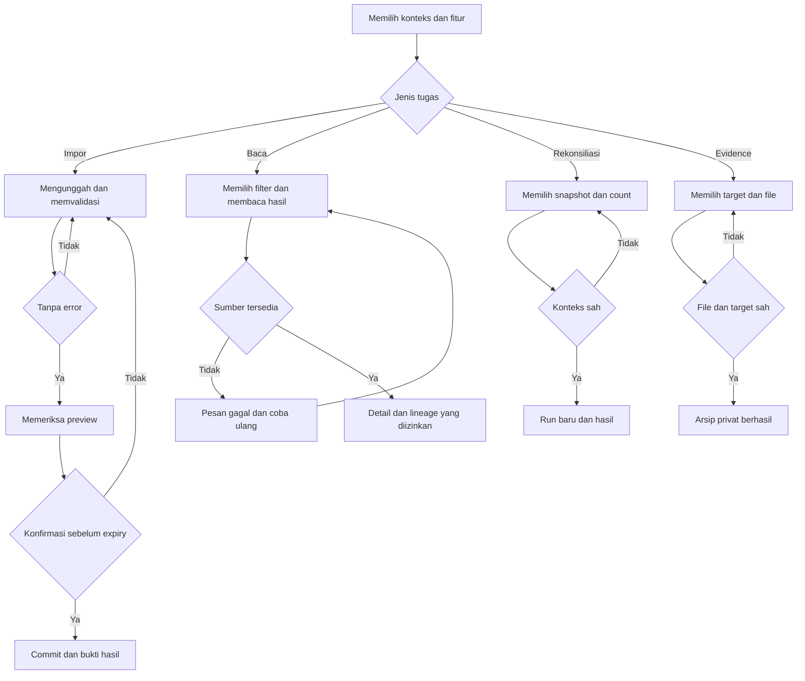
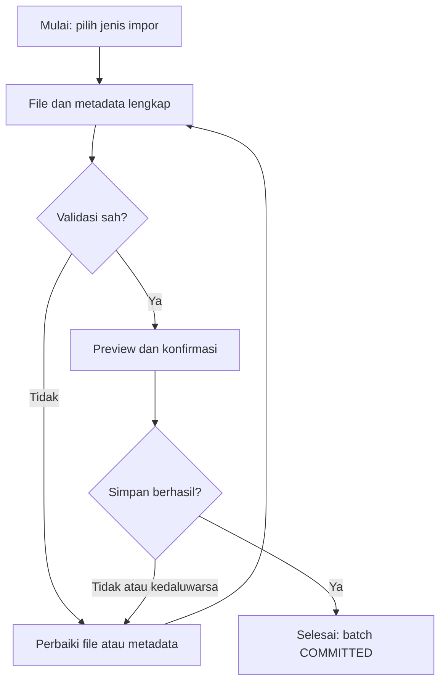
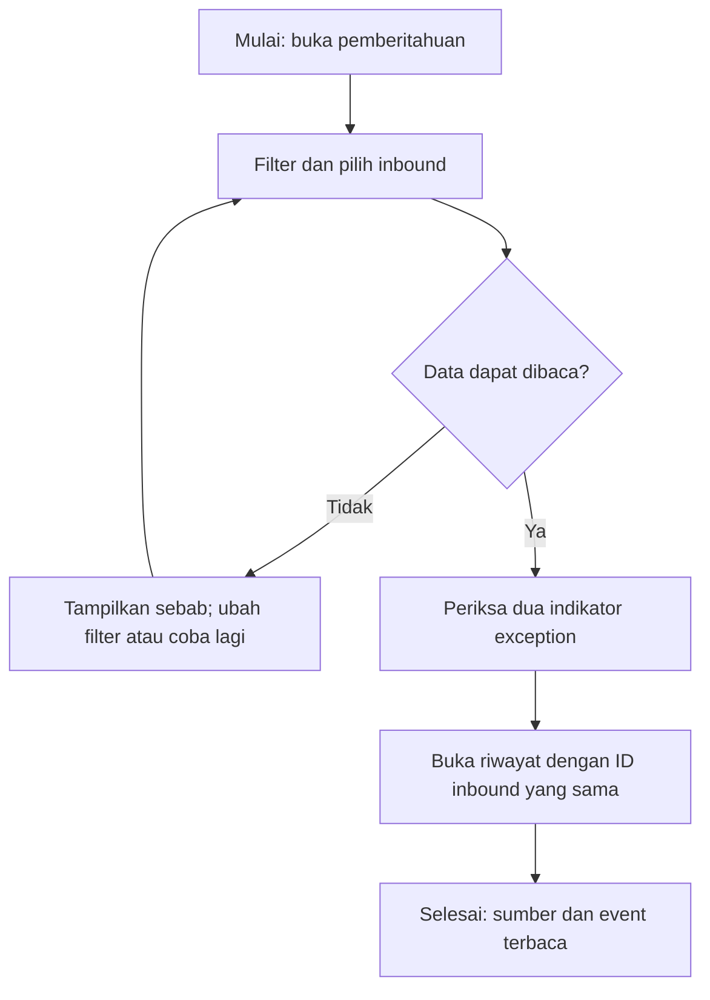
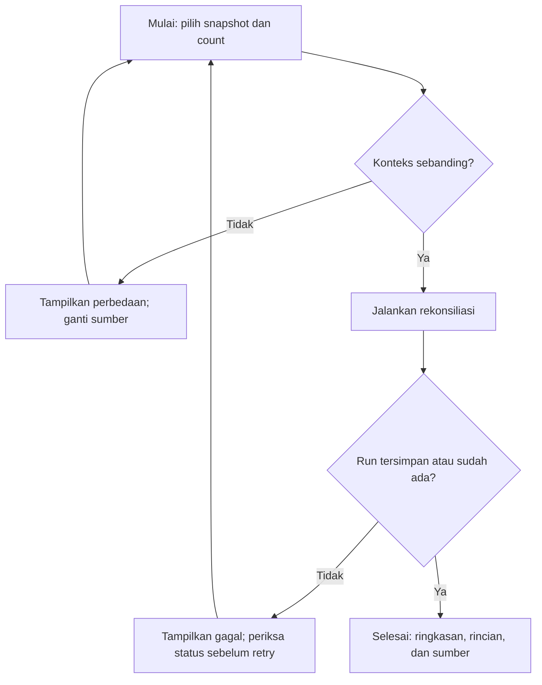
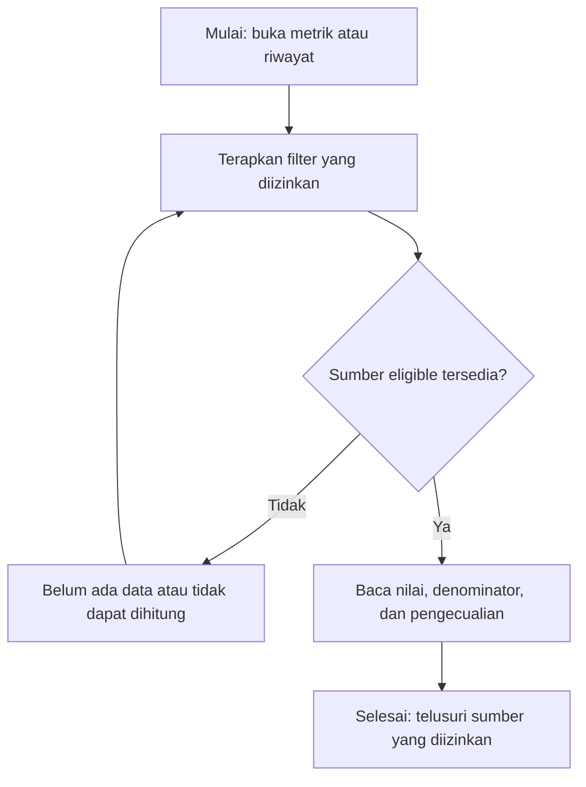
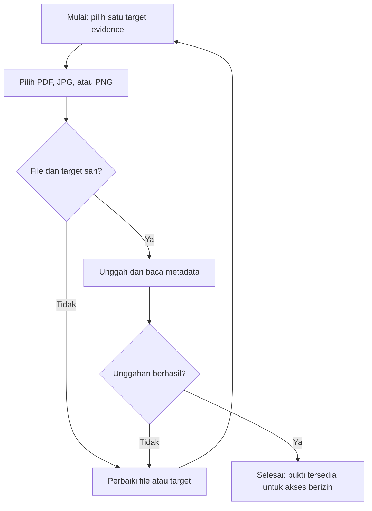

# Spesifikasi Prototipe UI/UX

## Identitas dan kendali dokumen

| Atribut | Nilai |
| --- | --- |
| Document ID | DOC-10 |
| Nama proyek | SIRIS — Capstone Project Kelompok 42 |
| Mitra | Warehouse PT Harina Chemicals Industry |
| Versi | 0.2.0 |
| Status dokumen | PROPOSED — NEEDS REVIEW |
| Tanggal penyusunan | 2026-11-10 |
| Pemilik dokumen | UI/UX Designer |
| Tujuan dokumen | Menyediakan rancangan layar dan perilaku interaksi yang konsisten. |
| Ruang lingkup | Website pendamping Erasoft; Supplier Inbound Reliability dan Inventory Accuracy & Reconciliation. |

Ketentuan pengguna diberi rujukan **SRC-01**. Desain baru berstatus **PROPOSED**, bukan BASELINE APPROVED. Belum ada aplikasi, hasil pengujian runtime, evaluasi stakeholder, atau persetujuan rilis yang dibuktikan dalam workspace ini. Semua contoh adalah **UJI**.

## Daftar isi

1. Identitas dan kendali dokumen
2. Referensi
3. Arah desain dan batas pekerjaan
4. Intake, asumsi, dan keputusan
5. Prinsip visual dan isi
6. Information architecture dan sitemap
7. Token desain bersumber SRC-09
8. Spesifikasi komponen
9. SCR-01 — Mengimpor Referensi Inbound
10. SCR-02 — Mengimpor Janji Supplier
11. SCR-03 — Mengimpor Data Penerimaan
12. SCR-04 — Memeriksa Exception Inbound
13. SCR-05 — Melihat Pemberitahuan Inbound
14. SCR-06 — Membaca Referensi Material WO
15. SCR-07 — Menelusuri Riwayat Inbound
16. SCR-08 — Melihat Metrik Supplier
17. SCR-09 — Mengimpor Data Stok
18. SCR-10 — Mengimpor Hasil Hitung Fisik
19. SCR-11 — Mengarsipkan Bukti Kartu Stok
20. SCR-12 — Menjalankan Rekonsiliasi Stok
21. SCR-13 — Menelusuri Riwayat Selisih Stok
22. SCR-14 — Melihat Metrik Persediaan
23. SCR-15 — Menelusuri Audit Proses
24. State matrix seluruh layar
25. Form, tabel, dan acceptance aksesibilitas
26. Kontrak implementasi dan gate desain
27. Spesifikasi kolom dan sumber data per layar
28. Lampiran kontrak visual SRC-09 (snapshot untuk keterlacakan)
29. Layar pendukung AUTH
30. Layar pendukung HOME
31. Status integrasi layar terhadap kontrak API
32. Dependencies
33. Open issues
34. Riwayat revisi

## Referensi

SRC-01: master prompt pengguna pada sesi penyusunan; SRC-02: `../AGENTS.md`. SRC-09: `../design.md` v1.0.0, kontrak desain untuk ditinjau yang tersedia pada pemeriksaan akhir; snapshot visual disertakan pada DOC-10. Register sumber lengkap, hierarki, dan sumber eksternal terdapat pada [DOC-00](00_MASTER_DOCUMENTATION_INDEX.md). Rujukan antardokumen: [DOC-00](00_MASTER_DOCUMENTATION_INDEX.md), [DOC-03](03_PRODUCT_REQUIREMENTS_DOCUMENT.md), [DOC-05](05_BUSINESS_RULES_RBAC.md), [DOC-07](07_DATABASE_DESIGN.md), [DOC-09](09_API_SPECIFICATION.md), [DOC-11](11_DEVELOPMENT_BACKLOG_WBS.md), [DOC-13](13_SOFTWARE_TEST_PLAN_TEST_CASES.md).

## Arah desain dan batas pekerjaan

Arah dari pengguna: **Enterprise Horizon Light**, referensi enterprise SAP HANA / SAP Fiori; clean, clear, professional; light theme; tabel enterprise; tanpa logo SIRIS. Referensi tersebut menjadi arah visual, bukan klaim penggunaan komponen SAP atau penyalinan aset. **PROPOSED:** kepadatan comfortable, bahasa UI Indonesia, desktop-first dengan reflow mobile. Elemen pembeda adalah bilah konteks gudang–mode–cutoff tepat di atas area data agar pengguna selalu melihat konteks perbandingan. Tidak ada dark-mode switch, logo baru, atau halaman analitik tambahan.

Pekerjaan ini dokumentasi saja, bukan pembangunan frontend. Untuk mempertahankan 19 dokumen yang diminta, keputusan desain dan token ditempatkan di DOC-10 ini, bukan menambah DESIGN.md dan implementasi adapter. Gate implementasi belum dilewati; persetujuan visual dan verifikasi runtime masih PENDING.

## Intake, asumsi, dan keputusan

| ID | Keputusan / asumsi | Sumber | Alasan / dampak | Status |
| --- | --- | --- | --- | --- |
| UI-A01 | Vue 3; web responsif; Bahasa Indonesia | SRC-01 | Selaras stack dan pengguna | Ketentuan pengguna |
| UI-A02 | Light theme, tanpa logo | SRC-01 | Hierarki informasi dan scope visual | Ketentuan pengguna |
| UI-A03 | Desktop-first dan comfortable density | ASSUMPTION | Tabel operasional; validasi perangkat mitra diperlukan | PROPOSED |
| UI-A04 | Lucide sebagai satu icon library | ASSUMPTION | Ikon sederhana; izin ISC tersedia | PROPOSED; versi paket belum dipilih |
| UI-A05 | Inter dengan fallback Arial, sans-serif | ASSUMPTION | Mengikuti SRC-09; self-host bila aset/font berlisensi tersedia | PROPOSED |
| UI-A06 | Target desain WCAG 2.2 AA | ASSUMPTION | Mendukung akses keyboard dan keterbacaan | PROPOSED; tidak menambah NFR baseline |
| UI-A07 | Route SCR-01–SCR-15 | ASSUMPTION | Route SRC-09 tersedia, persetujuan final belum tersedia; pemetaan satu tujuan per layar | PROPOSED; OD-03 |
| UI-A08 | Threshold performance | SRC-01 | Tidak mengarang target numerik | NEEDS BASELINE |

## Prinsip visual dan isi

Nada: bersih agar tabel mudah dipindai; jelas agar status tidak disalahartikan; profesional agar sesuai konteks gudang. Gunakan label permanen, posisi aksi konsisten, angka rata kanan, unit terpisah, dan alasan status nonvalid yang terlihat. Jangan memakai gradien dekoratif, hero pemasaran, kartu berlebihan, status berbasis warna saja, atau angka nol untuk data kosong. Motion hanya untuk feedback singkat; reduced-motion menghilangkan animasi nonesensial. Anti-reference: dashboard promosi penuh ilustrasi yang mengurangi ruang tabel.

## Information architecture dan sitemap

Navigasi mengikuti SRC-09: Utama (HOME), Supplier Inbound, Persediaan, Referensi (WO), Pengawasan (Audit). SCR-01–SCR-15 adalah alias dokumentasi untuk UI-01–UI-15 SRC-09. AUTH dan HOME adalah layar teknis/navigasi, bukan use case baru. Menu difilter matriks DOC-05. Bilah konteks tetap menampilkan mode dengan label teks ACTUAL/UJI; pergantian konteks mengosongkan selection dan membatalkan preview yang tidak sesuai. UC-16 tidak memiliki halaman, route, atau menu. Dukungan sesi mengikuti OD-07; tidak menambah UC autentikasi.



## Token desain bersumber SRC-09

Gunakan registry SRC-09 §4.9 yang disertakan utuh pada lampiran dokumen ini. Palette usulan awal DOC-10 dibatalkan agar tidak ada dua sumber token. Arah aktif tetap light; dark hanya cadangan registry dan tidak menambah switch. Ringkasan: action blue #0A6ED1, text #1D2D44, canvas #F7F9FC, Inter body 16px dan label/tabel minimum 14px, control desktop 40px/mobile 44px, focus 3px dengan gap 2px; breakpoint 768/1024/1440. Nilai lengkap dan alias mengikuti registry, bukan ringkasan ini.

Klaim 424 token/162 pasangan kontras dalam SRC-09 merupakan laporan sumber. Paket ini memeriksa ulang JSON dan graph alias; audit konsumsi UI, kontras semua rendered state dan runtime belum dilakukan. Tidak mengubah status gate sumber menjadi APPROVED.

## Spesifikasi komponen

Katalog, anatomy, variants, sizes, seluruh state, token, content rules, keyboard/ARIA, responsive, edge cases dan Do/Don't menggunakan SRC-09 §5 pada lampiran. Tabel berikut hanya alias dari ringkasan halaman DOC-10 ke komponen sumber, bukan sistem komponen kedua.

| Alias halaman | Komponen sumber SRC-09 | Kontrak yang diwarisi |
| --- | --- | --- |
| C-01 | Button, IconButton, Link | §5.1 C0, §5.2 profil aksi/navigasi, §5.3 delta |
| C-02 | FormField, Input, Select/Combobox, DatePicker | §5.1 C0, §5.2 form, §5.3–§5.4 delta |
| C-03 | FileUpload | §5.5 pattern, validasi tipe/ukuran di backend |
| C-04 | Table/DataGrid, Pagination | §5.4 tabel dan pagination; urutan sumber tetap terlacak |
| C-05 | Badge/Tag, Alert/Banner, Toast | §5.2 status, §5.3–§5.4 feedback |
| C-06 | Modal/Dialog | §5.4 fokus, Escape, konfirmasi dan pemulihan |
| C-07 | Navbar/Sidebar, Breadcrumb | §5.4–§5.5 navigasi berbasis role |
| C-08 | Skeleton, Spinner/Progress, EmptyState, ErrorPage | §5.2 presentation dan §6 state per layar |

Komponen tambahan yang sudah memiliki dasar pada SRC-09: Tabs, Drawer, Timeline, ContextStrip, ImportWizard, SourceSummary, MetricCard dan RunSummary. Gunakan nama dan alias token sumber; jangan memakai nama token usulan awal sebagai literal baru. Komponen di luar katalog IN sumber memerlukan alasan dan review sebelum ditambahkan.

## SCR-01 — Mengimpor Referensi Inbound

| Elemen | Spesifikasi |
| --- | --- |
| Screen ID | SCR-01 |
| Route | /inbound/import-reference — SRC-09 §3.3; status final NEEDS REVIEW |
| Page name | Mengimpor Referensi Inbound |
| Related UC | UC-01 + UC-16 internal |
| Allowed roles | Purchasing — PROPOSED DOC-05 |
| Purpose | Menetapkan referensi kebutuhan inbound yang dapat ditelusuri. |
| Layout | Bilah konteks → metadata/file → laporan validasi → preview → konfirmasi → hasil. |
| Components | C-01, C-02, C-04, C-05, C-07, C-08; C-03, C-06 |
| User actions | Pilih file, validasi, periksa preview, konfirmasi commit, batalkan sebelum commit, validasi ulang expiry. |
| Data dependencies | API-01, API-02, API-03, API-04, API-05, API-21; inbound_references |
| Validation | BR-IMP-01, BR-IMP-02, BR-IMP-03, BR-IMP-04, BR-DAT-01, BR-INB-01, BR-AUD-01, BR-SEC-01, BR-DAT-02; validasi backend wajib |
| States | Matriks bersama berikut berlaku lengkap; partial menampilkan bagian tersedia tanpa mengklaim final. |
| Navigation | Grup Inbound; kembali ke daftar mempertahankan filter yang masih sah. |
| Acceptance criteria | Tugas sesuai DOC-03; tidak ada data lintas scope; label mode selalu terlihat; error dan kosong dibedakan; seluruh aksi dapat keyboard. |

Wireframe teks: `[Header akun] [Navigasi] [Gudang | Mode | Cutoff]` → `[Bilah konteks] [metadata/file] [laporan validasi] [preview] [konfirmasi] [hasil.]`. Pada desktop mulai 1024px sidebar tetap, filter inline; tablet 768–1023px sidebar menjadi drawer dan filter dua kolom; mobile satu kolom, aksi bertumpuk, tabel scroll lokal dengan header dapat dibaca. Tidak ada field penting dihapus hanya agar muat.

## SCR-02 — Mengimpor Janji Supplier

| Elemen | Spesifikasi |
| --- | --- |
| Screen ID | SCR-02 |
| Route | /inbound/import-commitment — SRC-09 §3.3; status final NEEDS REVIEW |
| Page name | Mengimpor Janji Supplier |
| Related UC | UC-02 + UC-16 internal |
| Allowed roles | Purchasing — PROPOSED DOC-05 |
| Purpose | Mencatat janji awal dan perubahannya tanpa mengubah tanggal kebutuhan. |
| Layout | Bilah konteks → metadata/file → laporan validasi → preview → konfirmasi → hasil. |
| Components | C-01, C-02, C-04, C-05, C-07, C-08; C-03, C-06 |
| User actions | Pilih file, validasi, periksa preview, konfirmasi commit, batalkan sebelum commit, validasi ulang expiry. |
| Data dependencies | API-01, API-02, API-03, API-04, API-05, API-21; commitment_events |
| Validation | BR-IMP-01, BR-IMP-02, BR-IMP-03, BR-IMP-04, BR-DAT-01, BR-INB-01, BR-INB-02, BR-AUD-01, BR-SEC-01, BR-DAT-02; validasi backend wajib |
| States | Matriks bersama berikut berlaku lengkap; partial menampilkan bagian tersedia tanpa mengklaim final. |
| Navigation | Grup Inbound; kembali ke daftar mempertahankan filter yang masih sah. |
| Acceptance criteria | Tugas sesuai DOC-03; tidak ada data lintas scope; label mode selalu terlihat; error dan kosong dibedakan; seluruh aksi dapat keyboard. |

Wireframe teks: `[Header akun] [Navigasi] [Gudang | Mode | Cutoff]` → `[Bilah konteks] [metadata/file] [laporan validasi] [preview] [konfirmasi] [hasil.]`. Pada desktop mulai 1024px sidebar tetap, filter inline; tablet 768–1023px sidebar menjadi drawer dan filter dua kolom; mobile satu kolom, aksi bertumpuk, tabel scroll lokal dengan header dapat dibaca. Tidak ada field penting dihapus hanya agar muat.

## SCR-03 — Mengimpor Data Penerimaan

| Elemen | Spesifikasi |
| --- | --- |
| Screen ID | SCR-03 |
| Route | /inbound/import-receiving — SRC-09 §3.3; status final NEEDS REVIEW |
| Page name | Mengimpor Data Penerimaan |
| Related UC | UC-03 + UC-16 internal |
| Allowed roles | Warehouse — PROPOSED DOC-05 |
| Purpose | Mencatat penerimaan parsial dan penutup yang sah. |
| Layout | Bilah konteks → metadata/file → laporan validasi → preview → konfirmasi → hasil. |
| Components | C-01, C-02, C-04, C-05, C-07, C-08; C-03, C-06 |
| User actions | Pilih file, validasi, periksa preview, konfirmasi commit, batalkan sebelum commit, validasi ulang expiry. |
| Data dependencies | API-01, API-02, API-03, API-04, API-05, API-21; receiving_events |
| Validation | BR-IMP-01, BR-IMP-02, BR-IMP-03, BR-IMP-04, BR-DAT-01, BR-INB-03, BR-AUD-01, BR-SEC-01, BR-DAT-02; validasi backend wajib |
| States | Matriks bersama berikut berlaku lengkap; partial menampilkan bagian tersedia tanpa mengklaim final. |
| Navigation | Grup Inbound; kembali ke daftar mempertahankan filter yang masih sah. |
| Acceptance criteria | Tugas sesuai DOC-03; tidak ada data lintas scope; label mode selalu terlihat; error dan kosong dibedakan; seluruh aksi dapat keyboard. |

Wireframe teks: `[Header akun] [Navigasi] [Gudang | Mode | Cutoff]` → `[Bilah konteks] [metadata/file] [laporan validasi] [preview] [konfirmasi] [hasil.]`. Pada desktop mulai 1024px sidebar tetap, filter inline; tablet 768–1023px sidebar menjadi drawer dan filter dua kolom; mobile satu kolom, aksi bertumpuk, tabel scroll lokal dengan header dapat dibaca. Tidak ada field penting dihapus hanya agar muat.

## SCR-04 — Memeriksa Exception Inbound

| Elemen | Spesifikasi |
| --- | --- |
| Screen ID | SCR-04 |
| Route | /inbound/exceptions — SRC-09 §3.3; status final NEEDS REVIEW |
| Page name | Memeriksa Exception Inbound |
| Related UC | UC-04 |
| Allowed roles | Purchasing, Warehouse — PROPOSED DOC-05 |
| Purpose | Membedakan kondisi inbound terbuka dari exception final. |
| Layout | Bilah konteks → filter → ringkasan konteks → tabel → detail/lineage. |
| Components | C-01, C-02, C-04, C-05, C-07, C-08 |
| User actions | Ubah filter, sort kolom yang didukung API, pindah halaman, buka detail. |
| Data dependencies | API-06; inbound_references, commitment_events, receiving_events |
| Validation | BR-DAT-01, BR-INB-03, BR-INB-04, BR-SEC-01; validasi backend wajib |
| States | Matriks bersama berikut berlaku lengkap; partial menampilkan bagian tersedia tanpa mengklaim final. |
| Navigation | Grup Inbound; kembali ke daftar mempertahankan filter yang masih sah. |
| Acceptance criteria | Tugas sesuai DOC-03; tidak ada data lintas scope; label mode selalu terlihat; error dan kosong dibedakan; seluruh aksi dapat keyboard. |

Wireframe teks: `[Header akun] [Navigasi] [Gudang | Mode | Cutoff]` → `[Bilah konteks] [filter] [ringkasan konteks] [tabel] [detail/lineage.]`. Pada desktop mulai 1024px sidebar tetap, filter inline; tablet 768–1023px sidebar menjadi drawer dan filter dua kolom; mobile satu kolom, aksi bertumpuk, tabel scroll lokal dengan header dapat dibaca. Tidak ada field penting dihapus hanya agar muat.

## SCR-05 — Melihat Pemberitahuan Inbound

| Elemen | Spesifikasi |
| --- | --- |
| Screen ID | SCR-05 |
| Route | /inbound/notices — SRC-09 §3.3; status final NEEDS REVIEW |
| Page name | Melihat Pemberitahuan Inbound |
| Related UC | UC-05 |
| Allowed roles | Purchasing, Warehouse — PROPOSED DOC-05 |
| Purpose | Menyajikan pemberitahuan inbound di website sesuai bukti. |
| Layout | Bilah konteks → filter → ringkasan konteks → tabel → detail/lineage. |
| Components | C-01, C-02, C-04, C-05, C-07, C-08 |
| User actions | Ubah filter, sort kolom yang didukung API, pindah halaman, buka detail. |
| Data dependencies | API-07; inbound_references, commitment_events, receiving_events |
| Validation | BR-DAT-01, BR-INB-04, BR-SEC-01; validasi backend wajib |
| States | Matriks bersama berikut berlaku lengkap; partial menampilkan bagian tersedia tanpa mengklaim final. |
| Navigation | Grup Inbound; kembali ke daftar mempertahankan filter yang masih sah. |
| Acceptance criteria | Tugas sesuai DOC-03; tidak ada data lintas scope; label mode selalu terlihat; error dan kosong dibedakan; seluruh aksi dapat keyboard. |

Wireframe teks: `[Header akun] [Navigasi] [Gudang | Mode | Cutoff]` → `[Bilah konteks] [filter] [ringkasan konteks] [tabel] [detail/lineage.]`. Pada desktop mulai 1024px sidebar tetap, filter inline; tablet 768–1023px sidebar menjadi drawer dan filter dua kolom; mobile satu kolom, aksi bertumpuk, tabel scroll lokal dengan header dapat dibaca. Tidak ada field penting dihapus hanya agar muat.

## SCR-06 — Membaca Referensi Material WO

| Elemen | Spesifikasi |
| --- | --- |
| Screen ID | SCR-06 |
| Route | /materials/work-orders — SRC-09 §3.3; status final NEEDS REVIEW |
| Page name | Membaca Referensi Material WO |
| Related UC | UC-06 |
| Allowed roles | Purchasing, Production — PROPOSED DOC-05 |
| Purpose | Menyediakan bacaan referensi material WO tanpa perencanaan produksi. |
| Layout | Bilah konteks → filter → ringkasan konteks → tabel → detail/lineage. |
| Components | C-01, C-02, C-04, C-05, C-07, C-08 |
| User actions | Ubah filter, sort kolom yang didukung API, pindah halaman, buka detail. |
| Data dependencies | API-08, API-21; wo_references |
| Validation | BR-DAT-01, BR-SEC-01, BR-DAT-02; validasi backend wajib |
| States | Matriks bersama berikut berlaku lengkap; partial menampilkan bagian tersedia tanpa mengklaim final. |
| Navigation | Grup Inbound; kembali ke daftar mempertahankan filter yang masih sah. |
| Acceptance criteria | Tugas sesuai DOC-03; tidak ada data lintas scope; label mode selalu terlihat; error dan kosong dibedakan; seluruh aksi dapat keyboard. |

Wireframe teks: `[Header akun] [Navigasi] [Gudang | Mode | Cutoff]` → `[Bilah konteks] [filter] [ringkasan konteks] [tabel] [detail/lineage.]`. Pada desktop mulai 1024px sidebar tetap, filter inline; tablet 768–1023px sidebar menjadi drawer dan filter dua kolom; mobile satu kolom, aksi bertumpuk, tabel scroll lokal dengan header dapat dibaca. Tidak ada field penting dihapus hanya agar muat.

## SCR-07 — Menelusuri Riwayat Inbound

| Elemen | Spesifikasi |
| --- | --- |
| Screen ID | SCR-07 |
| Route | /inbound/history — SRC-09 §3.3; status final NEEDS REVIEW |
| Page name | Menelusuri Riwayat Inbound |
| Related UC | UC-07 |
| Allowed roles | Purchasing, Warehouse — PROPOSED DOC-05 |
| Purpose | Menelusuri referensi, perubahan janji dan penerimaan. |
| Layout | Bilah konteks → filter → ringkasan konteks → tabel → detail/lineage. |
| Components | C-01, C-02, C-04, C-05, C-07, C-08 |
| User actions | Ubah filter, sort kolom yang didukung API, pindah halaman, buka detail. |
| Data dependencies | API-09; inbound_references, commitment_events, receiving_events |
| Validation | BR-DAT-01, BR-INB-01, BR-INB-02, BR-INB-03, BR-SEC-01; validasi backend wajib |
| States | Matriks bersama berikut berlaku lengkap; partial menampilkan bagian tersedia tanpa mengklaim final. |
| Navigation | Grup Inbound; kembali ke daftar mempertahankan filter yang masih sah. |
| Acceptance criteria | Tugas sesuai DOC-03; tidak ada data lintas scope; label mode selalu terlihat; error dan kosong dibedakan; seluruh aksi dapat keyboard. |

Wireframe teks: `[Header akun] [Navigasi] [Gudang | Mode | Cutoff]` → `[Bilah konteks] [filter] [ringkasan konteks] [tabel] [detail/lineage.]`. Pada desktop mulai 1024px sidebar tetap, filter inline; tablet 768–1023px sidebar menjadi drawer dan filter dua kolom; mobile satu kolom, aksi bertumpuk, tabel scroll lokal dengan header dapat dibaca. Tidak ada field penting dihapus hanya agar muat.

## SCR-08 — Melihat Metrik Supplier

| Elemen | Spesifikasi |
| --- | --- |
| Screen ID | SCR-08 |
| Route | /inbound/metrics — SRC-09 §3.3; status final NEEDS REVIEW |
| Page name | Melihat Metrik Supplier |
| Related UC | UC-08 |
| Allowed roles | Purchasing, Management — PROPOSED DOC-05 |
| Purpose | Menyajikan metrik supplier dengan eligibility yang dapat dijelaskan. |
| Layout | Bilah konteks → filter → ringkasan konteks → tabel → detail/lineage. |
| Components | C-01, C-02, C-04, C-05, C-07, C-08 |
| User actions | Ubah filter, sort kolom yang didukung API, pindah halaman, buka detail. |
| Data dependencies | API-10; inbound_references, commitment_events, receiving_events |
| Validation | BR-DAT-01, BR-INB-03, BR-INB-04, BR-INB-05, BR-SEC-01; validasi backend wajib |
| States | Matriks bersama berikut berlaku lengkap; partial menampilkan bagian tersedia tanpa mengklaim final. |
| Navigation | Grup Inbound; kembali ke daftar mempertahankan filter yang masih sah. |
| Acceptance criteria | Tugas sesuai DOC-03; tidak ada data lintas scope; label mode selalu terlihat; error dan kosong dibedakan; seluruh aksi dapat keyboard. |

Wireframe teks: `[Header akun] [Navigasi] [Gudang | Mode | Cutoff]` → `[Bilah konteks] [filter] [ringkasan konteks] [tabel] [detail/lineage.]`. Pada desktop mulai 1024px sidebar tetap, filter inline; tablet 768–1023px sidebar menjadi drawer dan filter dua kolom; mobile satu kolom, aksi bertumpuk, tabel scroll lokal dengan header dapat dibaca. Tidak ada field penting dihapus hanya agar muat.

## SCR-09 — Mengimpor Data Stok

| Elemen | Spesifikasi |
| --- | --- |
| Screen ID | SCR-09 |
| Route | /inventory/import-stock — SRC-09 §3.3; status final NEEDS REVIEW |
| Page name | Mengimpor Data Stok |
| Related UC | UC-09 + UC-16 internal |
| Allowed roles | Warehouse — PROPOSED DOC-05 |
| Purpose | Mengimpor saldo QTY AKHIR bersama dukungan opsional. |
| Layout | Bilah konteks → metadata/file → laporan validasi → preview → konfirmasi → hasil. |
| Components | C-01, C-02, C-04, C-05, C-07, C-08; C-03, C-06 |
| User actions | Pilih file, validasi, periksa preview, konfirmasi commit, batalkan sebelum commit, validasi ulang expiry. |
| Data dependencies | API-01, API-02, API-03, API-04, API-05, API-11, API-21, API-22; stock_snapshots, stock_lines, stock_support_rows |
| Validation | BR-IMP-01, BR-IMP-02, BR-IMP-03, BR-IMP-04, BR-DAT-01, BR-INV-01, BR-INV-03, BR-AUD-01, BR-SEC-01, BR-DAT-02; validasi backend wajib |
| States | Matriks bersama berikut berlaku lengkap; partial menampilkan bagian tersedia tanpa mengklaim final. |
| Navigation | Grup Persediaan; kembali ke daftar mempertahankan filter yang masih sah. |
| Acceptance criteria | Tugas sesuai DOC-03; tidak ada data lintas scope; label mode selalu terlihat; error dan kosong dibedakan; seluruh aksi dapat keyboard. |

Wireframe teks: `[Header akun] [Navigasi] [Gudang | Mode | Cutoff]` → `[Bilah konteks] [metadata/file] [laporan validasi] [preview] [konfirmasi] [hasil.]`. Pada desktop mulai 1024px sidebar tetap, filter inline; tablet 768–1023px sidebar menjadi drawer dan filter dua kolom; mobile satu kolom, aksi bertumpuk, tabel scroll lokal dengan header dapat dibaca. Tidak ada field penting dihapus hanya agar muat.

## SCR-10 — Mengimpor Hasil Hitung Fisik

| Elemen | Spesifikasi |
| --- | --- |
| Screen ID | SCR-10 |
| Route | /inventory/import-count — SRC-09 §3.3; status final NEEDS REVIEW |
| Page name | Mengimpor Hasil Hitung Fisik |
| Related UC | UC-10 + UC-16 internal |
| Allowed roles | Warehouse — PROPOSED DOC-05 |
| Purpose | Menyimpan hasil hitung dan membedakan belum dihitung dari nol. |
| Layout | Bilah konteks → metadata/file → laporan validasi → preview → konfirmasi → hasil. |
| Components | C-01, C-02, C-04, C-05, C-07, C-08; C-03, C-06 |
| User actions | Pilih file, validasi, periksa preview, konfirmasi commit, batalkan sebelum commit, validasi ulang expiry. |
| Data dependencies | API-01, API-02, API-03, API-04, API-05, API-12, API-21; count_sessions, count_lines |
| Validation | BR-IMP-01, BR-IMP-02, BR-IMP-03, BR-IMP-04, BR-DAT-01, BR-INV-02, BR-INV-03, BR-AUD-01, BR-SEC-01, BR-DAT-02; validasi backend wajib |
| States | Matriks bersama berikut berlaku lengkap; partial menampilkan bagian tersedia tanpa mengklaim final. |
| Navigation | Grup Persediaan; kembali ke daftar mempertahankan filter yang masih sah. |
| Acceptance criteria | Tugas sesuai DOC-03; tidak ada data lintas scope; label mode selalu terlihat; error dan kosong dibedakan; seluruh aksi dapat keyboard. |

Wireframe teks: `[Header akun] [Navigasi] [Gudang | Mode | Cutoff]` → `[Bilah konteks] [metadata/file] [laporan validasi] [preview] [konfirmasi] [hasil.]`. Pada desktop mulai 1024px sidebar tetap, filter inline; tablet 768–1023px sidebar menjadi drawer dan filter dua kolom; mobile satu kolom, aksi bertumpuk, tabel scroll lokal dengan header dapat dibaca. Tidak ada field penting dihapus hanya agar muat.

## SCR-11 — Mengarsipkan Bukti Kartu Stok

| Elemen | Spesifikasi |
| --- | --- |
| Screen ID | SCR-11 |
| Route | /inventory/evidence — SRC-09 §3.3; status final NEEDS REVIEW |
| Page name | Mengarsipkan Bukti Kartu Stok |
| Related UC | UC-11 |
| Allowed roles | Warehouse — PROPOSED DOC-05 |
| Purpose | Mengaitkan bukti privat ke tepat satu target sah. |
| Layout | Bilah konteks → pencarian snapshot/baris → daftar evidence → unggah file → hasil. |
| Components | C-01, C-02, C-04, C-05, C-07, C-08; C-03, C-06 |
| User actions | Pilih target, unggah bukti, baca metadata, unduh jika diizinkan. |
| Data dependencies | API-17, API-18, API-19, API-21, API-22; evidence |
| Validation | BR-DAT-01, BR-EVD-01, BR-EVD-02, BR-AUD-01, BR-SEC-01, BR-DAT-02; validasi backend wajib |
| States | Matriks bersama berikut berlaku lengkap; partial menampilkan bagian tersedia tanpa mengklaim final. |
| Navigation | Grup Persediaan; kembali ke daftar mempertahankan filter yang masih sah. |
| Acceptance criteria | Tugas sesuai DOC-03; tidak ada data lintas scope; label mode selalu terlihat; error dan kosong dibedakan; seluruh aksi dapat keyboard. |

Wireframe teks: `[Header akun] [Navigasi] [Gudang | Mode | Cutoff]` → `[Bilah konteks] [pencarian snapshot/baris] [daftar evidence] [unggah file] [hasil.]`. Pada desktop mulai 1024px sidebar tetap, filter inline; tablet 768–1023px sidebar menjadi drawer dan filter dua kolom; mobile satu kolom, aksi bertumpuk, tabel scroll lokal dengan header dapat dibaca. Tidak ada field penting dihapus hanya agar muat.

## SCR-12 — Menjalankan Rekonsiliasi Stok

| Elemen | Spesifikasi |
| --- | --- |
| Screen ID | SCR-12 |
| Route | /inventory/reconcile — SRC-09 §3.3; status final NEEDS REVIEW |
| Page name | Menjalankan Rekonsiliasi Stok |
| Related UC | UC-12 |
| Allowed roles | Warehouse — PROPOSED DOC-05 |
| Purpose | Membandingkan pasangan stok dan hitung yang memenuhi konteks. |
| Layout | Bilah konteks → dua pemilih dataset → ringkasan kecocokan → konfirmasi → tabel hasil. |
| Components | C-01, C-02, C-04, C-05, C-07, C-08; C-06 |
| User actions | Pilih snapshot/count; jalankan; baca run; buka histori. |
| Data dependencies | API-13, API-14, API-21, API-22; reconciliation_runs, reconciliation_lines |
| Validation | BR-DAT-01, BR-INV-01, BR-INV-02, BR-INV-03, BR-INV-04, BR-INV-05, BR-INV-06, BR-AUD-01, BR-SEC-01; validasi backend wajib |
| States | Matriks bersama berikut berlaku lengkap; partial menampilkan bagian tersedia tanpa mengklaim final. |
| Navigation | Grup Persediaan; kembali ke daftar mempertahankan filter yang masih sah. |
| Acceptance criteria | Tugas sesuai DOC-03; tidak ada data lintas scope; label mode selalu terlihat; error dan kosong dibedakan; seluruh aksi dapat keyboard. |

Wireframe teks: `[Header akun] [Navigasi] [Gudang | Mode | Cutoff]` → `[Bilah konteks] [dua pemilih dataset] [ringkasan kecocokan] [konfirmasi] [tabel hasil.]`. Pada desktop mulai 1024px sidebar tetap, filter inline; tablet 768–1023px sidebar menjadi drawer dan filter dua kolom; mobile satu kolom, aksi bertumpuk, tabel scroll lokal dengan header dapat dibaca. Tidak ada field penting dihapus hanya agar muat.

## SCR-13 — Menelusuri Riwayat Selisih Stok

| Elemen | Spesifikasi |
| --- | --- |
| Screen ID | SCR-13 |
| Route | /inventory/history — SRC-09 §3.3; status final NEEDS REVIEW |
| Page name | Menelusuri Riwayat Selisih Stok |
| Related UC | UC-13 |
| Allowed roles | Warehouse, Management — PROPOSED DOC-05 |
| Purpose | Membaca versi hasil selisih tanpa menimpa histori. |
| Layout | Bilah konteks → filter → ringkasan konteks → tabel → detail/lineage. |
| Components | C-01, C-02, C-04, C-05, C-07, C-08 |
| User actions | Ubah filter, sort kolom yang didukung API, pindah halaman, buka detail. |
| Data dependencies | API-14, API-15; reconciliation_runs, reconciliation_lines |
| Validation | BR-DAT-01, BR-INV-04, BR-INV-05, BR-INV-06, BR-SEC-01; validasi backend wajib |
| States | Matriks bersama berikut berlaku lengkap; partial menampilkan bagian tersedia tanpa mengklaim final. |
| Navigation | Grup Persediaan; kembali ke daftar mempertahankan filter yang masih sah. |
| Acceptance criteria | Tugas sesuai DOC-03; tidak ada data lintas scope; label mode selalu terlihat; error dan kosong dibedakan; seluruh aksi dapat keyboard. |

Wireframe teks: `[Header akun] [Navigasi] [Gudang | Mode | Cutoff]` → `[Bilah konteks] [filter] [ringkasan konteks] [tabel] [detail/lineage.]`. Pada desktop mulai 1024px sidebar tetap, filter inline; tablet 768–1023px sidebar menjadi drawer dan filter dua kolom; mobile satu kolom, aksi bertumpuk, tabel scroll lokal dengan header dapat dibaca. Tidak ada field penting dihapus hanya agar muat.

## SCR-14 — Melihat Metrik Persediaan

| Elemen | Spesifikasi |
| --- | --- |
| Screen ID | SCR-14 |
| Route | /inventory/metrics — SRC-09 §3.3; status final NEEDS REVIEW |
| Page name | Melihat Metrik Persediaan |
| Related UC | UC-14 |
| Allowed roles | Warehouse, Management — PROPOSED DOC-05 |
| Purpose | Menyajikan metrik persediaan dari pasangan rekonsiliasi valid. |
| Layout | Bilah konteks → filter → ringkasan konteks → tabel → detail/lineage. |
| Components | C-01, C-02, C-04, C-05, C-07, C-08 |
| User actions | Ubah filter, sort kolom yang didukung API, pindah halaman, buka detail. |
| Data dependencies | API-16; reconciliation_runs, reconciliation_lines |
| Validation | BR-DAT-01, BR-INV-04, BR-INV-05, BR-SEC-01; validasi backend wajib |
| States | Matriks bersama berikut berlaku lengkap; partial menampilkan bagian tersedia tanpa mengklaim final. |
| Navigation | Grup Persediaan; kembali ke daftar mempertahankan filter yang masih sah. |
| Acceptance criteria | Tugas sesuai DOC-03; tidak ada data lintas scope; label mode selalu terlihat; error dan kosong dibedakan; seluruh aksi dapat keyboard. |

Wireframe teks: `[Header akun] [Navigasi] [Gudang | Mode | Cutoff]` → `[Bilah konteks] [filter] [ringkasan konteks] [tabel] [detail/lineage.]`. Pada desktop mulai 1024px sidebar tetap, filter inline; tablet 768–1023px sidebar menjadi drawer dan filter dua kolom; mobile satu kolom, aksi bertumpuk, tabel scroll lokal dengan header dapat dibaca. Tidak ada field penting dihapus hanya agar muat.

## SCR-15 — Menelusuri Audit Proses

| Elemen | Spesifikasi |
| --- | --- |
| Screen ID | SCR-15 |
| Route | /audit — SRC-09 §3.3; status final NEEDS REVIEW |
| Page name | Menelusuri Audit Proses |
| Related UC | UC-15 |
| Allowed roles | Warehouse — PROPOSED DOC-05 |
| Purpose | Menelusuri keberhasilan, kegagalan dan pembatalan proses. |
| Layout | Bilah konteks → filter → ringkasan konteks → tabel → detail/lineage. |
| Components | C-01, C-02, C-04, C-05, C-07, C-08 |
| User actions | Ubah filter, sort kolom yang didukung API, pindah halaman, buka detail. |
| Data dependencies | API-20; audit_events |
| Validation | BR-IMP-04, BR-DAT-01, BR-AUD-01, BR-SEC-01; validasi backend wajib |
| States | Matriks bersama berikut berlaku lengkap; partial menampilkan bagian tersedia tanpa mengklaim final. |
| Navigation | Grup Audit; kembali ke daftar mempertahankan filter yang masih sah. |
| Acceptance criteria | Tugas sesuai DOC-03; tidak ada data lintas scope; label mode selalu terlihat; error dan kosong dibedakan; seluruh aksi dapat keyboard. |

Wireframe teks: `[Header akun] [Navigasi] [Gudang | Mode | Cutoff]` → `[Bilah konteks] [filter] [ringkasan konteks] [tabel] [detail/lineage.]`. Pada desktop mulai 1024px sidebar tetap, filter inline; tablet 768–1023px sidebar menjadi drawer dan filter dua kolom; mobile satu kolom, aksi bertumpuk, tabel scroll lokal dengan header dapat dibaca. Tidak ada field penting dihapus hanya agar muat.

## State matrix seluruh layar

| State | Trigger | UI dan recovery |
| --- | --- | --- |
| loading | Request sedang berjalan | Skeleton/progress; context tetap terlihat; cegah submit ganda |
| empty | API sukses dengan items kosong | Tidak ada data sesuai filter; reset filter atau pilih sumber |
| partial | Sebagian sumber/context belum tersedia | Tampilkan alasan dan data tersedia; blok aksi yang membutuhkan data hilang |
| error | API gagal | Pesan aman + correlation_id; coba ulang; jangan render 0% |
| offline | Koneksi terputus | Pertahankan input; retry dengan idempotency key sama untuk mutasi yang statusnya belum jelas |
| success | Operasi/read berhasil | Tampilkan hasil permanen; toast untuk aksi; tautkan histori sesuai izin |
| permission-denied | 401/403 atau objek tersembunyi | Minta akses melalui penanggung jawab; tidak membocorkan data atau route privat |

## Form, tabel, dan acceptance aksesibilitas

Validasi form pada blur dan submit; error menyebut field, masalah dan cara memperbaiki. DATE menggunakan format yang dijelaskan; angka menampilkan unit dan presisi tanpa mengubah data raw. Filter tidak mengirim request sampai nilai valid; perubahan konteks menghapus selection yang tidak sah. Tabel memakai server pagination; sort hanya kolom yang diizinkan kontrak API. Default urutan waktu terbaru lalu ID; urutan khusus metrik masih OD-06.

Review desain: label, hierarki heading, landmark, pesan status, target sentuh, fokus dialog dan informasi tanpa warna sudah dispesifikasikan. Runtime PENDING: keyboard seluruh flow, screen reader, kontras semua state, 200% zoom, reflow 320px, target minimal, reduced-motion, tidak ada keyboard trap, error association dan aria-live. Cadangkan ruang perluasan teks 30–40%. Performance target numerik NEEDS BASELINE; ukur hanya setelah build tersedia.

## Kontrak implementasi dan gate desain

Vue components mengonsumsi semantic CSS variables yang diturunkan dari token; tidak menduplikasi nilai visual. Urutan implementasi: token → primitives → composite → template → pages. Sediakan katalog state saat implementasi, review keyboard manual dan alat a11y yang dipilih kemudian. G0 intake: NEEDS REVIEW; G1 arah: PENDING persetujuan; G2 layar: 17 layar SRC-09 terpetakan, persetujuan final belum tersedia; G3 token: registry sumber digunakan, graph alias diperiksa, audit runtime PENDING; G4–G6 komponen/layout/mapping: NEEDS REVIEW; G7 handoff: PENDING; G8 implementasi: NOT EXECUTED. Tidak ada klaim WCAG pass atau UI siap produksi.

## Spesifikasi kolom dan sumber data per layar

| Layar | Kolom / form output | Lookup konteks | Perilaku |
| --- | --- | --- | --- |
| SCR-01 | Preview: field EXPECTED DOC-08, nomor baris, error/warning | API-21 untuk pilihan referensi minimal; scope menurut tugas. | Tidak menampilkan field opsional kosong sebagai angka nol. |
| SCR-02 | Preview: field COMMITMENT DOC-08, nomor baris, error/warning | API-21 untuk pilihan referensi minimal; scope menurut tugas. | Tidak menampilkan field opsional kosong sebagai angka nol. |
| SCR-03 | Preview: field RECEIVING DOC-08, nomor baris, error/warning | API-21 untuk pilihan referensi minimal; scope menurut tugas. | Tidak menampilkan field opsional kosong sebagai angka nol. |
| SCR-04 | inbound_id, is_final, final_exceptions, open_overdue | API-21 untuk pilihan referensi minimal; scope menurut tugas. | Tidak menampilkan field opsional kosong sebagai angka nol. |
| SCR-05 | inbound_id, message, mode | API-21 untuk pilihan referensi minimal; scope menurut tugas. | Tidak menampilkan field opsional kosong sebagai angka nol. |
| SCR-06 | source_ref, material_id, required_quantity, uom, mode | API-21 untuk pilihan referensi minimal; scope menurut tugas. | Tidak menampilkan field opsional kosong sebagai angka nol. |
| SCR-07 | inbound_id, event_type, promised_date/received_at, received_quantity, is_closing, source_row_id | API-21 untuk pilihan referensi minimal; scope menurut tugas. | Tidak menampilkan field opsional kosong sebagai angka nol. |
| SCR-08 | metric_code, value, numerator/denominator bila formula tersedia, eligible_count, excluded_count, reason | API-21 untuk pilihan referensi minimal; scope menurut tugas. | Tidak menampilkan field opsional kosong sebagai angka nol. |
| SCR-09 | Preview STOCK; daftar snapshot id/cutoff_id/mode; lines material_id/uom/system_quantity | API-21 untuk pilihan referensi minimal; scope menurut tugas. | Tidak menampilkan field opsional kosong sebagai angka nol. |
| SCR-10 | Preview COUNT; daftar sesi id/cutoff_id/mode | API-21 untuk pilihan referensi minimal; scope menurut tugas. | Tidak menampilkan field opsional kosong sebagai angka nol. |
| SCR-11 | evidence_id, stock_line_id, file_name, size_bytes, media_type | API-21 untuk pilihan referensi minimal; scope menurut tugas. | Tidak menampilkan field opsional kosong sebagai angka nol. |
| SCR-12 | material_id, status, variance; nilai/unit kedua sisi bila disediakan DTO | API-21 untuk pilihan referensi minimal; scope menurut tugas. | Tidak menampilkan field opsional kosong sebagai angka nol. |
| SCR-13 | id, stock_snapshot_id, count_session_id, rule_version; detail run | API-21 untuk pilihan referensi minimal; scope menurut tugas. | Tidak menampilkan field opsional kosong sebagai angka nol. |
| SCR-14 | metric_code, value, numerator, denominator, excluded_count, reason | API-21 untuk pilihan referensi minimal; scope menurut tugas. | Tidak menampilkan field opsional kosong sebagai angka nol. |
| SCR-15 | id, action, outcome, mode, correlation_id; created_at bila tersedia DTO | API-21 untuk pilihan referensi minimal; scope menurut tugas. | Tidak menampilkan field opsional kosong sebagai angka nol. |

Semua field quantity/variance mengikuti decimal string/null DOC-09. Metadata yang belum diberikan API ditampilkan sebagai tidak tersedia, bukan dihitung dari raw di browser. Detail prototipe harus diperbarui bila route baseline ditemukan. Sorting hanya source_asc/source_desc sesuai kontrak; column sort lain belum disediakan.

## Lampiran kontrak visual SRC-09 (snapshot untuk keterlacakan)

Sumber: `../design.md` versi 1.0.0; SHA-256 `d250dfd717c1a75bc8a15f3f04a3a44143a4eec8a90ec069521d2b2c9b08f2ec`. Lampiran berikut mereproduksi bagian desain, bukan hasil implementasi atau pengujian oleh penyusun paket ini. Pernyataan sumber tentang prototype HTML, analisis fitur, observasi UI terdahulu, web verification dan gate PASS adalah atribusi kepada SRC-09; berkas dan bukti asal tersebut belum tersedia di workspace untuk diperiksa ulang. Standar visual/route/role dipakai sebagai sumber draft yang lebih spesifik daripada usulan AI awal. Ketentuan domain tambahan yang belum dapat diverifikasi dicatat pada register konflik DOC-00, bukan diangkat menjadi FR/NFR baseline.

### 3. IA, Flows, Screen Inventory, Wireframes

#### 3.1 Navigation model dan akses

Gunakan satu app shell: header tetap, sidebar kiri pada desktop, dan main workspace. Sidebar dikelompokkan menurut tugas supaya pengguna tidak perlu menebak hubungan data. Halaman yang tidak diizinkan tidak tampil; akses route langsung tetap harus ditolak oleh aplikasi dan layanan otorisasi. UI bukan batas keamanan server.

| Grup | Urutan halaman | Role |
| --- | --- | --- |
| Utama | Beranda | Semua sesi sah |
| Supplier Inbound | Impor Referensi Inbound → Impor Janji Supplier → Impor Penerimaan → Exception Inbound → Pemberitahuan Inbound → Riwayat Inbound → Metrik Supplier | Mengikuti matriks layar |
| Persediaan | Impor Data Stok → Impor Hasil Hitung Fisik → Arsip Bukti Kartu Stok → Rekonsiliasi Stok → Riwayat Selisih Stok → Metrik Persediaan | Mengikuti matriks layar |
| Referensi | Referensi Material WO | Purchasing, Production |
| Pengawasan | Audit Proses | Warehouse |

Header memuat teks SIRIS, gudang aktif, badge mode, alias akun, role baca saja, dan menu Keluar. Pilihan role hanya diperbolehkan pada alat demonstrasi yang jelas berlabel Simulasi; tidak menjadi kontrol pengubah izin pada aplikasi operasional. Tidak ada supplier login, registrasi publik, admin console baru, pencarian global palsu, atau notifikasi email/WhatsApp.

#### 3.2 Lima flow utama

Semua flow mengasumsikan sesi dan izin sah. Hak akses halaman masuk ditangani sebelum flow; data pada tiap flow tetap terikat gudang dan mode.











#### 3.3 Screen inventory

P0 = penting untuk alur utama; P1 = wajib dalam V1 setelah fondasi P0; P2 = ditunda. Tidak ada halaman V1 yang boleh dihilangkan karena berlabel P1. `L/E/P/X/O/S/D` merujuk loading/empty/partial/error/offline/success/permission-denied pada §6.

| ID | Halaman / route | Tujuan | Role | Komponen utama | State | Prioritas |
| --- | --- | --- | --- | --- | --- | --- |
| AUTH | Masuk — `/login` | Sesi pengguna | Semua pengguna tanpa sesi | Form masuk, label, pesan error | L/E/P/X/O/S/D; N/A hanya sesuai §6 | P0 |
| HOME | Beranda — `/` | Pintu masuk sesuai role | Semua sesi sah | Context Strip, daftar tugas, ringkasan sumber | L/E/P/X/O/S/D; N/A hanya sesuai §6 | P1 |
| UI-01 | Impor Referensi Inbound — `/inbound/import-reference` | EXPECTED → referensi inbound | Purchasing | ImportWizard, FileUpload, ValidationReport | L/E/P/X/O/S/D; N/A hanya sesuai §6 | P0 |
| UI-02 | Impor Janji Supplier — `/inbound/import-commitment` | COMMITMENT → INITIAL/CHANGE | Purchasing | ImportWizard, event preview, SourceSummary | L/E/P/X/O/S/D; N/A hanya sesuai §6 | P0 |
| UI-03 | Impor Penerimaan — `/inbound/import-receiving` | RECEIVING → receipt parsial/final | Warehouse | ImportWizard, receipt preview | L/E/P/X/O/S/D; N/A hanya sesuai §6 | P0 |
| UI-04 | Exception Inbound — `/inbound/exceptions` | Dua indikator final inbound | Purchasing, Warehouse | FilterBar, Table, DetailDrawer | L/E/P/X/O/S/D; N/A hanya sesuai §6 | P0 |
| UI-05 | Pemberitahuan Inbound — `/inbound/notices` | Prioritaskan inbound yang perlu diperiksa | Purchasing, Warehouse | Counter kategori, list, tautan detail | L/E/P/X/O/S/D; N/A hanya sesuai §6 | P0 |
| UI-06 | Referensi Material WO — `/materials/work-orders` | Baca referensi material | Purchasing, Production | FilterBar, Table, SourceSummary | L/E/P/X/O/S/D; N/A hanya sesuai §6 | P1 |
| UI-07 | Riwayat Inbound — `/inbound/history` | Telusuri event suatu inbound | Purchasing, Warehouse | Pemilih inbound, Timeline, SourceSummary | L/E/P/X/O/S/D; N/A hanya sesuai §6 | P0 |
| UI-08 | Metrik Supplier — `/inbound/metrics` | Enam metrik supplier | Purchasing, Management | FilterBar, enam MetricCard, tabel dasar hitung | L/E/P/X/O/S/D; N/A hanya sesuai §6 | P1 |
| UI-09 | Impor Data Stok — `/inventory/import-stock` | STOCK → snapshot dan data pendukung | Warehouse | ImportWizard multi-file, cutoff metadata | L/E/P/X/O/S/D; N/A hanya sesuai §6 | P0 |
| UI-10 | Impor Hasil Hitung Fisik — `/inventory/import-count` | COUNT → batch hitung fisik | Warehouse | ImportWizard, scope, count preview | L/E/P/X/O/S/D; N/A hanya sesuai §6 | P0 |
| UI-11 | Arsip Bukti Kartu Stok — `/inventory/evidence` | Lampirkan bukti pada satu target | Warehouse | Target selector, FileUpload, evidence list | L/E/P/X/O/S/D; N/A hanya sesuai §6 | P1 |
| UI-12 | Rekonsiliasi Stok — `/inventory/reconcile` | Bandingkan sumber eligible | Warehouse | Dua SourceSummary, eligibility, RunSummary, Table | L/E/P/X/O/S/D; N/A hanya sesuai §6 | P0 |
| UI-13 | Riwayat Selisih Stok — `/inventory/history` | Baca run dan hasil per item | Warehouse, Management | FilterBar, Table, Tabs, DetailDrawer | L/E/P/X/O/S/D; N/A hanya sesuai §6 | P0 |
| UI-14 | Metrik Persediaan — `/inventory/metrics` | Empat metrik persediaan | Warehouse, Management | Tiga MetricCard, tabel I-VAR, konteks run | L/E/P/X/O/S/D; N/A hanya sesuai §6 | P1 |
| UI-15 | Audit Proses — `/audit` | Telusuri kejadian proses berizin | Warehouse | FilterBar, Table, DetailDrawer | L/E/P/X/O/S/D; N/A hanya sesuai §6 | P1 |

UC-16 **tidak mempunyai route atau menu**. Halaman detail, dialog, preview, dan state hasil adalah bagian dari 17 layar di atas, bukan fitur baru.

#### 3.4 Wireframe berbasis zona

Zoning berikut merupakan spesifikasi low-fidelity setiap layar. Baris adalah urutan vertikal; rentang kolom menentukan proporsi desktop 12 kolom. `A` selalu breadcrumb + judul + deskripsi + Context Strip (kecuali AUTH). `Z` adalah tindakan/pagination. Tabel zona dipilih agar posisi setiap layar dapat dibandingkan tanpa gambar dekoratif.

| ID | Baris B | Baris C | Baris D | Z / tindakan utama |
| --- | --- | --- | --- | --- |
| AUTH | Kolom 1–6: penjelasan tugas; 7–12: form lebar maksimum 400 | Label akun, password, tampilkan password | Pesan gagal dan informasi sesi | Masuk; tanpa register/social login |
| HOME | 1–12: tugas yang diizinkan role, grid 2 kolom | 1–12: ringkasan data dengan konteks | 1–12: aktivitas relevan jika tersedia | Tautan ke fitur, tanpa KPI baru |
| UI-01 | 1–12: stepper empat tahap | 1–8: metadata dan EXPECTED file; 9–12: panduan ringkas | 1–12: validasi/preview menurut tahap | Validasi → Lihat Preview → Simpan |
| UI-02 | 1–12: stepper | 1–8: metadata dan COMMITMENT file; 9–12: INITIAL/CHANGE rules | 1–12: preview event berurutan | Sama pola impor |
| UI-03 | 1–12: stepper | 1–8: RECEIVING file dan metadata; 9–12: petunjuk final | 1–12: preview receipt dan final flag | Sama pola impor |
| UI-04 | 1–12: FilterBar | 1–12: daftar inbound | Drawer 480 px: dasar dua indikator dan sumber | Cari, Reset, Detail, Lihat riwayat |
| UI-05 | 1–12: FilterBar | 1–6: delay final; 7–12: mismatch final | 1–12: overdue terbuka terpisah; daftar inbound | Detail inbound |
| UI-06 | 1–12: FilterBar | 1–12: tabel referensi WO | Drawer: field lengkap dan metadata sumber | Cari, Reset, Detail |
| UI-07 | 1–12: pemilih/filter inbound | 1–8: timeline; 9–12: ringkasan inbound | 1–12: sumber event terpilih | Kembali ke inbound yang sama |
| UI-08 | 1–12: FilterBar | Enam KPI dalam 3 kolom × 2 baris | 1–12: tabel dasar hitung dan pengecualian | Terapkan, Reset; drill-down berizin |
| UI-09 | 1–12: stepper | 1–8: paket file; 9–12: cutoff/source context | 1–12: hasil validasi per komponen dan preview gabungan | Satu Simpan untuk paket STOCK |
| UI-10 | 1–12: stepper | 1–8: COUNT dan scope; 9–12: cutoff/source context | 1–12: preview counted/null/zero | Sama pola impor |
| UI-11 | 1–12: pemilih satu target | 1–6: unggah bukti; 7–12: ringkasan target | 1–12: daftar evidence | Unggah Bukti, Unduh |
| UI-12 | 1–6: pilih snapshot; 7–12: pilih count | 1–12: perbandingan metadata dan eligibility | 1–12: ringkasan hasil lalu tabel detail | Jalankan Rekonsiliasi; Lihat riwayat |
| UI-13 | 1–12: FilterBar | 1–12: tabel run | Detail: Ringkasan/Rincian, sumber, hasil per item | Detail run; tanpa edit/hapus |
| UI-14 | 1–12: FilterBar | Tiga KPI dalam 3 kolom | 1–12: tabel I-VAR, pengecualian, source run | Terapkan, Reset |
| UI-15 | 1–12: FilterBar | 1–12: tabel audit | Drawer: metadata kejadian yang diizinkan | Cari, Reset, Detail |

Aturan layout setiap zona: container tidak menyusut di bawah isi kontrol; label dapat membungkus; informasi utama tidak diklip. Footer tindakan berada dalam normal flow; jika dibuat sticky, ruang bawah dan scroll padding harus mencegah kontrol tertutup.

#### 3.5 Responsive contract

| Lebar CSS | Shell dan grid | Perubahan isi |
| --- | --- | --- |
| 320–767 | Header 56; sidebar menjadi drawer; 4 kolom; gutter 16; margin 16 | Semua zona B/C/D ditumpuk; CTA utama penuh lebar; target ≥44; filter satu kolom |
| 768–1023 | Header 64; drawer; 8 kolom; gutter 24; margin 24 | Pasangan form/summary dapat 4+4; filter dua kolom; KPI dua kolom |
| 1024–1439 | Header 64; sidebar 240; 12 kolom; gutter 24; margin 24 | Ikuti zoning; filter dua kolom bila minimum field tidak cukup; KPI 3 kolom |
| ≥1440 | Header 64; sidebar 240; 12 kolom; gutter 24; margin 32 | Workspace maksimum 1600; KPI 3 kolom; tidak meregangkan teks panjang |

Ketetapan per pola dan layar: AUTH menyembunyikan panel penjelasan samping pada mobile, bukan form; HOME tugas menjadi satu kolom; UI-01/02/03/09/10 memindahkan panduan setelah form dan menampilkan nama tahap aktif; UI-04/05/06/13/15 memindahkan kolom sekunder ke detail baris; UI-07 menempatkan ringkasan sebelum timeline; UI-08/14 menumpuk KPI tanpa mengubah label/nilai; UI-11 ringkasan target sebelum upload; UI-12 snapshot lalu count lalu eligibility, semuanya tetap terlihat.

Untuk tabel perbandingan yang memerlukan hubungan dua dimensi (preview dan rekonsiliasi), izinkan horizontal scroll **di dalam region tabel berlabel**, bukan overflow seluruh halaman. Kolom identitas tetap mudah diakses; sediakan detail baris penuh sebagai alternatif baca. Untuk list sederhana, gunakan baris ringkas dengan rincian terbuka. Pada 320 px, jangan menyembunyikan sumber, satuan, status, alasan gagal, atau tindakan utama. Desktop dan mobile mempunyai kapabilitas yang sama, walau penyajian berbeda.

### 4. Global Design

#### 4.1 Token policy

Registry JSON di §4.9 adalah sumber nilai numerik dan warna. Tabel naratif menjelaskan penggunaannya. Jika proses build memerlukan `design-tokens.json`, ekstrak blok JSON secara identik; jangan memelihara dua sumber yang berbeda. Perubahan dimulai dari dokumen ini, lalu generate adapter. Ini pengecualian format yang disengaja untuk memenuhi permintaan satu file.

Urutan alias wajib `primitive → semantic → component`. Komponen boleh memakai semantic langsung untuk properti yang belum punya alias component; tidak boleh memakai primitive atau literal visual. Nilai struktural seperti `display`, `flex`, `inherit`, `auto`, `100%`, `currentColor`, dan kata kunci sistem forced-colors bukan literal desain yang harus diduplikasi. Breakpoint dihasilkan pada build karena CSS custom property tidak dipakai langsung sebagai kondisi media query.

Gunakan nama path bertitik dalam dokumentasi; JSON menyimpan nested object. Tema dikelompokkan pada `semantic.light`, `semantic.dark`, dan `semantic.high-contrast`; ini konvensi organisasi SIRIS, bukan properti `$mode` rekaan DTCG. `$type`, `$value`, alias kurung kurawal, color object sRGB, dan dimension object mengikuti format DTCG 2025.10 [R4–R5].

#### 4.2 Warna dan batas pemakaian

Light adalah tema V1. Pertahankan action blue `#0A6ED1`, tinta `#1D2D44`, putih, dan canvas `#F7F9FC`. Muted text menggunakan `#526579`; warna border kartu yang pucat **tidak** boleh dipakai sebagai satu-satunya batas input. Input memakai `border.strong`. Active navigation menggunakan teks biru gelap di latar biru pucat, plus indikator posisi aktif dan `aria-current`.

Dark dan high-contrast mempunyai role eksplisit untuk mencegah inversi otomatis. Dark belum diaktifkan di V1 dan tidak menambahkan switch. Preferensi OS dark tidak mengganti pilihan light yang sudah ditetapkan. Pada `forced-colors: active`, izinkan sistem menentukan Canvas, CanvasText, ButtonFace, ButtonText, Highlight, HighlightText, dan LinkText; jangan memakai `forced-color-adjust: none` secara global. Palette high-contrast di registry adalah fallback desain, bukan pengganti pengujian sistem operasi.

Warna status tidak menjadi nilai kinerja. Success menunjukkan proses/status berhasil, danger menunjukkan error/discrepancy, warning menunjukkan kondisi yang perlu perhatian, info menunjukkan konteks. Positive variance tidak otomatis hijau: +3 dan −5 sama-sama DISCREPANCY.

#### 4.3 Typography

Gunakan Inter untuk tampilan dan body karena bentuk angka/hurufnya sesuai pembacaan data; fallback Arial, sans-serif. Monospace sistem khusus ID/metadata pendek, bukan paragraf utama. Maksimal dua keluarga font. Self-host WOFF2 ketika tersedia dengan lisensi; `font-display: swap`; preload hanya font utama yang benar-benar dipakai. Jangan mengandalkan CDN saat offline. Lisensi Inter diperiksa melalui sumber resmi [R8].

Skala dasar rasio 1,125 dengan pembulatan optik ke langkah tabel; h1 dan display merupakan pengecualian yang disengaja untuk keselarasan enterprise. Default root 16 px tetap mengikuti preferensi browser; ukuran teks memakai rem. Kolom numerik memakai tabular-nums, rata kanan, tanpa memotong tanda positif/negatif. Teks panjang maksimum 70ch. Tracking dinyatakan di token sebagai rem ekuivalen pada ukuran acuan.

| Peran | Ukuran acuan | Line-height | Weight | Tracking |
| --- | --- | --- | --- | --- |
| display | 32 px | 1.25 | 600 | -0.02 em |
| h1 | 24 px | 1.333 | 600 | -0.01 em |
| h2 | 20 px | 1.4 | 600 | 0 em |
| h3 | 18 px | 1.333 | 600 | 0 em |
| h4 | 16 px | 1.5 | 600 | 0 em |
| h5 | 14 px | 1.429 | 600 | 0 em |
| h6 | 14 px | 1.429 | 500 | 0 em |
| body-lg | 18 px | 1.556 | 400 | 0 em |
| body-md | 16 px | 1.5 | 400 | 0 em |
| body-sm | 14 px | 1.429 | 400 | 0 em |
| label | 14 px | 1.429 | 500 | 0 em |
| caption | 14 px | 1.429 | 400 | 0 em |
| code | 14 px | 1.429 | 400 | 0 em |

Body umum 16 px; body-sm, label, caption, dan tabel minimum 14 px. Jangan mengembalikan label ke 10–11 px untuk memadatkan layar. Saat ruang kurang, ubah struktur atau gunakan detail; jangan mengecilkan seluruh UI.

#### 4.4 Spacing, sizing, shape, dan elevation

- Base spacing 4 px; skala 0/4/8/12/16/20/24/32/40/48/64/96. Dalam komponen gunakan 8/12/16; antarblok 24/32; canvas mengikuti breakpoint.
- Control sm 32, md 40, lg 44 px. Desktop default md; sm hanya aksi tabel sekunder; mobile menggunakan lg. Semua target web memenuhi minimum 24; kontrol yang ditetapkan di sini lebih besar.
- Ikon 16/20/24; ilustrasi empty hanya ikon 32. Stroke Lucide 2. Target sentuh tidak disamakan dengan ukuran ikon.
- Radius 0/4/6/8/12/999. Input/button 6; card 8; dialog 12. Pill 999 hanya status kecil bila perlu, bukan semua card.
- Border 1 px; strong 2 saat diperlukan; focus 3 px dengan gap 2 px. Jangan mengubah layout ketika border state bertambah: gunakan outline/inset.
- Elevation 0: workspace/table; 1: kartu opsional; 2: dropdown; 3: dialog/drawer; 4: overlay khusus ketika lapisan perlu dibedakan. Tidak semua surface memakai shadow.
- Layer berurutan: base 0, sticky 10, dropdown 30, overlay 40, modal 50, toast 60, tooltip 70. Menu dalam modal ikut konteks modal; tooltip tidak boleh terpotong oleh stacking context.
- Hover/pressed/disabled memakai warna opaque yang sudah ditentukan, opacity 1. Disabled tetap terbaca dan diberi alasan; jangan mengalikan opacity seluruh komponen. Scrim memakai tinta 48%; tidak menaruh teks langsung di scrim.

#### 4.5 Ikon dan imagery

Hanya Lucide. Pemetaan: home/House, impor/FileUp, penerimaan/Truck, janji/CalendarDays, pemberitahuan/Bell, riwayat/History, metrik/ChartColumn, stok/Package, hitung/ClipboardList, rekonsiliasi/ArrowLeftRight, evidence/FileCheck, audit/ShieldCheck, pencarian/Search, filter/Filter, unduh/Download. Gunakan export yang tersedia pada versi terpasang; bila alias berbeda, pertahankan bentuk dan catat pemetaan, jangan campur icon set.

Ikon dekoratif di samping label `aria-hidden`; icon-only button mempunyai accessible name dan tooltip. Tidak ada ikon di sebelah identitas SIRIS. Tidak ada foto stok, ilustrasi AI, mascot, background tekstur, atau gradient. Evidence boleh memakai thumbnail rasio 4:3 `object-fit: contain`, tanpa crop isi bukti; ukuran asli tersedia melalui akses berizin. PDF memakai kartu metadata. SVG untuk ikon; PNG/JPG untuk evidence asli; lazy-load thumbnail di bawah fold. Jangan mengubah berkas asli hanya untuk preview.

#### 4.6 Motion dan density

Satu density aktif: comfortable. Desktop dan mobile memakai token control yang berbeda sesuai target; tidak menambah preferensi density. Durasi 120/180/240 ms hanya untuk feedback/transisi ringan; delayed skeleton muncul setelah 300 ms jika data belum tersedia. Toast 6000 ms untuk konfirmasi nonkritis, dengan jeda saat hover/focus dan tombol tutup; hasil penting tetap ada inline. Reduced-motion meniadakan shimmer dan animasi perpindahan; loading tetap mempunyai teks status.

#### 4.7 Hasil hitung kontras desain

Perhitungan memakai luminansi relatif sRGB dan `(Lterang + 0,05)/(Lgelap + 0,05)`. Evaluasi lulus memakai angka tidak dibulatkan; tabel menampilkan ringkasan. Teks normal ditargetkan ≥4,5:1 dan batas/focus yang bermakna ≥3:1 [R2–R3]. Batas kartu dekoratif bukan batas kontrol. Semua pasangan di bawah merupakan token desain, bukan bukti hasil render browser.

| Tema | Kelompok pasangan | Jumlah | Rasio minimum | Ambang | Status |
| --- | --- | --- | --- | --- | --- |
| light | Teks dan link pada surface/canvas/raised/hover | 24 | 5.339:1 | 4.5:1 | PASS — hitung token |
| light | Label primary default/hover/active | 3 | 5.043:1 | 4.5:1 | PASS — hitung token |
| light | Active navigation dan disabled | 2 | 5.339:1 | 4.5:1 | PASS — hitung token |
| light | Empat feedback foreground/background | 4 | 4.791:1 | 4.5:1 | PASS — hitung token |
| light | Control border dan focus pada seluruh permukaan yang dipakai | 16 | 4.151:1 | 3:1 | PASS — hitung token |
| light | Error boundary pada field | 2 | 6.098:1 | 3:1 | PASS — hitung token |
| light | Ikon feedback pada surface | 3 | 5.335:1 | 3:1 | PASS — hitung token |
| dark | Teks dan link pada surface/canvas/raised/hover | 24 | 5.030:1 | 4.5:1 | PASS — hitung token |
| dark | Label primary default/hover/active | 3 | 7.596:1 | 4.5:1 | PASS — hitung token |
| dark | Active navigation dan disabled | 2 | 5.903:1 | 4.5:1 | PASS — hitung token |
| dark | Empat feedback foreground/background | 4 | 7.194:1 | 4.5:1 | PASS — hitung token |
| dark | Control border dan focus pada seluruh permukaan yang dipakai | 16 | 3.703:1 | 3:1 | PASS — hitung token |
| dark | Error boundary pada field | 2 | 7.427:1 | 3:1 | PASS — hitung token |
| dark | Ikon feedback pada surface | 3 | 8.900:1 | 3:1 | PASS — hitung token |
| high-contrast | Teks dan link pada surface/canvas/raised/hover | 24 | 21.000:1 | 4.5:1 | PASS — hitung token |
| high-contrast | Label primary default/hover/active | 3 | 7.455:1 | 4.5:1 | PASS — hitung token |
| high-contrast | Active navigation dan disabled | 2 | 21.000:1 | 4.5:1 | PASS — hitung token |
| high-contrast | Empat feedback foreground/background | 4 | 21.000:1 | 4.5:1 | PASS — hitung token |
| high-contrast | Control border dan focus pada seluruh permukaan yang dipakai | 16 | 21.000:1 | 3:1 | PASS — hitung token |
| high-contrast | Error boundary pada field | 2 | 21.000:1 | 3:1 | PASS — hitung token |
| high-contrast | Ikon feedback pada surface | 3 | 21.000:1 | 3:1 | PASS — hitung token |

Total **162 pasangan** dihitung. Scrim `#102033` alpha 0,48 di atas putih menghasilkan sekitar `#8C949D`; scrim bukan latar teks dan bukan indikator fokus. Fokus pada primary menggunakan gap warna surface sehingga ring berbatasan dengan surface/gap yang telah diuji; jangan menempelkan ring biru langsung pada tombol biru tanpa pemisah.

Audit baseline: focus lama `#9BCAF5` pada putih ≈ 1.73:1; muted `#718096` pada putih ≈ 4.02:1. Keduanya tidak dipertahankan untuk fungsi yang memerlukan ambang tersebut. Kontras disabled tetap ditargetkan terbaca walaupun komponen tidak aktif memiliki pengecualian pada kriteria tertentu.

#### 4.8 Validasi registry dan pemakaian

Registry memuat **424 token**. Parser JSON dan resolusi seluruh alias dijalankan saat penyusunan; referensi hilang dan siklus harus menghasilkan kegagalan. Primitive dimension/number dengan nilai sama dipakai ulang; nilai tipe berbeda boleh sama karena maknanya berbeda. Variasi light/dark/high-contrast memakai alias, bukan menyalin nilai.

Neutral scale penuh serta palette dark merupakan **reserved foundation**, bukan klaim semua token sudah dipakai layar. Komponen token merupakan kontrak konsumsi untuk implementasi mendatang. Token tanpa consumer harus dilaporkan saat implementasi, lalu diberi alasan reserved atau dihapus; jangan membuat pemakaian palsu demi menutup audit. G3 tetap pending sampai audit konsumsi dan adapter selesai. Detail cek yang dijalankan berada di §10.

#### 4.9 Registry token DTCG — sumber ekstraksi

Salin tepat satu blok JSON berikut apabila toolchain membutuhkan file token. Nilai yang sama di tabel naratif tidak menjadi sumber kedua.

```json
{
  "primitive": {
    "color": {
      "white": {"$type":"color","$value":{"colorSpace":"srgb","components":[1.0,1.0,1.0],"alpha":1,"hex":"#FFFFFF"}},
      "black": {"$type":"color","$value":{"colorSpace":"srgb","components":[0.0,0.0,0.0],"alpha":1,"hex":"#000000"}},
      "neutral-50": {"$type":"color","$value":{"colorSpace":"srgb","components":[0.96862745,0.97647059,0.98823529],"alpha":1,"hex":"#F7F9FC"}},
      "neutral-100": {"$type":"color","$value":{"colorSpace":"srgb","components":[0.93333333,0.94901961,0.96470588],"alpha":1,"hex":"#EEF2F6"}},
      "neutral-200": {"$type":"color","$value":{"colorSpace":"srgb","components":[0.8745098,0.89803922,0.9254902],"alpha":1,"hex":"#DFE5EC"}},
      "neutral-300": {"$type":"color","$value":{"colorSpace":"srgb","components":[0.70980392,0.75294118,0.8],"alpha":1,"hex":"#B5C0CC"}},
      "neutral-400": {"$type":"color","$value":{"colorSpace":"srgb","components":[0.54117647,0.59607843,0.65882353],"alpha":1,"hex":"#8A98A8"}},
      "neutral-500": {"$type":"color","$value":{"colorSpace":"srgb","components":[0.38823529,0.45490196,0.52941176],"alpha":1,"hex":"#637487"}},
      "neutral-600": {"$type":"color","$value":{"colorSpace":"srgb","components":[0.32156863,0.39607843,0.4745098],"alpha":1,"hex":"#526579"}},
      "neutral-700": {"$type":"color","$value":{"colorSpace":"srgb","components":[0.24313725,0.31372549,0.39607843],"alpha":1,"hex":"#3E5065"}},
      "neutral-800": {"$type":"color","$value":{"colorSpace":"srgb","components":[0.17254902,0.24313725,0.33333333],"alpha":1,"hex":"#2C3E55"}},
      "neutral-900": {"$type":"color","$value":{"colorSpace":"srgb","components":[0.11372549,0.17647059,0.26666667],"alpha":1,"hex":"#1D2D44"}},
      "neutral-950": {"$type":"color","$value":{"colorSpace":"srgb","components":[0.0627451,0.1254902,0.2],"alpha":1,"hex":"#102033"}},
      "blue-50": {"$type":"color","$value":{"colorSpace":"srgb","components":[0.93333333,0.96078431,0.98823529],"alpha":1,"hex":"#EEF5FC"}},
      "blue-100": {"$type":"color","$value":{"colorSpace":"srgb","components":[0.89803922,0.94117647,0.98039216],"alpha":1,"hex":"#E5F0FA"}},
      "blue-600": {"$type":"color","$value":{"colorSpace":"srgb","components":[0.03921569,0.43137255,0.81960784],"alpha":1,"hex":"#0A6ED1"}},
      "blue-700": {"$type":"color","$value":{"colorSpace":"srgb","components":[0.03137255,0.32941176,0.62745098],"alpha":1,"hex":"#0854A0"}},
      "blue-800": {"$type":"color","$value":{"colorSpace":"srgb","components":[0.02352941,0.25490196,0.49019608],"alpha":1,"hex":"#06417D"}},
      "green-50": {"$type":"color","$value":{"colorSpace":"srgb","components":[0.91372549,0.96470588,0.9254902],"alpha":1,"hex":"#E9F6EC"}},
      "green-700": {"$type":"color","$value":{"colorSpace":"srgb","components":[0.1372549,0.47843137,0.2627451],"alpha":1,"hex":"#237A43"}},
      "amber-50": {"$type":"color","$value":{"colorSpace":"srgb","components":[1.0,0.95686275,0.85882353],"alpha":1,"hex":"#FFF4DB"}},
      "amber-800": {"$type":"color","$value":{"colorSpace":"srgb","components":[0.47843137,0.30980392,0.0],"alpha":1,"hex":"#7A4F00"}},
      "red-50": {"$type":"color","$value":{"colorSpace":"srgb","components":[0.99607843,0.93333333,0.93333333],"alpha":1,"hex":"#FEEEEE"}},
      "red-700": {"$type":"color","$value":{"colorSpace":"srgb","components":[0.68235294,0.18823529,0.18823529],"alpha":1,"hex":"#AE3030"}},
      "dark-blue": {"$type":"color","$value":{"colorSpace":"srgb","components":[0.56078431,0.76862745,1.0],"alpha":1,"hex":"#8FC4FF"}},
      "dark-blue-hover": {"$type":"color","$value":{"colorSpace":"srgb","components":[0.70980392,0.84705882,1.0],"alpha":1,"hex":"#B5D8FF"}},
      "dark-blue-active": {"$type":"color","$value":{"colorSpace":"srgb","components":[0.45490196,0.70980392,0.96862745],"alpha":1,"hex":"#74B5F7"}},
      "dark-green-bg": {"$type":"color","$value":{"colorSpace":"srgb","components":[0.08235294,0.23529412,0.16470588],"alpha":1,"hex":"#153C2A"}},
      "dark-green-fg": {"$type":"color","$value":{"colorSpace":"srgb","components":[0.60784314,0.89019608,0.70196078],"alpha":1,"hex":"#9BE3B3"}},
      "dark-amber-bg": {"$type":"color","$value":{"colorSpace":"srgb","components":[0.23921569,0.18823529,0.08235294],"alpha":1,"hex":"#3D3015"}},
      "dark-amber-fg": {"$type":"color","$value":{"colorSpace":"srgb","components":[0.95686275,0.80784314,0.48627451],"alpha":1,"hex":"#F4CE7C"}},
      "dark-red-bg": {"$type":"color","$value":{"colorSpace":"srgb","components":[0.2745098,0.14509804,0.16862745],"alpha":1,"hex":"#46252B"}},
      "dark-red-fg": {"$type":"color","$value":{"colorSpace":"srgb","components":[1.0,0.64705882,0.67058824],"alpha":1,"hex":"#FFA5AB"}},
      "dark-info-bg": {"$type":"color","$value":{"colorSpace":"srgb","components":[0.08627451,0.20392157,0.30980392],"alpha":1,"hex":"#16344F"}},
      "dark-info-fg": {"$type":"color","$value":{"colorSpace":"srgb","components":[0.6627451,0.82745098,1.0],"alpha":1,"hex":"#A9D3FF"}},
      "hc-hover": {"$type":"color","$value":{"colorSpace":"srgb","components":[0.2,0.2,0.2],"alpha":1,"hex":"#333333"}},
      "hc-active": {"$type":"color","$value":{"colorSpace":"srgb","components":[0.33333333,0.33333333,0.33333333],"alpha":1,"hex":"#555555"}},
      "scrim": {"$type":"color","$value":{"colorSpace":"srgb","components":[0.0627451,0.1254902,0.2],"alpha":0.48,"hex":"#102033"}}
    },
    "dimension": {
      "px-0": {"$type":"dimension","$value":{"value":0,"unit":"px"}},
      "px-4": {"$type":"dimension","$value":{"value":4,"unit":"px"}},
      "px-8": {"$type":"dimension","$value":{"value":8,"unit":"px"}},
      "px-12": {"$type":"dimension","$value":{"value":12,"unit":"px"}},
      "px-16": {"$type":"dimension","$value":{"value":16,"unit":"px"}},
      "px-20": {"$type":"dimension","$value":{"value":20,"unit":"px"}},
      "px-24": {"$type":"dimension","$value":{"value":24,"unit":"px"}},
      "px-32": {"$type":"dimension","$value":{"value":32,"unit":"px"}},
      "px-40": {"$type":"dimension","$value":{"value":40,"unit":"px"}},
      "px-48": {"$type":"dimension","$value":{"value":48,"unit":"px"}},
      "px-64": {"$type":"dimension","$value":{"value":64,"unit":"px"}},
      "px-96": {"$type":"dimension","$value":{"value":96,"unit":"px"}},
      "px-44": {"$type":"dimension","$value":{"value":44,"unit":"px"}},
      "px-6": {"$type":"dimension","$value":{"value":6,"unit":"px"}},
      "px-999": {"$type":"dimension","$value":{"value":999,"unit":"px"}},
      "px-1": {"$type":"dimension","$value":{"value":1,"unit":"px"}},
      "px-2": {"$type":"dimension","$value":{"value":2,"unit":"px"}},
      "px-3": {"$type":"dimension","$value":{"value":3,"unit":"px"}},
      "px-320": {"$type":"dimension","$value":{"value":320,"unit":"px"}},
      "px-768": {"$type":"dimension","$value":{"value":768,"unit":"px"}},
      "px-1024": {"$type":"dimension","$value":{"value":1024,"unit":"px"}},
      "px-1440": {"$type":"dimension","$value":{"value":1440,"unit":"px"}},
      "px-1600": {"$type":"dimension","$value":{"value":1600,"unit":"px"}},
      "px-240": {"$type":"dimension","$value":{"value":240,"unit":"px"}},
      "px-56": {"$type":"dimension","$value":{"value":56,"unit":"px"}},
      "px-480": {"$type":"dimension","$value":{"value":480,"unit":"px"}},
      "px-720": {"$type":"dimension","$value":{"value":720,"unit":"px"}},
      "px-400": {"$type":"dimension","$value":{"value":400,"unit":"px"}},
      "px-160": {"$type":"dimension","$value":{"value":160,"unit":"px"}},
      "px-120": {"$type":"dimension","$value":{"value":120,"unit":"px"}},
      "rem-2": {"$type":"dimension","$value":{"value":2,"unit":"rem"}},
      "rem-m0p04": {"$type":"dimension","$value":{"value":-0.04,"unit":"rem"}},
      "rem-1p5": {"$type":"dimension","$value":{"value":1.5,"unit":"rem"}},
      "rem-m0p015": {"$type":"dimension","$value":{"value":-0.015,"unit":"rem"}},
      "rem-1p25": {"$type":"dimension","$value":{"value":1.25,"unit":"rem"}},
      "rem-0p0": {"$type":"dimension","$value":{"value":0.0,"unit":"rem"}},
      "rem-1p125": {"$type":"dimension","$value":{"value":1.125,"unit":"rem"}},
      "rem-1": {"$type":"dimension","$value":{"value":1,"unit":"rem"}},
      "rem-0": {"$type":"dimension","$value":{"value":0,"unit":"rem"}},
      "rem-0p875": {"$type":"dimension","$value":{"value":0.875,"unit":"rem"}}
    },
    "number": {
      "n2": {"$type":"number","$value":2},
      "n0": {"$type":"number","$value":0},
      "n10": {"$type":"number","$value":10},
      "n30": {"$type":"number","$value":30},
      "n40": {"$type":"number","$value":40},
      "n50": {"$type":"number","$value":50},
      "n60": {"$type":"number","$value":60},
      "n70": {"$type":"number","$value":70},
      "n4": {"$type":"number","$value":4},
      "n8": {"$type":"number","$value":8},
      "n12": {"$type":"number","$value":12},
      "n1p3333333333333333": {"$type":"number","$value":1.3333333333333333},
      "n1p7777777777777777": {"$type":"number","$value":1.7777777777777777},
      "n1": {"$type":"number","$value":1},
      "n0p48": {"$type":"number","$value":0.48},
      "n1p25": {"$type":"number","$value":1.25},
      "n1p33333333": {"$type":"number","$value":1.33333333},
      "n1p4": {"$type":"number","$value":1.4},
      "n1p5": {"$type":"number","$value":1.5},
      "n1p42857143": {"$type":"number","$value":1.42857143},
      "n1p55555556": {"$type":"number","$value":1.55555556}
    },
    "duration": {
      "instant": {"$type":"duration","$value":{"value":0,"unit":"ms"}},
      "fast": {"$type":"duration","$value":{"value":120,"unit":"ms"}},
      "standard": {"$type":"duration","$value":{"value":180,"unit":"ms"}},
      "slow": {"$type":"duration","$value":{"value":240,"unit":"ms"}},
      "loading-delay": {"$type":"duration","$value":{"value":300,"unit":"ms"}},
      "toast": {"$type":"duration","$value":{"value":6000,"unit":"ms"}}
    },
    "easing": {
      "standard": {"$type":"cubicBezier","$value":[0.2,0,0,1]}
    },
    "font": {
      "sans": {"$type":"fontFamily","$value":["Inter","Arial","sans-serif"]},
      "mono": {"$type":"fontFamily","$value":["ui-monospace","SFMono-Regular","Consolas","monospace"]}
    },
    "weight": {
      "w400": {"$type":"fontWeight","$value":400},
      "w500": {"$type":"fontWeight","$value":500},
      "w600": {"$type":"fontWeight","$value":600},
      "w700": {"$type":"fontWeight","$value":700}
    },
    "shadow": {
      "e0": {"$type":"shadow","$value":{"color":{"colorSpace":"srgb","components":[0.0627451,0.1254902,0.2],"alpha":0,"hex":"#102033"},"offsetX":{"value":0,"unit":"px"},"offsetY":{"value":0,"unit":"px"},"blur":{"value":0,"unit":"px"},"spread":{"value":0,"unit":"px"}}},
      "e1": {"$type":"shadow","$value":{"color":{"colorSpace":"srgb","components":[0.0627451,0.1254902,0.2],"alpha":0.06,"hex":"#102033"},"offsetX":{"value":0,"unit":"px"},"offsetY":{"value":1,"unit":"px"},"blur":{"value":2,"unit":"px"},"spread":{"value":0,"unit":"px"}}},
      "e2": {"$type":"shadow","$value":{"color":{"colorSpace":"srgb","components":[0.0627451,0.1254902,0.2],"alpha":0.12,"hex":"#102033"},"offsetX":{"value":0,"unit":"px"},"offsetY":{"value":4,"unit":"px"},"blur":{"value":12,"unit":"px"},"spread":{"value":0,"unit":"px"}}},
      "e3": {"$type":"shadow","$value":{"color":{"colorSpace":"srgb","components":[0.0627451,0.1254902,0.2],"alpha":0.16,"hex":"#102033"},"offsetX":{"value":0,"unit":"px"},"offsetY":{"value":12,"unit":"px"},"blur":{"value":32,"unit":"px"},"spread":{"value":0,"unit":"px"}}},
      "e4": {"$type":"shadow","$value":{"color":{"colorSpace":"srgb","components":[0.0627451,0.1254902,0.2],"alpha":0.2,"hex":"#102033"},"offsetX":{"value":0,"unit":"px"},"offsetY":{"value":24,"unit":"px"},"blur":{"value":64,"unit":"px"},"spread":{"value":0,"unit":"px"}}}
    }
  },
  "semantic": {
    "base": {
      "space": {
        "s0": {"$type":"dimension","$value":"{primitive.dimension.px-0}"},
        "s4": {"$type":"dimension","$value":"{primitive.dimension.px-4}"},
        "s8": {"$type":"dimension","$value":"{primitive.dimension.px-8}"},
        "s12": {"$type":"dimension","$value":"{primitive.dimension.px-12}"},
        "s16": {"$type":"dimension","$value":"{primitive.dimension.px-16}"},
        "s20": {"$type":"dimension","$value":"{primitive.dimension.px-20}"},
        "s24": {"$type":"dimension","$value":"{primitive.dimension.px-24}"},
        "s32": {"$type":"dimension","$value":"{primitive.dimension.px-32}"},
        "s40": {"$type":"dimension","$value":"{primitive.dimension.px-40}"},
        "s48": {"$type":"dimension","$value":"{primitive.dimension.px-48}"},
        "s64": {"$type":"dimension","$value":"{primitive.dimension.px-64}"},
        "s96": {"$type":"dimension","$value":"{primitive.dimension.px-96}"}
      },
      "control": {
        "sm": {"$type":"dimension","$value":"{primitive.dimension.px-32}"},
        "md": {"$type":"dimension","$value":"{primitive.dimension.px-40}"},
        "lg": {"$type":"dimension","$value":"{primitive.dimension.px-44}"}
      },
      "icon": {
        "sm": {"$type":"dimension","$value":"{primitive.dimension.px-16}"},
        "md": {"$type":"dimension","$value":"{primitive.dimension.px-20}"},
        "lg": {"$type":"dimension","$value":"{primitive.dimension.px-24}"},
        "empty": {"$type":"dimension","$value":"{primitive.dimension.px-32}"},
        "stroke": {"$type":"number","$value":"{primitive.number.n2}"}
      },
      "radius": {
        "none": {"$type":"dimension","$value":"{primitive.dimension.px-0}"},
        "sm": {"$type":"dimension","$value":"{primitive.dimension.px-4}"},
        "control": {"$type":"dimension","$value":"{primitive.dimension.px-6}"},
        "surface": {"$type":"dimension","$value":"{primitive.dimension.px-8}"},
        "dialog": {"$type":"dimension","$value":"{primitive.dimension.px-12}"},
        "pill": {"$type":"dimension","$value":"{primitive.dimension.px-999}"}
      },
      "border": {
        "default": {"$type":"dimension","$value":"{primitive.dimension.px-1}"},
        "strong": {"$type":"dimension","$value":"{primitive.dimension.px-2}"},
        "focus": {"$type":"dimension","$value":"{primitive.dimension.px-3}"},
        "focus-gap": {"$type":"dimension","$value":"{primitive.dimension.px-2}"}
      },
      "layout": {
        "min": {"$type":"dimension","$value":"{primitive.dimension.px-320}"},
        "sm": {"$type":"dimension","$value":"{primitive.dimension.px-768}"},
        "md": {"$type":"dimension","$value":"{primitive.dimension.px-1024}"},
        "lg": {"$type":"dimension","$value":"{primitive.dimension.px-1440}"},
        "max": {"$type":"dimension","$value":"{primitive.dimension.px-1600}"},
        "sidebar": {"$type":"dimension","$value":"{primitive.dimension.px-240}"},
        "header": {"$type":"dimension","$value":"{primitive.dimension.px-64}"},
        "header-mobile": {"$type":"dimension","$value":"{primitive.dimension.px-56}"},
        "drawer": {"$type":"dimension","$value":"{primitive.dimension.px-480}"},
        "dialog-sm": {"$type":"dimension","$value":"{primitive.dimension.px-480}"},
        "dialog-lg": {"$type":"dimension","$value":"{primitive.dimension.px-720}"},
        "form": {"$type":"dimension","$value":"{primitive.dimension.px-400}"},
        "field-min": {"$type":"dimension","$value":"{primitive.dimension.px-160}"},
        "row": {"$type":"dimension","$value":"{primitive.dimension.px-48}"},
        "row-mobile": {"$type":"dimension","$value":"{primitive.dimension.px-56}"},
        "table-cell-min": {"$type":"dimension","$value":"{primitive.dimension.px-120}"},
        "skeleton-row": {"$type":"dimension","$value":"{primitive.dimension.px-48}"},
        "prose-ch": {"$type":"number","$value":"{primitive.number.n70}"}
      },
      "layer": {
        "base": {"$type":"number","$value":"{primitive.number.n0}"},
        "sticky": {"$type":"number","$value":"{primitive.number.n10}"},
        "dropdown": {"$type":"number","$value":"{primitive.number.n30}"},
        "overlay": {"$type":"number","$value":"{primitive.number.n40}"},
        "modal": {"$type":"number","$value":"{primitive.number.n50}"},
        "toast": {"$type":"number","$value":"{primitive.number.n60}"},
        "tooltip": {"$type":"number","$value":"{primitive.number.n70}"}
      },
      "grid": {
        "columns-mobile": {"$type":"number","$value":"{primitive.number.n4}"},
        "columns-tablet": {"$type":"number","$value":"{primitive.number.n8}"},
        "columns-desktop": {"$type":"number","$value":"{primitive.number.n12}"}
      },
      "imagery": {
        "evidence-ratio": {"$type":"number","$value":"{primitive.number.n1p3333333333333333}"},
        "chart-ratio": {"$type":"number","$value":"{primitive.number.n1p7777777777777777}"}
      },
      "form": {
        "textarea-lines": {"$type":"number","$value":"{primitive.number.n4}"}
      },
      "opacity": {
        "opaque": {"$type":"number","$value":"{primitive.number.n1}"},
        "disabled": {"$type":"number","$value":"{primitive.number.n1}"},
        "hover": {"$type":"number","$value":"{primitive.number.n1}"},
        "pressed": {"$type":"number","$value":"{primitive.number.n1}"},
        "overlay": {"$type":"number","$value":"{primitive.number.n0p48}"}
      },
      "motion": {
        "instant": {"$type":"duration","$value":"{primitive.duration.instant}"},
        "fast": {"$type":"duration","$value":"{primitive.duration.fast}"},
        "standard": {"$type":"duration","$value":"{primitive.duration.standard}"},
        "slow": {"$type":"duration","$value":"{primitive.duration.slow}"},
        "loading-delay": {"$type":"duration","$value":"{primitive.duration.loading-delay}"},
        "toast": {"$type":"duration","$value":"{primitive.duration.toast}"},
        "easing": {"$type":"cubicBezier","$value":"{primitive.easing.standard}"}
      },
      "font": {
        "display": {"$type":"fontFamily","$value":"{primitive.font.sans}"},
        "body": {"$type":"fontFamily","$value":"{primitive.font.sans}"},
        "mono": {"$type":"fontFamily","$value":"{primitive.font.mono}"}
      },
      "weight": {
        "w400": {"$type":"fontWeight","$value":"{primitive.weight.w400}"},
        "w500": {"$type":"fontWeight","$value":"{primitive.weight.w500}"},
        "w600": {"$type":"fontWeight","$value":"{primitive.weight.w600}"},
        "w700": {"$type":"fontWeight","$value":"{primitive.weight.w700}"}
      },
      "type": {
        "display": {
          "size": {"$type":"dimension","$value":"{primitive.dimension.rem-2}"},
          "line-height": {"$type":"number","$value":"{primitive.number.n1p25}"},
          "tracking": {"$type":"dimension","$value":"{primitive.dimension.rem-m0p04}"},
          "weight": {"$type":"fontWeight","$value":"{primitive.weight.w600}"}
        },
        "h1": {
          "size": {"$type":"dimension","$value":"{primitive.dimension.rem-1p5}"},
          "line-height": {"$type":"number","$value":"{primitive.number.n1p33333333}"},
          "tracking": {"$type":"dimension","$value":"{primitive.dimension.rem-m0p015}"},
          "weight": {"$type":"fontWeight","$value":"{primitive.weight.w600}"}
        },
        "h2": {
          "size": {"$type":"dimension","$value":"{primitive.dimension.rem-1p25}"},
          "line-height": {"$type":"number","$value":"{primitive.number.n1p4}"},
          "tracking": {"$type":"dimension","$value":"{primitive.dimension.rem-0p0}"},
          "weight": {"$type":"fontWeight","$value":"{primitive.weight.w600}"}
        },
        "h3": {
          "size": {"$type":"dimension","$value":"{primitive.dimension.rem-1p125}"},
          "line-height": {"$type":"number","$value":"{primitive.number.n1p33333333}"},
          "tracking": {"$type":"dimension","$value":"{primitive.dimension.rem-0p0}"},
          "weight": {"$type":"fontWeight","$value":"{primitive.weight.w600}"}
        },
        "h4": {
          "size": {"$type":"dimension","$value":"{primitive.dimension.rem-1}"},
          "line-height": {"$type":"number","$value":"{primitive.number.n1p5}"},
          "tracking": {"$type":"dimension","$value":"{primitive.dimension.rem-0}"},
          "weight": {"$type":"fontWeight","$value":"{primitive.weight.w600}"}
        },
        "h5": {
          "size": {"$type":"dimension","$value":"{primitive.dimension.rem-0p875}"},
          "line-height": {"$type":"number","$value":"{primitive.number.n1p42857143}"},
          "tracking": {"$type":"dimension","$value":"{primitive.dimension.rem-0p0}"},
          "weight": {"$type":"fontWeight","$value":"{primitive.weight.w600}"}
        },
        "h6": {
          "size": {"$type":"dimension","$value":"{primitive.dimension.rem-0p875}"},
          "line-height": {"$type":"number","$value":"{primitive.number.n1p42857143}"},
          "tracking": {"$type":"dimension","$value":"{primitive.dimension.rem-0p0}"},
          "weight": {"$type":"fontWeight","$value":"{primitive.weight.w500}"}
        },
        "body-lg": {
          "size": {"$type":"dimension","$value":"{primitive.dimension.rem-1p125}"},
          "line-height": {"$type":"number","$value":"{primitive.number.n1p55555556}"},
          "tracking": {"$type":"dimension","$value":"{primitive.dimension.rem-0p0}"},
          "weight": {"$type":"fontWeight","$value":"{primitive.weight.w400}"}
        },
        "body-md": {
          "size": {"$type":"dimension","$value":"{primitive.dimension.rem-1}"},
          "line-height": {"$type":"number","$value":"{primitive.number.n1p5}"},
          "tracking": {"$type":"dimension","$value":"{primitive.dimension.rem-0}"},
          "weight": {"$type":"fontWeight","$value":"{primitive.weight.w400}"}
        },
        "body-sm": {
          "size": {"$type":"dimension","$value":"{primitive.dimension.rem-0p875}"},
          "line-height": {"$type":"number","$value":"{primitive.number.n1p42857143}"},
          "tracking": {"$type":"dimension","$value":"{primitive.dimension.rem-0p0}"},
          "weight": {"$type":"fontWeight","$value":"{primitive.weight.w400}"}
        },
        "label": {
          "size": {"$type":"dimension","$value":"{primitive.dimension.rem-0p875}"},
          "line-height": {"$type":"number","$value":"{primitive.number.n1p42857143}"},
          "tracking": {"$type":"dimension","$value":"{primitive.dimension.rem-0p0}"},
          "weight": {"$type":"fontWeight","$value":"{primitive.weight.w500}"}
        },
        "caption": {
          "size": {"$type":"dimension","$value":"{primitive.dimension.rem-0p875}"},
          "line-height": {"$type":"number","$value":"{primitive.number.n1p42857143}"},
          "tracking": {"$type":"dimension","$value":"{primitive.dimension.rem-0p0}"},
          "weight": {"$type":"fontWeight","$value":"{primitive.weight.w400}"}
        },
        "code": {
          "size": {"$type":"dimension","$value":"{primitive.dimension.rem-0p875}"},
          "line-height": {"$type":"number","$value":"{primitive.number.n1p42857143}"},
          "tracking": {"$type":"dimension","$value":"{primitive.dimension.rem-0p0}"},
          "weight": {"$type":"fontWeight","$value":"{primitive.weight.w400}"}
        }
      },
      "elevation": {
        "e0": {"$type":"shadow","$value":"{primitive.shadow.e0}"},
        "e1": {"$type":"shadow","$value":"{primitive.shadow.e1}"},
        "e2": {"$type":"shadow","$value":"{primitive.shadow.e2}"},
        "e3": {"$type":"shadow","$value":"{primitive.shadow.e3}"},
        "e4": {"$type":"shadow","$value":"{primitive.shadow.e4}"}
      }
    },
    "light": {
      "color": {
        "bg": {
          "canvas": {"$type":"color","$value":"{primitive.color.neutral-50}"},
          "surface": {"$type":"color","$value":"{primitive.color.white}"},
          "raised": {"$type":"color","$value":"{primitive.color.white}"},
          "subtle": {"$type":"color","$value":"{primitive.color.blue-50}"},
          "hover": {"$type":"color","$value":"{primitive.color.neutral-100}"},
          "active": {"$type":"color","$value":"{primitive.color.blue-100}"},
          "disabled": {"$type":"color","$value":"{primitive.color.neutral-100}"},
          "overlay": {"$type":"color","$value":"{primitive.color.scrim}"}
        },
        "fg": {
          "default": {"$type":"color","$value":"{primitive.color.neutral-900}"},
          "muted": {"$type":"color","$value":"{primitive.color.neutral-600}"},
          "subtle": {"$type":"color","$value":"{primitive.color.neutral-600}"},
          "on-accent": {"$type":"color","$value":"{primitive.color.white}"},
          "disabled": {"$type":"color","$value":"{primitive.color.neutral-600}"}
        },
        "border": {
          "default": {"$type":"color","$value":"{primitive.color.neutral-200}"},
          "strong": {"$type":"color","$value":"{primitive.color.neutral-500}"}
        },
        "accent": {
          "default": {"$type":"color","$value":"{primitive.color.blue-600}"},
          "hover": {"$type":"color","$value":"{primitive.color.blue-700}"},
          "active": {"$type":"color","$value":"{primitive.color.blue-800}"}
        },
        "link": {
          "default": {"$type":"color","$value":"{primitive.color.blue-700}"},
          "hover": {"$type":"color","$value":"{primitive.color.blue-800}"},
          "active": {"$type":"color","$value":"{primitive.color.blue-800}"}
        },
        "nav": {
          "selected": {"$type":"color","$value":"{primitive.color.blue-700}"}
        },
        "focus": {
          "ring": {"$type":"color","$value":"{primitive.color.blue-600}"},
          "gap": {"$type":"color","$value":"{primitive.color.white}"}
        },
        "feedback": {
          "success": {
            "bg": {"$type":"color","$value":"{primitive.color.green-50}"},
            "fg": {"$type":"color","$value":"{primitive.color.green-700}"}
          },
          "warning": {
            "bg": {"$type":"color","$value":"{primitive.color.amber-50}"},
            "fg": {"$type":"color","$value":"{primitive.color.amber-800}"}
          },
          "danger": {
            "bg": {"$type":"color","$value":"{primitive.color.red-50}"},
            "fg": {"$type":"color","$value":"{primitive.color.red-700}"}
          },
          "info": {
            "bg": {"$type":"color","$value":"{primitive.color.blue-50}"},
            "fg": {"$type":"color","$value":"{primitive.color.blue-700}"}
          }
        }
      }
    },
    "dark": {
      "color": {
        "bg": {
          "canvas": {"$type":"color","$value":"{primitive.color.neutral-950}"},
          "surface": {"$type":"color","$value":"{primitive.color.neutral-900}"},
          "raised": {"$type":"color","$value":"{primitive.color.neutral-800}"},
          "subtle": {"$type":"color","$value":"{primitive.color.neutral-800}"},
          "hover": {"$type":"color","$value":"{primitive.color.neutral-800}"},
          "active": {"$type":"color","$value":"{primitive.color.neutral-800}"},
          "disabled": {"$type":"color","$value":"{primitive.color.neutral-800}"},
          "overlay": {"$type":"color","$value":"{primitive.color.scrim}"}
        },
        "fg": {
          "default": {"$type":"color","$value":"{primitive.color.neutral-50}"},
          "muted": {"$type":"color","$value":"{primitive.color.neutral-300}"},
          "subtle": {"$type":"color","$value":"{primitive.color.neutral-300}"},
          "on-accent": {"$type":"color","$value":"{primitive.color.neutral-950}"},
          "disabled": {"$type":"color","$value":"{primitive.color.neutral-300}"}
        },
        "border": {
          "default": {"$type":"color","$value":"{primitive.color.neutral-700}"},
          "strong": {"$type":"color","$value":"{primitive.color.neutral-400}"}
        },
        "accent": {
          "default": {"$type":"color","$value":"{primitive.color.dark-blue}"},
          "hover": {"$type":"color","$value":"{primitive.color.dark-blue-hover}"},
          "active": {"$type":"color","$value":"{primitive.color.dark-blue-active}"}
        },
        "link": {
          "default": {"$type":"color","$value":"{primitive.color.dark-blue}"},
          "hover": {"$type":"color","$value":"{primitive.color.dark-blue-hover}"},
          "active": {"$type":"color","$value":"{primitive.color.dark-blue-active}"}
        },
        "nav": {
          "selected": {"$type":"color","$value":"{primitive.color.dark-blue}"}
        },
        "focus": {
          "ring": {"$type":"color","$value":"{primitive.color.dark-blue}"},
          "gap": {"$type":"color","$value":"{primitive.color.neutral-950}"}
        },
        "feedback": {
          "success": {
            "bg": {"$type":"color","$value":"{primitive.color.dark-green-bg}"},
            "fg": {"$type":"color","$value":"{primitive.color.dark-green-fg}"}
          },
          "warning": {
            "bg": {"$type":"color","$value":"{primitive.color.dark-amber-bg}"},
            "fg": {"$type":"color","$value":"{primitive.color.dark-amber-fg}"}
          },
          "danger": {
            "bg": {"$type":"color","$value":"{primitive.color.dark-red-bg}"},
            "fg": {"$type":"color","$value":"{primitive.color.dark-red-fg}"}
          },
          "info": {
            "bg": {"$type":"color","$value":"{primitive.color.dark-info-bg}"},
            "fg": {"$type":"color","$value":"{primitive.color.dark-info-fg}"}
          }
        }
      }
    },
    "high-contrast": {
      "color": {
        "bg": {
          "canvas": {"$type":"color","$value":"{primitive.color.white}"},
          "surface": {"$type":"color","$value":"{primitive.color.white}"},
          "raised": {"$type":"color","$value":"{primitive.color.white}"},
          "subtle": {"$type":"color","$value":"{primitive.color.white}"},
          "hover": {"$type":"color","$value":"{primitive.color.white}"},
          "active": {"$type":"color","$value":"{primitive.color.white}"},
          "disabled": {"$type":"color","$value":"{primitive.color.white}"},
          "overlay": {"$type":"color","$value":"{primitive.color.scrim}"}
        },
        "fg": {
          "default": {"$type":"color","$value":"{primitive.color.black}"},
          "muted": {"$type":"color","$value":"{primitive.color.black}"},
          "subtle": {"$type":"color","$value":"{primitive.color.black}"},
          "on-accent": {"$type":"color","$value":"{primitive.color.white}"},
          "disabled": {"$type":"color","$value":"{primitive.color.black}"}
        },
        "border": {
          "default": {"$type":"color","$value":"{primitive.color.black}"},
          "strong": {"$type":"color","$value":"{primitive.color.black}"}
        },
        "accent": {
          "default": {"$type":"color","$value":"{primitive.color.black}"},
          "hover": {"$type":"color","$value":"{primitive.color.hc-hover}"},
          "active": {"$type":"color","$value":"{primitive.color.hc-active}"}
        },
        "link": {
          "default": {"$type":"color","$value":"{primitive.color.black}"},
          "hover": {"$type":"color","$value":"{primitive.color.black}"},
          "active": {"$type":"color","$value":"{primitive.color.black}"}
        },
        "nav": {
          "selected": {"$type":"color","$value":"{primitive.color.black}"}
        },
        "focus": {
          "ring": {"$type":"color","$value":"{primitive.color.black}"},
          "gap": {"$type":"color","$value":"{primitive.color.white}"}
        },
        "feedback": {
          "success": {
            "bg": {"$type":"color","$value":"{primitive.color.white}"},
            "fg": {"$type":"color","$value":"{primitive.color.black}"}
          },
          "warning": {
            "bg": {"$type":"color","$value":"{primitive.color.white}"},
            "fg": {"$type":"color","$value":"{primitive.color.black}"}
          },
          "danger": {
            "bg": {"$type":"color","$value":"{primitive.color.white}"},
            "fg": {"$type":"color","$value":"{primitive.color.black}"}
          },
          "info": {
            "bg": {"$type":"color","$value":"{primitive.color.white}"},
            "fg": {"$type":"color","$value":"{primitive.color.black}"}
          }
        }
      }
    }
  },
  "component": {
    "light": {
      "button": {
        "primary-bg": {"$type":"color","$value":"{semantic.light.color.accent.default}"},
        "primary-hover": {"$type":"color","$value":"{semantic.light.color.accent.hover}"},
        "primary-active": {"$type":"color","$value":"{semantic.light.color.accent.active}"},
        "primary-fg": {"$type":"color","$value":"{semantic.light.color.fg.on-accent}"},
        "disabled-bg": {"$type":"color","$value":"{semantic.light.color.bg.disabled}"},
        "disabled-fg": {"$type":"color","$value":"{semantic.light.color.fg.disabled}"}
      },
      "control": {
        "bg": {"$type":"color","$value":"{semantic.light.color.bg.surface}"},
        "fg": {"$type":"color","$value":"{semantic.light.color.fg.default}"},
        "border": {"$type":"color","$value":"{semantic.light.color.border.strong}"},
        "error": {"$type":"color","$value":"{semantic.light.color.feedback.danger.fg}"}
      },
      "surface": {
        "bg": {"$type":"color","$value":"{semantic.light.color.bg.surface}"},
        "border": {"$type":"color","$value":"{semantic.light.color.border.default}"}
      },
      "table": {
        "header": {"$type":"color","$value":"{semantic.light.color.bg.canvas}"},
        "hover": {"$type":"color","$value":"{semantic.light.color.bg.hover}"},
        "selected": {"$type":"color","$value":"{semantic.light.color.bg.active}"}
      },
      "navigation": {
        "selected-bg": {"$type":"color","$value":"{semantic.light.color.bg.active}"},
        "selected-fg": {"$type":"color","$value":"{semantic.light.color.nav.selected}"}
      },
      "focus": {
        "ring": {"$type":"color","$value":"{semantic.light.color.focus.ring}"},
        "gap": {"$type":"color","$value":"{semantic.light.color.focus.gap}"}
      }
    },
    "dark": {
      "button": {
        "primary-bg": {"$type":"color","$value":"{semantic.dark.color.accent.default}"},
        "primary-hover": {"$type":"color","$value":"{semantic.dark.color.accent.hover}"},
        "primary-active": {"$type":"color","$value":"{semantic.dark.color.accent.active}"},
        "primary-fg": {"$type":"color","$value":"{semantic.dark.color.fg.on-accent}"},
        "disabled-bg": {"$type":"color","$value":"{semantic.dark.color.bg.disabled}"},
        "disabled-fg": {"$type":"color","$value":"{semantic.dark.color.fg.disabled}"}
      },
      "control": {
        "bg": {"$type":"color","$value":"{semantic.dark.color.bg.surface}"},
        "fg": {"$type":"color","$value":"{semantic.dark.color.fg.default}"},
        "border": {"$type":"color","$value":"{semantic.dark.color.border.strong}"},
        "error": {"$type":"color","$value":"{semantic.dark.color.feedback.danger.fg}"}
      },
      "surface": {
        "bg": {"$type":"color","$value":"{semantic.dark.color.bg.surface}"},
        "border": {"$type":"color","$value":"{semantic.dark.color.border.default}"}
      },
      "table": {
        "header": {"$type":"color","$value":"{semantic.dark.color.bg.canvas}"},
        "hover": {"$type":"color","$value":"{semantic.dark.color.bg.hover}"},
        "selected": {"$type":"color","$value":"{semantic.dark.color.bg.active}"}
      },
      "navigation": {
        "selected-bg": {"$type":"color","$value":"{semantic.dark.color.bg.active}"},
        "selected-fg": {"$type":"color","$value":"{semantic.dark.color.nav.selected}"}
      },
      "focus": {
        "ring": {"$type":"color","$value":"{semantic.dark.color.focus.ring}"},
        "gap": {"$type":"color","$value":"{semantic.dark.color.focus.gap}"}
      }
    },
    "high-contrast": {
      "button": {
        "primary-bg": {"$type":"color","$value":"{semantic.high-contrast.color.accent.default}"},
        "primary-hover": {"$type":"color","$value":"{semantic.high-contrast.color.accent.hover}"},
        "primary-active": {"$type":"color","$value":"{semantic.high-contrast.color.accent.active}"},
        "primary-fg": {"$type":"color","$value":"{semantic.high-contrast.color.fg.on-accent}"},
        "disabled-bg": {"$type":"color","$value":"{semantic.high-contrast.color.bg.disabled}"},
        "disabled-fg": {"$type":"color","$value":"{semantic.high-contrast.color.fg.disabled}"}
      },
      "control": {
        "bg": {"$type":"color","$value":"{semantic.high-contrast.color.bg.surface}"},
        "fg": {"$type":"color","$value":"{semantic.high-contrast.color.fg.default}"},
        "border": {"$type":"color","$value":"{semantic.high-contrast.color.border.strong}"},
        "error": {"$type":"color","$value":"{semantic.high-contrast.color.feedback.danger.fg}"}
      },
      "surface": {
        "bg": {"$type":"color","$value":"{semantic.high-contrast.color.bg.surface}"},
        "border": {"$type":"color","$value":"{semantic.high-contrast.color.border.default}"}
      },
      "table": {
        "header": {"$type":"color","$value":"{semantic.high-contrast.color.bg.canvas}"},
        "hover": {"$type":"color","$value":"{semantic.high-contrast.color.bg.hover}"},
        "selected": {"$type":"color","$value":"{semantic.high-contrast.color.bg.active}"}
      },
      "navigation": {
        "selected-bg": {"$type":"color","$value":"{semantic.high-contrast.color.bg.active}"},
        "selected-fg": {"$type":"color","$value":"{semantic.high-contrast.color.nav.selected}"}
      },
      "focus": {
        "ring": {"$type":"color","$value":"{semantic.high-contrast.color.focus.ring}"},
        "gap": {"$type":"color","$value":"{semantic.high-contrast.color.focus.gap}"}
      }
    },
    "base": {
      "button": {
        "height": {"$type":"dimension","$value":"{semantic.base.control.md}"},
        "radius": {"$type":"dimension","$value":"{semantic.base.radius.control}"},
        "padding": {"$type":"dimension","$value":"{semantic.base.space.s16}"}
      },
      "input": {
        "height": {"$type":"dimension","$value":"{semantic.base.control.md}"},
        "radius": {"$type":"dimension","$value":"{semantic.base.radius.control}"},
        "padding": {"$type":"dimension","$value":"{semantic.base.space.s12}"}
      },
      "card": {
        "padding": {"$type":"dimension","$value":"{semantic.base.space.s24}"},
        "radius": {"$type":"dimension","$value":"{semantic.base.radius.surface}"}
      },
      "table": {
        "row-height": {"$type":"dimension","$value":"{semantic.base.layout.row}"},
        "cell-padding": {"$type":"dimension","$value":"{semantic.base.space.s12}"}
      },
      "dialog": {
        "radius": {"$type":"dimension","$value":"{semantic.base.radius.dialog}"},
        "padding": {"$type":"dimension","$value":"{semantic.base.space.s24}"}
      },
      "shell": {
        "sidebar": {"$type":"dimension","$value":"{semantic.base.layout.sidebar}"},
        "header": {"$type":"dimension","$value":"{semantic.base.layout.header}"},
        "gutter": {"$type":"dimension","$value":"{semantic.base.space.s24}"}
      },
      "focus": {
        "width": {"$type":"dimension","$value":"{semantic.base.border.focus}"},
        "offset": {"$type":"dimension","$value":"{semantic.base.border.focus-gap}"}
      }
    }
  }
}
```

### 5. Component Specs

#### 5.1 Katalog dan inheritance

Hierarchy: foundation → primitives → composites → patterns → templates → screens. Semua komponen IN mewarisi kontrak C0, state profile yang disebutkan, token global, serta responsive contract §3.5. Nilai yang tidak diulang bukan izin untuk memilih styling baru. Field spesifikasi di bawah dibaca bersama: tujuan/anatomi/varian/ukuran/state/token/content/a11y/responsive/edge cases/Do–Don't.

| Lapisan | IN | OUT dan alasan |
| --- | --- | --- |
| Foundation | Token, typography, focus, icon | Logo/brand illustration: dilarang |
| Primitives | Button, IconButton, Link, Input, Textarea, Select/Combobox, Checkbox, Radio, DatePicker, Badge, Skeleton, Spinner/Progress | Switch: tidak ada setting boolean yang memerlukannya; Slider: tidak ada nilai kontinu; Avatar: alias teks cukup |
| Composites | FormField, Card, List, Table, Tabs, Accordion, Modal/Dialog, Drawer/Sheet, Tooltip, DropdownMenu, Toast, Alert/Banner, Pagination, Breadcrumb, EmptyState, ErrorPage | Popover generik: tidak diperlukan; editable DataGrid: data tidak diedit inline |
| Patterns | Navbar/Sidebar, PageHeader + Context Strip, FilterBar, FileUpload, ImportWizard, ValidationReport, SourceSummary, Timeline, MetricCard, MetricChart, RunSummary | BottomNav: terlalu banyak fitur; drag-only interaction: tidak diperlukan |
| Templates | AppShell, ImportPage, ListDetailPage, MetricsPage, ReconcilePage, AuthPage | LandingPage, kanban, chat, kalender operasional: di luar scope |

**C0 — kontrak umum setiap komponen IN:** gunakan semantic/component tokens, bahasa Indonesia, label bermakna, satu tujuan per aksi, focus-visible, ukuran minimum sesuai §4, dan layout logical properties. Teks dapat bertambah 40%; ID panjang memakai wrapping pada detail; tooltip tidak menjadi satu-satunya cara membaca informasi. RTL belum menjadi scope locale, tetapi gunakan `start/end` dan jangan membalik angka, ID, atau timeline kronologis secara manual. Pada data kosong jangan menciptakan isi. Button/link di dalam komponen mewarisi profil A; field mewarisi F; container tanpa aksi mewarisi P. Semantik native HTML diutamakan; jangan menambahkan `role` yang bertentangan.

#### 5.2 Profil state yang wajib diimplementasikan

| Profil | Default | Hover | Focus-visible | Active/pressed | Disabled | Loading | Error | Empty / success |
| --- | --- | --- | --- | --- | --- | --- | --- | --- |
| A — aksi | Token default sesuai varian | Token hover; tidak geser | Ring + gap; nama aksi tetap | Token active; aktivasi sekali | Warna disabled + alasan di konteks; tidak menjalankan aksi | Spinner + kata kerja, lebar stabil, cegah submit ganda | Error inline/banner pada konteks; tombol retry kembali aktif jika sah | Empty N/A: aksi tidak memuat koleksi; success diumumkan di konteks lalu tombol kembali normal |
| F — field | Label, input, hint | Border tetap jelas | Ring pada kontrol | Caret/pemilihan native | Disabled hanya jika prasyarat belum ada; nilai tetap terbaca | Skeleton/pesan memuat opsi; input tidak menerima nilai yang belum tersedia | Border danger, `aria-invalid`, teks sebab + perbaikan | Kosong adalah nilai awal; sukses validasi di laporan atau hint bila perlu, bukan semua field hijau |
| S — pemilihan | Pilihan dan nilai terpilih jelas | Hover pada target | Ring pada target aktif | Checked/selected + teks/indikator | Opsi tidak bisa dipilih; alasan ditampilkan bila relevan | Tahan pilihan saat opsi dimuat; umumkan status | Kelompok menampilkan error; pertahankan pilihan yang sah | Tidak ada opsi → pesan + pemulihan; success → nilai terpilih, tanpa toast berulang |
| O — overlay | Terbuka dengan judul dan konten | Overlay N/A; kontrol anak mengikuti A/F | Fokus masuk ke judul/field pertama yang sesuai | Overlay N/A; anak mengikuti A/F | Overlay N/A; aksi anak dapat disabled | Spinner hanya area yang memuat; tutup tetap tersedia jika aman | Pesan di dalam overlay; fokus tidak pindah ke belakang | Empty/success mengikuti konten; close mengembalikan fokus ke pemicu |
| D — koleksi | Header, data, sumber, paging | Baris highlight jika punya aksi; tanpa aksi N/A | Link/button/region scroll fokus sesuai semantik | Baris dipilih dengan penanda bila detail terbuka | Koleksi N/A; aksi anak dapat disabled | Skeleton dengan jumlah kolom tetap, `aria-busy` | Error blok + Coba Lagi; jangan tampilkan empty | EmptyState sesuai konteks; success = data lengkap dengan sumber |
| N — navigasi | Label dan tujuan jelas | Background hover + link | Ring; tidak terpotong shell | `aria-current`/selected + penanda | Jangan tampilkan menu yang tidak berizin; target belum tersedia dapat disabled dengan alasan | Status perpindahan di main, bukan spinner semua menu | Error route di main; shell tetap tersedia jika sesi sah | Empty N/A: navigasi sah selalu punya tujuan; success = tujuan dan fokus h1 diperbarui |
| P — presentasi | Teks/data dengan hierarki | N/A: bukan kontrol | N/A untuk container; anak interaktif tetap fokus | N/A: tidak menjalankan aksi | N/A: informasi tidak menjadi kontrol disabled | Skeleton pengganti atau status teks | Banner/error terdekat, bukan angka palsu | Empty dijelaskan bila datanya opsional; success = informasi sah, tanpa interaksi tambahan |

Pada perangkat tanpa hover, kolom hover N/A karena tidak ada pointer hover. Setiap fungsi tetap tersedia melalui tap/keyboard. Success/error bukan alasan mengganti teks tombol tanpa menjelaskan hasil di area yang bisa dibaca ulang.

#### 5.3 Primitives

| Komponen | Purpose, anatomy, variants, sizes | State / tokens | Content, a11y, keyboard | Responsive, edge cases, Do / Don't |
| --- | --- | --- | --- | --- |
| Button | Menjalankan aksi; ikon opsional + label + progress. Primary/secondary/tertiary/danger; sm/md/lg | A; `component.{theme}.button.*`, `component.base.button.*`, `semantic.base.control.*` | Native button; type eksplisit; Enter/Space; label kata kerja. Danger hanya aksi destruktif yang memang disetujui scope; tidak menciptakan delete | Mobile lg; label boleh wrap dan tinggi bertambah. DO satu primary/area; DON'T icon-only tanpa IconButton |
| IconButton | Aksi ringkas seperti tutup; satu ikon. Neutral; md/lg | A; button/control/focus tokens; icon.md | Accessible name sama fungsi, tooltip; native button; Enter/Space | Target mobile 44, tidak mengikuti ikon 20. DO gunakan hanya aksi yang mudah dikenali; DON'T simpan utama sebagai ikon |
| Link | Perpindahan route/sumber; teks + ikon opsional. Inline/table/navigation | A untuk states, N untuk navigasi; `semantic.{theme}.color.link.*`, focus | Anchor dengan URL; underline untuk link dalam kalimat; Enter; link file mengumumkan jenis unduhan | Wrap teks; label ID harus lengkap pada detail. Disabled link dirender teks dengan penjelasan, bukan href palsu. DON'T `href="#"` untuk aksi |
| Input | Metadata, pencarian, akun; label melalui FormField. Text/password/search; md/lg | F; `component.{theme}.control.*`, `component.base.input.*` | Native input, name/autocomplete/inputmode sesuai fungsi; password mendukung paste; label permanen | Lebar 100%; tinggi bertambah hanya wrapper. Nilai panjang dapat digulir dalam input. DON'T memasukkan data kuantitas transaksi manual di luar impor |
| Textarea | Catatan sumber singkat bila field baseline tersedia; label + area + hint. Default | F; control tokens; `space.s12` | Native textarea; label; panjang maksimum berasal kontrak data, ditampilkan setelah diketahui | Full-width, resize vertikal; teks panjang tidak memecah halaman. DON'T menambah field wajib baru hanya agar komponen terpakai |
| Select/Combobox | Memilih gudang, sumber, supplier/material/UOM, status. Native select default; searchable hanya bila opsi banyak | F + S; control tokens; `layout.field-min` | Native select dahulu; custom combobox wajib memenuhi panah/Enter/Escape, active-descendant dan expanded. Tampilkan label opsi + ID bila ambigu | Full-width mobile; menu tak keluar viewport. Kosong/error opsi dibedakan. DO UOM dari daftar UOM; DON'T isi dengan gudang/supplier |
| Checkbox | Pilihan independen yang benar-benar ada pada form/filter, bukan edit record impor. Box + label | S; control, accent, focus; target control.md/lg | Native checkbox, Space; label dapat diklik; indeterminate hanya bila ada kelompok nyata | Label wrap; target seluruh label. DON'T tambah bulk-select jika tidak ada bulk action yang sah |
| Radio | Memilih tepat satu mode atau tipe target. Group legend + opsi | S; control/accent/focus; gap s12 | Fieldset/legend; tombol panah native; satu nilai aktif | Susun vertikal pada mobile. DO beri penjelasan mode UJI; DON'T mengubah izin melalui radio role |
| DatePicker | Tanggal/periode; label + native date control + hint. Single dan range dua field | F; control tokens | Input type date; format tampilan sesuai locale, label batas awal/akhir; keyboard native; error periode terbalik | Dua field menjadi bertumpuk; tanggal saja tidak diberi jam buatan. DON'T menebak cutoff dari tanggal cetak |
| Badge/Tag | Menampilkan mode/status, bukan tombol. Label + ikon opsional | P; `feedback.*`, `fg.muted`, radius.sm, space.s4/s8 | Teks status terlihat; tidak semua badge `role=status`; perubahan penting diumumkan di live region terpisah | Wrap label panjang; tidak truncate status. DO bedakan UJI/ACTUAL dalam kata; DON'T warna saja |
| Skeleton | Ruang sementara sebelum data datang; bentuk sesuai konten | P; bg.hover/bg.canvas; layout.skeleton-row | `aria-hidden`; container `aria-busy`; satu status “Memuat data…” | Ukuran stabil, tanpa shimmer reduced-motion; tidak menampilkan angka seolah data. Error menghentikan skeleton |
| Spinner/Progress | Status proses; spinner + teks atau native progress bila persentase diketahui | P; accent, icon.md, motion | `role=status` untuk teks; progressbar hanya jika kemajuan terukur; indeterminate tanpa persen palsu | Teks tidak hilang pada mobile. DO “Memvalidasi berkas…”; DON'T progress 99% yang dibuat-buat |

Ukuran minimum area Textarea adalah empat baris body; gunakan line-height token dan padding input, bukan angka CSS baru. DatePicker tidak membutuhkan library kalender tambahan. Primary button label tetap putih pada light; secondary menggunakan fg.default, bg.surface, border.strong; tertiary menggunakan link.default dan bg.surface/hover; danger menggunakan feedback.danger.fg sebagai teks dan border pada feedback.danger.bg. State danger tidak boleh mengubah warna menjadi raw value baru.

#### 5.4 Composites

| Komponen | Purpose, anatomy, variants, sizes | State / tokens | Content, a11y, keyboard | Responsive, edge cases, Do / Don't |
| --- | --- | --- | --- | --- |
| FormField | Mengikat label, required marker, kontrol, hint/error. Default/error/read-only | F; type.label/caption, space.s8, feedback.danger | `label for`, `aria-describedby`; required tertulis; error pertama difokuskan setelah submit | Full-width; hint wrap. DO jelaskan cara memperbaiki; DON'T label hanya placeholder |
| Card | Mengelompokkan satu topik; heading, body, footer opsional. Plain/status/metric | P; surface/bg/border, card.padding/radius, elevation.e0/e1 | Section berjudul bila tepat; bukan seluruh kartu clickable | Padding s16 mobile/s24 desktop; teks panjang wrap. DON'T nested card tanpa kebutuhan struktur |
| List | Kumpulan objek sederhana/evidence/task; heading, rows, empty | D; surface, space.s12/s16, border.default | Native ul/ol; tiap aksi button/link terpisah | Beralih satu kolom; filename panjang wrap. DON'T mengganti tabel perbandingan menjadi kartu yang kehilangan hubungan kolom |
| Table | Data tabular baca saja; caption, header, rows, footer. Standard/validation/comparison | D; `component.{theme}.table.*`, table.row-height/cell-padding | Native table, th scope; sortable header button + aria-sort; row action jelas; jangan `role=grid` tanpa interaksi grid | Scroll region berlabel untuk comparison; detail untuk kolom sekunder. Nilai null/0 berbeda; ID/UOM tidak dipotong. DON'T edit cell atau virtualisasi tak teruji |
| Tabs | Memisahkan Ringkasan/Rincian tanpa route baru; tablist + tabs + panels | S; accent/nav.selected, border.default, control.md/lg | Panah kiri/kanan; Home/End; Enter/Space aktivasi manual; tab aktif dan aria-controls terikat | Tab strip boleh scroll; fokus tetap terlihat. Empty/error per panel. DON'T menyembunyikan error di tab tanpa indikator |
| Accordion | Detail metadata/panduan sekunder; heading + toggle + panel | A + P; type.h3, space.s16, border.default | Button dengan aria-expanded/controls; Enter/Space; fokus tetap pada pemicu | Full width; label wrap. DON'T menutup error wajib atau satu-satunya primary action di accordion |
| Modal/Dialog | Konfirmasi simpan; title, summary, Cancel/Simpan. Small 480, large 720 bila perlu | O; surface, dialog.radius/padding, elevation.e3, layer.modal | Dialog berlabel; trap fokus; Escape menutup sebelum mutasi; fokus awal Batal untuk konfirmasi; kembalikan ke pemicu | Mobile hampir penuh lebar dengan margin16; body scroll, footer tetap dapat dicapai. DON'T backdrop-dismiss yang membuang isian tanpa konfirmasi |
| Drawer/Sheet | Detail objek dan mobile navigation; title, close, body | O + D; layout.drawer, surface, elevation.e3, layer.modal | Modal drawer trap fokus dan Escape; nonmodal desktop detail harus diberi region dan urutan fokus logis; jangan campur model | Lebar desktop 480; mobile full viewport dengan safe-area. ID hilang → not-found; DON'T membuka record lain otomatis |
| Tooltip | Penjelasan pendek icon/metric; trigger + teks | O terbatas; bg.raised, fg.default, border.strong, radius.sm, elevation.e2 | Muncul hover/focus; tidak memindahkan fokus; Escape menutup; tidak berisi kontrol; trigger punya nama tanpa tooltip | Clamp ke viewport; isi panjang pindah ke disclosure teks. DO tip tambahan; DON'T error/rumus penting hanya tooltip |
| DropdownMenu | Menu akun/Keluar; trigger + daftar aksi | O + A; surface, control.md/lg, elevation.e2, layer.dropdown | Keyboard panah/Home/End/Escape; Enter aktif; fokus kembali trigger | Tetap dalam viewport; alias panjang wrap. DON'T menambah settings atau ganti role operasional |
| Toast | Konfirmasi singkat; icon, pesan, close | P + A; feedback.info/success, radius.control, elevation.e2, layer.toast | `role=status` polite; tidak mengambil fokus; close bernama | Mobile pada area aman dan tidak menutup CTA; durasi token.toast. Error kritis tidak hanya toast |
| Alert/Banner | Status konteks, warning, error, koneksi; icon, title/text, recovery | P + A; feedback.*, space.s16, radius.control | `role=alert` hanya error mendesak baru; info polite; jangan announce berulang pada render | Teks/recovery bertumpuk; pesan panjang tetap terbaca. DON'T menghilangkan banner gagal sebelum pengguna pulih |
| Pagination | Pindah halaman tabel; range, size, prev/next | A + S; control.md/lg, space.s8/s16 | Nav berlabel; current page diumumkan; tombol ujung disabled; arah fokus stabil | Mobile range dan prev/next, size boleh baris kedua. Empty total0 bukan halaman 1 dari 0. DON'T infinite scroll sebagai pengganti |
| Breadcrumb | Menunjukkan posisi; ordered list + links/current | N; type.caption, fg.muted, link, space.s8 | Nav aria-label Jejak navigasi; item akhir aria-current page | Wrap atau ringkas parent, judul tetap lengkap. DON'T ikon chevron dibaca screen reader |
| EmptyState | Tidak ada sumber/hasil; judul, alasan, tindakan relevan | P + A; icon.empty, type.h3/body-md, space.s24 | Heading dan teks; CTA hanya jika role berhak | Full-width; tidak memakai ilustrasi. Bedakan data belum ada/filter tidak cocok. DON'T menunjukkan kegagalan layanan sebagai kosong |
| ErrorPage | 403/404/sesi habis/gagal total; title, sebab aman, recovery | P + A; feedback.danger/info, space.s24 | Fokus ke heading; informasi tidak membocorkan keberadaan objek terlarang | Shell dipertahankan jika sesi sah; retry/back/login sesuai sebab. DON'T stack trace atau tombol tanpa tujuan |

#### 5.5 Patterns dan templates

Semua patterns berikut IN dan tercatat sebagai tambahan bernama pada Change Log. Ukuran diturunkan dari token dan zona, bukan CSS khusus per halaman.

| Komponen | Purpose, anatomy, variants, sizes | State / tokens | Content, a11y, keyboard | Responsive, edge cases, Do / Don't |
| --- | --- | --- | --- | --- |
| Navbar/Sidebar | Navigasi tugas; header, grouped links, account. Desktop/sidebar dan mobile/drawer | N; shell.header/sidebar; nav selected; surface | Header/nav/main landmarks; skip link; aria-current; tidak menampilkan menu di luar role | Sidebar 240 atau drawer; panjang label wrap. DON'T hamburger tanpa accessible name |
| PageHeader + Context Strip | Menyatukan judul, tujuan, konteks, aksi | P + A; h1, body-md, bg.subtle, space.s8/s16/s24 | Satu h1; context berupa dl; badge mode terbaca; action punya label | Context wrap beberapa baris; tidak disembunyikan pada mobile. DON'T menjadikan source ID link bila pengguna tidak berhak |
| FilterBar | Menerapkan satu set filter; fields, Cari/Terapkan, Reset, applied summary | F + A; control, space.s16, card.padding | Form; Enter menjalankan submit; label tiap filter; hasil update live polite | 4/2/1 kolom sesuai ruang; preserved draft/applied. DON'T mengubah data hasil sebelum filter sah diterapkan |
| FileUpload | Memilih file/menampilkan metadata; picker, dropzone, attachment list, remove | F + A; border.strong, bg.subtle, radius.control, space.s24 | Native file input; tombol Pilih Berkas; drag-drop opsional; nama file/ukuran terbaca | File panjang wrap; dapat pilih ulang berkas sama setelah koreksi; empty/incompatible/oversize/error/success eksplisit. DON'T validasi sukses tanpa file |
| ImportWizard | Mengendalikan lima jenis impor dengan empat tahap | S + F + A; control, accent, space.s24, border.default | Ordered steps; aria-current step; fokus heading setelah langkah; langkah masa depan tidak dapat dilewati | Mobile “Tahap n dari 4 — Nama”; tombol tidak terpotong. DON'T commit sebelum preview sah |
| ValidationReport | Ringkasan valid/error/warning dan lokasi kesalahan | D + P; feedback.*, table.*, type.code | Ringkasan live sekali; error rows file/sheet/row/field/reason; teks lengkap | Tabel scroll dengan detail; jumlah error 0 dibedakan dari belum validasi. DON'T warning dilabeli INVALID tanpa error |
| SourceSummary | Metadata file/batch/snapshot/count/run; heading + dl | P; surface, type.label/code, space.s12/s16 | Label/value sesuai urutan baca; missing menjadi Tidak tersedia | Satu kolom mobile; waktu panjang wrap. DO bedakan recorded_at/imported_at; DON'T expose path privat |
| Timeline | Event inbound berurutan; date, type, values, source | D + P; border.strong, icon.sm, space.s24 | Ordered list; urutan kronologis; event type dalam teks | Satu kolom; source detail disclosure. DO mempertahankan event lama; DON'T edit/delete |
| MetricCard | Satu metrik terdefinisi; nama, nilai/unit, denominator/context | P; type.display/label/caption, card tokens | Nama metrik diperluas di teks bantuan; nilai tidak aria-live setiap render | KPI wrap ke1/2/3 kolom; angka besar tidak dipotong. DON'T green/red ranking supplier |
| MetricChart | Opsional setelah data/table; chart + legend + tabel alternatif | D + P; accent/feedback tokens, space.s16, surface | Judul, ringkasan dan data tabel; tooltip bisa fokus; pattern/label membedakan seri | Rasio 16:9 bila grafik ada; min-width tidak memaksa overflow halaman. Empty/error pakai teks. DON'T grafik dekoratif atau sum beda UOM |
| RunSummary | Ringkasan satu reconciliation run; runID, enam jumlah, sumber | P; card, type.h2/display, space.s16 | Counts berlabel; sum konsisten dengan tabel; source link berizin | 3 kolom desktop,1 mobile; long IDwrap. DON'T menyebut nonvalid sebagai matched |

**Template contract:** AppShell menggabungkan Navbar/Sidebar dan main; ImportPage menggabungkan PageHeader, ImportWizard, ValidationReport, Table, Dialog; ListDetailPage menggabungkan FilterBar, Table/List, Drawer; MetricsPage menggabungkan FilterBar, MetricCard dan tabel penjelas; ReconcilePage menggabungkan SourceSummary, eligibility, RunSummary dan Table; AuthPage memuat form sesi. Semua template mewarisi state §6, responsive §3.5, dan a11y §7. Variants hanya komposisi yang disebutkan; tidak ada warna/radius/font tambahan. Template tidak menambahkan role ARIA di atas landmark yang sudah ada. Edge case seluruh template: teks +40%, source ID panjang, data 0 / 1 / banyak, error satu bagian, sesi habis. DO reuse; DON'T menyalin komponen lalu mengubah styling per layar.

### 6. State Matrix, Form & Data Patterns

#### 6.1 State dictionary

Kode pada matriks mengikat **trigger → UI → recovery** berikut; nama halaman pada matriks menentukan objek datanya. Semua layar mencakup tujuh keadaan. N/A hanya untuk kasus yang memang tidak punya makna.

| Kode | Trigger | UI | Recovery / hasil |
| --- | --- | --- | --- |
| L-A | Masuk sedang diperiksa | Tombol Masuk loading, form tetap tampil | Tunggu; gagal kembali ke form tanpa menghapus akun |
| L-I | Staging/validasi/commit impor | Status tahap + progress, aksi ganda diblokir | Respons sah melanjutkan; gagal tampil X-I |
| L-R | Data/filter/detail diminta | Skeleton area data, shell/filter tetap terlihat | Ganti ke hasil/error; request lama tidak menimpa konteks baru |
| L-C | Rekonsiliasi berjalan | Processing banner, sumber read-only sementara | Tampilkan run final atau X-C |
| E-A | Form masuk belum diisi | Label dan hint; tidak ada error sebelum interaksi | Isi akun/password |
| E-I | Belum ada file | Dropzone dan metadata; Validasi disabled dengan alasan | Pilih file dan lengkapi metadata |
| E-R | Permintaan sukses tetapi data 0 | “Belum ada data” atau “Tidak ada hasil untuk filter ini” | CTA impor hanya jika role berhak; Reset filter untuk hasil 0 |
| E-C | Snapshot/count belum dipilih | Dua selector dan instruksi; Jalankan disabled | Pilih kedua sumber |
| E-M | Tidak ada sumber eligible/denominator 0 | “Tidak dapat dihitung” + alasan | Ubah filter atau lihat syarat sumber; tidak menjadi 0% |
| P-I | File/metadata belum lengkap atau VALID dengan warning | Field yang belum lengkap/error; warning tetap terlihat | Lengkapi prasyarat; warning-only dapat lanjut jika kontrak mengizinkan |
| P-R | Respons sah mempunyai field opsional kosong/section gagal | Data sah tetap ada; “Tidak tersedia” atau error per section | Lihat metadata/retry section; jangan mengarang nilai |
| P-C | Sumber belum sebanding atau hasil mencakup nonvalid | Eligibility reason atau status per item; variance nonvalid “—” | Ganti sumber bila ineligible; hasil nonvalid tetap dibaca |
| P-M | Sebagian metrik tidak punya denominator/sumber | Kartu valid tetap ada, kartu lain alasan unavailable | Periksa sumber/ubah filter; tidak menyembunyikan exclusions |
| X-A | Kredensial atau layanan masuk gagal | Pesan aman dekat form; tanpa bocoran akun terdaftar | Perbaiki isian atau Coba Lagi sesuai error |
| X-I | File invalid, preview stale, commit gagal | Laporan error atau banner; tidak ada klaim COMMITTED | Perbaiki file/validasi ulang; status commit tak pasti diperiksa dulu |
| X-R | API/layanan baca gagal | Banner “Data gagal dimuat” + Coba Lagi | Retry request pada konteks sama |
| X-C | Operasi rekonsiliasi gagal | Alasan aman, source pilihan dipertahankan | Periksa status; retry terkontrol, tidak membuat run ganda |
| O-A | Koneksi gagal saat masuk | Banner koneksi + form | Coba lagi setelah terhubung |
| O-I | Jaringan hilang pada upload/commit | Banner koneksi; data form tetap selama aman | Jangan antrekan commit otomatis; periksa status saat online |
| O-R | Tidak dapat memuat/memperbarui data | Banner offline; cache yang sah diberi label waktu/status lama jika tersedia | Refresh setelah terhubung; jangan menyatakan data cache terbaru |
| O-C | Koneksi hilang saat rekonsiliasi | Status belum terkonfirmasi; tombol ganda diblokir | Periksa status run setelah terhubung |
| S-A | Sesi sah terbentuk | Arahkan ke beranda yang sesuai role | Fokus h1 beranda |
| S-I | Respons final COMMITTED | BatchID, jumlah, sumber, hasil simpan; toast opsional | Lihat hasil atau mulai impor baru |
| S-R | Baca sukses | Data dan sumber sesuai filter aktif | Buka detail yang diizinkan |
| S-C | Run COMMITTED atau identical run ditemukan | RunID dan hasil yang sama; label “Hasil sudah tersedia” untuk reuse | Baca Ringkasan/Rincian, buka histori |
| S-M | Metrik sah | Nilai, denominator, exclusion, sumber | Telusuri dasar hitung yang diizinkan |
| D-R | Sesi sah tanpa izin route/objek | 403 aman; shell terbatas; tidak bocorkan data | Kembali ke beranda/fitur berizin |
| D-A | Sesi tidak ada/kedaluwarsa | Halaman masuk + pesan sesi | Masuk kembali; hanya return URL internal yang sah |

#### 6.2 Matriks setiap layar

| Layar | Loading | Empty | Partial | Error | Offline | Success | Permission-denied |
| --- | --- | --- | --- | --- | --- | --- | --- |
| AUTH | L-A | E-A | Isian belum lengkap: F; perbaiki sebelum submit | X-A | O-A | S-A | Akun tidak boleh masuk: pesan aman X-A; sesi tidak diperlukan untuk membuka form |
| HOME | L-R | E-R: belum ada sumber; tugas role tetap ada | P-R per widget | X-R | O-R | S-R | D-A; widget tidak berizin tidak ditampilkan |
| UI-01 | L-I | E-I | P-I | X-I | O-I | S-I | D-R/D-A |
| UI-02 | L-I | E-I; referensi inbound0 → impor referensi dahulu | P-I | X-I | O-I | S-I | D-R/D-A |
| UI-03 | L-I | E-I; referensi 0 → minta sumber referensi berizin | P-I | X-I | O-I | S-I | D-R/D-A |
| UI-04 | L-R | E-R | P-R; OPEN dipisahkan dari evaluasi final | X-R | O-R | S-R | D-R/D-A |
| UI-05 | L-R | E-R: tidak ada pemberitahuan sesuai kategori | P-R; overdue terbuka bukan final | X-R | O-R | S-R | D-R/D-A |
| UI-06 | L-R | E-R: belum ada referensi WO | P-R: nilai hilang bukan 0 | X-R | O-R | S-R | D-R/D-A |
| UI-07 | L-R | E-R; belum memilih inbound → instruksi pilih | P-R: timeline sumber belum lengkap | X-R; ID tidak ditemukan →404 | O-R | S-R | D-R/D-A |
| UI-08 | L-R | E-M | P-M | X-R | O-R | S-M | D-R/D-A |
| UI-09 | L-I | E-I | P-I; cutoff UNVERIFIED tetap terlabel | X-I | O-I | S-I; belum tentu eligible rekonsiliasi | D-R/D-A |
| UI-10 | L-I | E-I | P-I; belum dihitung berbeda dari0 | X-I | O-I | S-I | D-R/D-A |
| UI-11 | L-I saat upload; L-R saat daftar | E-R: belum ada bukti pada target | Target dipilih/file belum ada → E-I; metadata opsional kosong → P-R | X-I atau X-R sesuai aksi | O-I/O-R | S-R dengan konfirmasi bukti tersimpan | D-R/D-A |
| UI-12 | L-C | E-C | P-C | X-C | O-C | S-C | D-R/D-A |
| UI-13 | L-R | E-R: belum ada run | P-R; hasil nonvalid tetap bagian run | X-R; ID tidak ditemukan →404 | O-R | S-R | D-R/D-A |
| UI-14 | L-R | E-M | P-M; satu cutoff perlu penjelasan I-REPEAT | X-R | O-R | S-M | D-R/D-A |
| UI-15 | L-R | E-R: tidak ada kejadian sesuai filter | P-R: metadata yang disaring tidak ditampilkan | X-R | O-R | S-R | D-R/D-A |

State offline terkait konektivitas layanan aplikasi; tidak menyatakan SIRIS mendukung operasi bisnis offline. Jika demo lokal tidak menggunakan layanan, uji state tersebut melalui fixture yang jelas berlabel Simulasi. Jangan memakai error fake pada aplikasi operasional.

#### 6.3 Shared import state machine

Tahap visual tepat empat: **Pilih File → Hasil Validasi → Preview → Hasil Simpan**. Status proses dan nomor tahap adalah dua hal berbeda.

| Status | Tindakan yang tersedia | Tindakan yang diblokir | Transisi sah |
| --- | --- | --- | --- |
| Belum ada file | Pilih Berkas, isi metadata | Validasi/Simpan; sertakan alasan | File lengkap → staging |
| STAGED | Validasi, Batal | Simpan/Lihat Preview | VALID / INVALID / FAILED / CANCELLED |
| INVALID | Baca error, ganti file, validasi ulang, Batal | Lihat Preview dan Simpan | STAGED setelah perbaikan |
| VALID | Lihat Preview, Batal | Commit langsung tanpa review | PREVIEW |
| VALID + warning | Sama dengan VALID, warning tetap terlihat | Menghilangkan warning dari preview | PREVIEW |
| PREVIEW | Simpan, kembali, Batal | Menyimpan ketika konteks berubah | Konfirmasi → COMMITTED / FAILED / EXPIRED / STALE |
| EXPIRED / STALE | Validasi Ulang | Simpan | STAGED atau proses validasi ulang sesuai kontrak |
| COMMITTED | Lihat batch/hasil, Mulai Impor Baru | Simpan batch yang sama sebagai baru | Batch identik mengembalikan hasil yang ada |
| CANCELLED | Mulai Impor Baru | Mengklaim ada data final | Form baru |
| FAILED | Baca sebab; retry yang sah | Klaim sukses/menyimpan sebagian | State terakhir yang diizinkan setelah pemeriksaan status |

Preview berlaku 30 menit sejak waktu validasi yang sah dari layanan, terikat file, metadata, pengguna, dan revisi referensi. Tampilkan waktu kedaluwarsa; perubahan file/gudang/mode/metadata membatalkan preview. Saat habis, umumkan sekali dan minta validasi ulang. Jangan memperpanjang hanya dengan reload. Konfirmasi akhir memuat jenis impor, gudang, mode, jumlah baris, warning, sumber, dan tindakan **Batal / Simpan**.

Jika pengguna meninggalkan form yang berubah, konfirmasi kehilangan staging/input bila relevan. Saat permintaan commit sudah terkirim, tombol tutup tidak boleh menjanjikan pembatalan transaksi server. Koneksi terputus berarti status belum diketahui; status operasi harus diperiksa sebelum menyatakan rollback atau menjalankan ulang. UI harus mempertahankan idempotency context sesuai kontrak layanan tanpa memaparkan detail kriptografi kepada pengguna.

#### 6.4 Kontrak per halaman dan tabel

Filter default selalu memakai gudang yang diizinkan dan mode aktif. Tanggal default tidak boleh dikarang sebagai periode operasional; gunakan periode dataset yang tersedia atau minta pilihan. Sorting stabil memakai ID sebagai tie-breaker. Pagination default 25 dengan pilihan 10/25/50; filter berubah mengembalikan halaman pertama. Simpan filter terapan di state route yang aman, tanpa token, isi file, atau data pribadi. Aksi Reset menghapus filter opsional dan mempertahankan batas role/gudang/mode yang tidak boleh dilanggar.

| Layar | Field/kolom wajib | Filter dan sort | Aturan yang tidak boleh berubah |
| --- | --- | --- | --- |
| UI-01 | inbound ID, supplier, material, gudang, UOM, release date bila tersedia, requested date, requested quantity, sumber | Preview urutan baris sumber; error dapat disaring | Requested quantity >0; requested date tidak ditimpa perubahan janji |
| UI-02 | inbound ID, INITIAL/CHANGE, sequence, previous date, committed date, recorded_at | Preview per inbound lalu sequence naik | INITIAL sequence1 previous_date null; CHANGE mengikuti urutan dan tanggal lama; event lama tetap tersimpan |
| UI-03 | receipt ID, inbound ID, quantity, UOM, waktu penerimaan, final flag, sumber | Preview urutan sumber; tampilkan parsial/final | Total receipt sah dalam UOM sebanding; penerimaan parsial bukan mismatch final; record final mengikuti aturan domain |
| UI-04 | inbound ID, supplier/material, requested date, final arrival, requested/received quantity, UOM, dua indikator, alasan | Supplier, gudang, mode, periode, status; default tanggal diminta naik lalu ID | Hanya delivery delay dan quantity mismatch; OPEN_NOT_FINAL_EVALUATED diberi teks penjelas |
| UI-05 | inbound ID, kategori final, tanggal acuan, status, Detail | Gudang, supplier, periode, mode, kategori; terbaru menurut tanggal relevan lalu ID | Badge menghitung inbound unik per kategori; satu inbound boleh masuk dua kategori; overdue terbuka terpisah |
| UI-06 | Field WO/material/quantity/UOM yang tersedia dalam sumber + referensi baris | WO/material/gudang/mode jika tersedia; kode WO lalu material | Baca saja; nilai absent “Tidak tersedia”; tidak ada buat/edit WO; jangan invent actual use |
| UI-07 | inbound summary, requested date, INITIAL/CHANGE, receipt, recorded_at dan imported_at, sumber | inbound ID wajib untuk timeline; urutan waktu sumber lalu sequence/ID | ID harus sama dari daftar→detail→riwayat; jangan fallback ke record pertama |
| UI-08 | Enam metrik, numerator, denominator, excluded, periode, source refs | Supplier, material, UOM, gudang, mode, tanggal awal/akhir; tabel grup supplier/material/UOM | S-FILL terkelompok; hanya sumber eligible; detail Management tanpa file raw |
| UI-09 | Saldo wajib; master/movement/WO opsional; periode laporan, generated date, effective date/time, basis, precision, cutoff status, basis reference | Preview per komponen/file dan row sumber | Satu paket STOCK dan satu commit; saldo dari QTY AKHIR, tidak dijumlah ulang dari movement; UNVERIFIED bukan eligible |
| UI-10 | item_code, UOM, is_counted, physical_quantity, scope, sumber baris; metadata cutoff | Preview urutan sumber; filter error/status counted | true+0 sah; false+null belum dihitung; true+null dan false+nilai invalid; missing row bukan 0 |
| UI-11 | evidence ID, target, filename, MIME, ukuran, uploaded_at; hash hanya jika berizin | Target snapshot ATAU count; newest uploaded_at lalu ID | PDF/JPG/PNG maksimum5 MiB; tepat satu target; tidak OCR; bukti tidak menjadi sumber quantity |
| UI-12 | item, stock/count UOM, system/physical quantity, is_counted, status, variance, reason | Result status/material bila tersedia; item_code naik; hasil terikat run | Physical−system untuk pasangan valid; nonvalid variance “—”; tidak ada penyesuaian stok |
| UI-13 | run ID, snapshot ID, count ID, cutoff, rule version, matched/discrepancy/nonvalid, created_at | Gudang, mode, cutoff, status; cutoff terbaru lalu created_at/ID | Tab Ringkasan/Rincian; immutable; Management hanya metadata normalized berizin |
| UI-14 | I-EXACT, I-COVER, I-REPEAT; tabel I-VAR, nonvalid, run IDs | Gudang, mode, cutoff range, rule version, run berizin; I-VAR item_code naik | Agregasi memilih latest committed run untuk cutoff + rule-version sama; tidak menjumlah beda UOM |
| UI-15 | request ID, actor alias, timestamp, action, result, batch/run ref, reason, limited counts | Gudang, periode, action, result; timestamp terbaru lalu request ID | SUCCESS/FAILED/CANCELLED; tanpa edit/hapus, password, sesi, path privat, atau kontak pribadi |

Semua tabel mendukung caption, total hasil, empty/skeleton/error, header sticky hanya jika tidak menutup fokus, dan text selection. Kolom angka rata kanan; teks rata start; tanggal konsisten. Tabel preview tidak melakukan sorting yang menghilangkan hubungan nomor baris sumber; setiap sort/filter tetap menampilkan lokasi asal.

#### 6.5 Rekonsiliasi: eligibility sebelum primary action

Tampilkan kedua sumber berdampingan pada desktop dan berurutan pada mobile. Jalankan aktif hanya jika kedua sumber COMMITTED, gudang sama, mode sama, effective time/basis/precision sebanding sesuai kontrak, dan cutoff sah. ACTUAL membutuhkan verifikasi; UJI membutuhkan SIMULATED. ACTUAL UNVERIFIED tidak boleh lolos. Berikan alasan spesifik untuk setiap mismatch konteks; jangan hanya “Data tidak valid”. Rule version ditampilkan dari sumber/kontrak; fixture saat ini RECON-1.0, bukan string yang diam-diam memaksa rule produksi.

Hasil mempunyai status MATCHED, DISCREPANCY, COUNT_MISSING, NOT_COUNTED, STOCK_MISSING, UOM_MISMATCH. Empat status terakhir adalah nonvalid untuk perhitungan variance; tetap muncul di tabel dan jumlah cakupan. Tampilkan total union, valid pairs, matched, discrepancy, nonvalid, dan snapshot items. Result existing fingerprint dibaca ulang; tidak menampilkan run duplikat seolah hasil baru.

#### 6.6 Kontrak metrik dan fixture

Definisi di bawah berasal dari analisis fitur, bukan rekomendasi desain eksternal. Frontend aplikasi mengonsumsi hasil domain yang sah; jangan mengulang rumus berbeda di beberapa halaman.

| Metrik | Definisi tampilan dan batas |
| --- | --- |
| OTD-R | Final tepat waktu terhadap requested date / final eligible untuk R ×100% |
| OTD-C | Final tepat waktu terhadap janji terakhir yang sah sebelum completion / final eligible untuk C ×100% |
| Quantity Mismatch Rate | Final dengan total received ≠ expected / final eligible untuk quantity ×100% |
| S-FILL | Σmin(received,expected)/Σexpected ×100%, per supplier+material+UOM |
| S-LEAD | Rata-rata hari kalender completion−release untuk record eligible |
| S-CHANGE | Jumlah event CHANGE yang termasuk cakupan |
| I-VAR | Physical quantity−system quantity per pasangan valid |
| I-EXACT | Matched/valid pairs ×100% |
| I-COVER | Valid pairs/snapshot items in scope ×100% |
| I-REPEAT | Jumlah item discrepancy pada sedikitnya dua cutoff berbeda dalam periode |

Fixture demonstrasi yang konsisten: 5 inbound, 6 commitment events dengan2 CHANGE, 6 receipts, 4 final, 1 open; delay final 1 dan mismatch final 2; OTD-R 75%, OTD-C 100%, mismatch 50%, S-LEAD 10,25 hari, S-CHANGE 2. Jangan membuat satu S-FILL gabungan lintas material/UOM.

Fixture persediaan: snapshot 8 item, count 8 baris dalam scope MAT-001–MAT-009, union 9, valid 5, matched 2, discrepancy 3, nonvalid 4 (masing-masing 1 NOT_COUNTED/UOM_MISMATCH/COUNT_MISSING/STOCK_MISSING). I-EXACT 40%; I-COVER 62,5%; I-REPEAT 0 dengan teks **“Hanya satu cutoff tersedia; pengulangan lintas cutoff belum dapat dinilai.”** I-VAR: MAT-001=0, MAT-002=−5, MAT-003=+3, MAT-005=−20, MAT-008=0. Angka tersebut khusus UJI dan bukan penilaian aktual perusahaan.

Kartu supplier tepat 6; persediaan 3 kartu (I-EXACT/I-COVER/I-REPEAT) dengan I-VAR peritem di tabel. Grafik opsional hanya bila menjelaskan data tersebut dan mempunyai tabel alternatif. Tidak ada health score, ranking baik/buruk, forecasting, penyebab keterlambatan otomatis, atau konversi UOM yang tidak disetujui.

#### 6.7 Microcopy yang dikunci

| Kondisi | Teks | Tindakan |
| --- | --- | --- |
| File belum dipilih | Pilih berkas terlebih dahulu. | Pilih Berkas |
| Metadata wajib kosong | Lengkapi [nama field] sebelum melakukan validasi. | Fokus field |
| File invalid | Berkas belum dapat diproses. Perbaiki kesalahan pada daftar berikut, lalu unggah kembali. | Ganti Berkas |
| Warning saja | Validasi selesai dengan peringatan. Periksa informasi berikut sebelum melanjutkan. | Lihat Preview |
| Preview lama | Preview sudah kedaluwarsa atau sumber berubah. Lakukan validasi ulang. | Validasi Ulang |
| Commit berhasil | Data berhasil disimpan. | Lihat Hasil |
| Demo berhasil | Simulasi penyimpanan selesai. Data ini merupakan data UJI. | Lihat Hasil Simulasi |
| Status commit tidak pasti | Hasil penyimpanan belum dapat dikonfirmasi. Periksa status proses sebelum mencoba kembali. | Periksa Status |
| Cancel sebelum commit | Impor dibatalkan. Tidak ada data final yang dibuat dari proses ini. | Mulai Impor Baru |
| Cutoff belum terbukti | Waktu pembanding belum terbukti; belum dapat direkonsiliasi. | Periksa Sumber |
| Mode berbeda | Snapshot dan hasil hitung fisik menggunakan mode data yang berbeda. | Ganti Sumber |
| Belum dihitung | Belum dihitung | Tidak ada input koreksi |
| Missing | Tidak tersedia | Lihat Metadata jika berizin |
| Metrik denominator 0 | Tidak dapat dihitung. Tidak ada data yang memenuhi syarat pada cakupan ini. | Ubah Filter |
| Data 0 | Belum ada data pada cakupan ini. | Aksi sesuai role |
| Filter 0 | Tidak ada hasil untuk filter yang dipilih. | Reset Filter |
| Baca gagal | Data gagal dimuat. Coba kembali. | Coba Lagi |
| Tidak berizin | Anda tidak memiliki akses ke halaman atau data ini. | Kembali ke Beranda |
| Sesi habis | Sesi Anda telah berakhir. Silakan masuk kembali. | Masuk |
| Offline | Koneksi terputus. Data belum dapat diperbarui. | Coba Lagi |
| Duplikat run | Hasil untuk pasangan sumber ini sudah tersedia. | Lihat Hasil |
| File bukti terlalu besar | Ukuran bukti melebihi 5 MiB. Pilih berkas yang lebih kecil. | Ganti Berkas |

Microcopy `[nama field]` adalah substitusi label field nyata, bukan placeholder yang boleh tersisa dalam UI. Owner konten: tim CAPSTONE; error domain yang belum diketahui harus disepakati pada kontrak data, bukan dibuat model secara acak.

### 7. Accessibility, i18n, Performance

#### 7.1 Accessibility acceptance

Target WCAG 2.2 AA menjadi batas desain [R1]. Tabel berikut adalah pemetaan acceptance internal SIRIS, bukan kutipan standar atau hasil audit aplikasi. **PASS-D** berarti ketentuannya telah dirumuskan dalam desain; bukan lulus runtime. Seluruh kriteria yang memerlukan browser/assistive technology tetap **PENDING-R** sampai ada bukti. Jika penerapan nyata menunjukkan kegagalan, ubah menjadi FAIL dan perbaiki sebelum release.

| Kriteria | Berlaku / bukti desain SIRIS | Desain | Runtime |
| --- | --- | --- | --- |
| 1.1.1 | Ikon dekoratif disembunyikan dari AT; bukti informatif punya nama/deskripsi | PASS-D §4.5 | PENDING-R |
| 1.2.1–1.2.5 | Tidak ada audio/video pada scope UI | N/A: media tidak dibuat | N/A selama scope tetap |
| 1.3.1 | Header tabel, FormField, dl metadata, heading dan landmark | PASS-D §5 | PENDING-R |
| 1.3.2 | Urutan DOM sama dengan zoning dan alur tugas | PASS-D §3.4 | PENDING-R |
| 1.3.3 | Instruksi menyebut nama field/aksi, bukan “yang merah/di kanan” | PASS-D §6.7 | PENDING-R |
| 1.3.4 | Tidak mengunci orientasi layar | PASS-D §3.5 | PENDING-R |
| 1.3.5 | Akun/password memakai autocomplete sesuai fungsi | PASS-D §5.3 | PENDING-R |
| 1.4.1 | Setiap status mempunyai label; grafik memakai label/pattern | PASS-D §4.2, §5 | PENDING-R |
| 1.4.2 | Tidak ada audio otomatis | N/A: audio tidak dibuat | N/A selama scope tetap |
| 1.4.3 | Token teks dihitung terhadap permukaan yang dipakai | PASS-D §4.7 [R2] | PENDING-R computed styles |
| 1.4.4 | Font rem, text zoom 200%, kontrol tidak fixed-height untuk teks panjang | PASS-D §4.3 | PENDING-R |
| 1.4.5 | Semua label berupa teks, bukan gambar | PASS-D §4.5 | PENDING-R |
| 1.4.10 | Reflow 320 px; scroll 2D dibatasi region tabel yang membutuhkan perbandingan | PASS-D §3.5 [R13] | PENDING-R |
| 1.4.11 | Border kontrol/focus/icon bermakna mempunyai pasangan kontras | PASS-D §4.7 [R3] | PENDING-R |
| 1.4.12 | Override text spacing tidak boleh mengklip label/baris | PASS-D C0 | PENDING-R |
| 1.4.13 | Tooltip dapat ditutup, tetap terbaca saat pointer/fokus, tidak esensial | PASS-D §5.4 | PENDING-R |
| 2.1.1–2.1.2 | Semua alur via keyboard; dialog dapat ditutup dan fokus kembali | PASS-D §5 [R12] | PENDING-R |
| 2.1.4 | Tidak ada shortcut karakter tunggal global | PASS-D: tidak dibuat | PENDING-R |
| 2.2.1 | Preview 30 menit adalah aturan domain; kebutuhan akses waktu/sesi harus disepakati | PENDING-D: jangan mengklaim pengecualian otomatis | PENDING-R |
| 2.2.2 | Tidak ada auto-carousel/auto-scroll; toast dapat dihentikan/dibaca ulang | PASS-D §4.6 | PENDING-R |
| 2.3.1 | Tidak ada flashing atau kedipan berulang | PASS-D §2 | PENDING-R |
| 2.4.1 | Skip link ke main dan landmark stabil | PASS-D §5.5 | PENDING-R |
| 2.4.2 | Document title “Nama Halaman — SIRIS” | PASS-D | PENDING-R |
| 2.4.3 | Fokus mengikuti urutan tugas; dialog tidak mengembalikan fokus ke elemen hilang | PASS-D §5 | PENDING-R |
| 2.4.4 | Link menyebut objek/tujuan; label Detail diberi konteks ID | PASS-D §5.3 | PENDING-R |
| 2.4.5 | Sidebar + beranda tugas + breadcrumb; wizard mengikuti proses berurutan | PASS-D §3.1 | PENDING-R |
| 2.4.6 | Judul dan label menjelaskan tugas | PASS-D §3, §6.7 | PENDING-R |
| 2.4.7, 2.4.11 | Focus ring jelas, scroll padding mencegah sticky menutupi target | PASS-D §3.4, §4.7 | PENDING-R |
| 2.5.1–2.5.2 | Aksi via click/tap tunggal; tidak mengeksekusi pada pointer-down | PASS-D §5 | PENDING-R |
| 2.5.3 | Accessible name memuat label visual yang sama | PASS-D C0 | PENDING-R |
| 2.5.4 | Tidak ada kontrol berbasis gerakan perangkat | N/A: motion input tidak dibuat | N/A selama scope tetap |
| 2.5.7 | Upload mempunyai tombol pilih file selain drag-drop | PASS-D §5.5 | PENDING-R |
| 2.5.8 | Kontrol desktop 32/40, mobile 44; pemeriksaan semua hit area | PASS-D §4.4 [R6] | PENDING-R |
| 3.1.1–3.1.2 | `lang=id`; bagian bahasa lain ditandai bila diperlukan, ID/kode tetap | PASS-D §7.2 | PENDING-R |
| 3.2.1–3.2.2 | Focus/select filter tidak otomatis commit atau berpindah halaman | PASS-D §6.4 | PENDING-R |
| 3.2.3–3.2.4 | Urutan nav, label, ikon dan komponen konsisten | PASS-D §3, §5 | PENDING-R |
| 3.2.6 | Panduan tugas berada di posisi konsisten; tidak menambah kanal help palsu | PASS-D §3.4 | PENDING-R bila help ada |
| 3.3.1–3.3.3 | Error menyebut field, sebab dan perbaikan; summary menuju field | PASS-D §6.7 [R17] | PENDING-R |
| 3.3.4 | Preview dan konfirmasi sebelum data final; koreksi melalui sumber sebelum commit | PASS-D §6.3 [R16] | PENDING-R |
| 3.3.7 | Metadata sah dipertahankan antarstep; tidak meminta input ulang tanpa sebab | PASS-D §6.3 | PENDING-R |
| 3.3.8 | Paste/password manager tidak diblokir; tanpa puzzle login tambahan | PASS-D §5.3 [R15] | PENDING-R |
| 4.1.2 | Native controls, nama/peran/nilai tepat, hubungan panel terikat | PASS-D §5 | PENDING-R |
| 4.1.3 | Status hasil/validasi diumumkan tanpa memindah fokus sembarang | PASS-D §5.2 [R14] | PENDING-R |

`4.1.1 Parsing` tidak dipakai sebagai klaim kriteria WCAG 2.2; HTML valid tetap menjadi pemeriksaan mutu implementasi. Reduced-motion adalah ketentuan desain tambahan dan tidak boleh diklaim sebagai bukti seluruh AA.

Kasus waktu yang belum selesai: validitas preview 30 menit tidak boleh diubah tanpa persetujuan aturan bisnis. Tim perlu menentukan mekanisme bantuan waktu yang sesuai, misalnya validasi ulang dengan mempertahankan metadata dan review yang aman, serta perilaku sesi. Jangan menyatakan sudah memenuhi 2.2.1 hanya karena ada tombol Coba Lagi. Gate G5 tetap pending untuk keputusan ini.

#### 7.2 Locale dan konten

Gunakan `id-ID` dan konteks zona `Asia/Jakarta` untuk tanggal/waktu yang memang mempunyai timestamp. Tanggal-only tetap tanggal-only. Jangan mengubah `effective_precision=DATE` menjadi pukul 00.00 seolah waktu aktual diketahui. Label `recorded_at`, `imported_at`, tanggal cetak, periode laporan, dan effective cutoff tidak boleh dipertukarkan.

Nilai numerik: `10,25 hari`, `62,5%`, `1.000`; unit selalu eksplisit. Null tampil “Tidak tersedia” atau “—” dengan penjelasan; zero sah tampil 0; positive variance dapat memakai tanda+. Pembulatan hanya presentasi mengikuti presisi sumber/kontrak; nilai dasar perhitungan tidak dipotong. Metadata yang belum memiliki presisi resmi merupakan pertanyaan integrasi, bukan alasan membulatkan semua kuantitas ke bilangan bulat.

Sediakan ruang ekspansi teks40%, multiline label, dan logical CSS start/end. RTL locale tidak termasuk V1; jangan membuat tombol language switch yang tidak bekerja. Identitas dummy WH-01, SUP-01, MAT-001, INB-SYN-001 boleh dipakai; jangan menggunakan nama supplier asli, kontak, tanda tangan, atau nomor transaksi rahasia pada fixture/screenshot publik.

#### 7.3 Performance dan browser

Target field p75: LCP ≤ 2,5 detik, INP ≤ 200 ms, CLS ≤ 0,1, diukur terpisah desktop/mobile [R11]. Angka ini target, bukan hasil yang telah dicapai. Tidak ada laporan Lighthouse atau field metric baru dalam pekerjaan desain ini.

Keputusan anggaran internal A-06: initial JS aplikasi maksimal250 KiB gzip, CSS maksimal60 KiB gzip, font awal maksimal150 KiB, tanpa foto dekoratif. Ukuran aktual dan penyesuaian berdasarkan repository harus dicatat. Tabel merender satu halaman25 baris; jangan memuat semua record hanya untuk menghitung pagination. Query lambat tidak ditutupi dengan angka fixture. Muat halaman berat secara lazy; tree-shake ikon; jangan bundel seluruh katalog Lucide seperti pada contoh statis awal.

Tetapkan dimensi skeleton/thumbnail sebelum render; hindari perubahan tinggi besar sesudah font atau data masuk. Normalisasi data berat tidak dilakukan dalam render loop. Abaikan respons request lama ketika gudang/filter berubah. Jangan auto-poll tanpa kebutuhan yang disetujui.

Target browser default: rilis stabil saat pengujian dan satu rilis sebelumnya untuk Chrome, Edge, Firefox, Safari. Versi numerik dan dukungan nyata belum diverifikasi. Catat OS/browser/viewport pada bukti; lakukan keyboard+screen reader minimal pada satu kombinasi Windows dan satu macOS bila lingkungan tersedia. Jika tidak tersedia, status PENDING, bukan PASS.

### 8. Stack Mapping & Implementation Contract

#### 8.1 Target dan dependency policy

Target desain adalah aplikasi Vue 3 sesuai konteks proyek, dengan komponen milik proyek dan CSS custom properties. Dokumen ini tidak memigrasikan contoh UI statis atau membuat repository baru. Manifest/lockfile aplikasi harus diperiksa terlebih dahulu; pertahankan versi yang kompatibel jika sudah ada. Jangan memilih framework baru secara otomatis.

| Kebutuhan | Keputusan | Alasan, lisensi, dan bukti | Status versi |
| --- | --- | --- | --- |
| Framework | Vue 3; komponen dan Composition API sesuai struktur proyek | Mempertahankan stack yang disepakati; dokumentasi resmi aktif; MIT [R9–R10] | API dasar diverifikasi; patch version proyek UNVERIFIED |
| Styling | CSS custom properties + stylesheet/scoped style proyek | Token dapat dipakai tanpa UI suite; tidak ada dependency baru | Platform CSS; adapter perlu diuji |
| Ikon | Lucide; untuk Vue baru dokumentasi resmi memakai `@lucide/vue` | Konsisten dengan identitas lama; tree-shakable; ISC dan attribution MIT untuk ikon turunan [R7] | Package API diverifikasi; versi terpasang/lockfile UNVERIFIED |
| Font | Inter self-host jika aset tersedia; fallback sistem | Sesuai desain awal; SIL OFL 1.1 pada sumber resmi [R8] | Berkas font aktual UNVERIFIED |
| Router/state | Gunakan mekanisme yang sudah ada dalam repository | Menghindari dependency paralel | Keputusan package tertunda sampai audit manifest |
| UI library | Tidak menambah suite baru | Komponen eksisting ditertibkan, bukan diganti tema berbeda | N/A: tidak ada library dipilih |
| Chart | HTML/SVG sederhana jika perlu; tabel adalah baseline | Kebutuhan visual ringan; menghindari package chart tanpa kebutuhan | N/A: dependency chart tidak ditambahkan |
| A11y/test | Gunakan alat yang tersedia pada repository; axe dan manual checks sebagai target | Tool membantu bukti, tidak mengganti audit manusia | Versi tool UNVERIFIED sebelum setup |

Dokumentasi Lucide saat riset mengarahkan panduan Vue lama ke package `@lucide/vue`. Jangan memasang `lucide-vue-next` dan `@lucide/vue` bersamaan. Jika repository masih memakai versi lama yang kompatibel, audit migrasi dan ekspor dahulu; perubahan package bukan bagian otomatis dari desain. Tidak ada klaim seluruh dependency sudah terpasang atau mutakhir.

#### 8.2 Mapping token ke stack

| Token / layer | Representasi | Source alias | Contoh penggunaan |
| --- | --- | --- | --- |
| Primitive color | Hanya sumber registry | `primitive.color.blue-600` | Tidak dikonsumsi komponen langsung |
| Semantic theme | CSS variable di `[data-theme=light]` | `semantic.light.color.accent.default` → primitive | `--color-accent-default` |
| Semantic base | CSS variable di root | `semantic.base.space.s16` → primitive dimension | `gap: var(--space-s16)` |
| Component theme | CSS alias ke semantic variable | `component.light.button.primary-bg` | `--button-primary-bg: var(--color-accent-default)` |
| Component base | CSS alias ke semantic base | `component.base.button.height` | `--button-height: var(--control-md)` |
| Typography | font-size/line-height/font-weight/letter-spacing variables | `semantic.base.type.body-md.*` | Body menggunakan seluruh empat properti |
| Breakpoint | Media query hasil generate build | `semantic.base.layout.sm/md/lg` | Nilai768/1024/1440 diturunkan, bukan disalin manual di setiap file |
| Vue props | Varian bernama, bukan prop warna/ukuran bebas | `variant=primary`, `size=md` | Komponen memilih alias token yang sesuai |
| Icon props | Size/stroke dari resolved token | `semantic.base.icon.md/stroke` | Nama ikon eksplisit; tidak import katalog dinamis seluruh library |

**Kontrak adapter deterministik:** flatten nested path; resolve alias dengan pemeriksaan cycle; gunakan theme aktif untuk semantic/component color; hapus prefix layer/theme pada nama CSS publik; ubah titik menjadi hyphen. Color object sRGB menjadi CSS rgb/rgba yang ekuivalen; dimension mempertahankan unit; duration menjadi ms; cubicBezier menjadi cubic-bezier; fontFamily menjadi daftar yang di-quote sesuai kebutuhan; shadow menjadi daftar CSS valid; token `layout.prose-ch` diberi unit ch pada adapter; `imagery.*-ratio` menjadi aspect-ratio; `grid.columns-*` menjadi jumlah kolom; `form.textarea-lines` menjadi jumlah baris awal. Jangan menghilangkan alias component→semantic ketika menghasilkan CSS. Deteksi benturan nama setelah normalisasi dan hentikan build jika ada. Field `hex` adalah fallback metadata yang konsisten dengan komponen sRGB, bukan sumber warna berbeda.

Contoh adapter yang diturunkan, bukan stylesheet layar baru:

```css
[data-theme="light"] {
  --color-accent-default: #0A6ED1;
  --color-fg-on-accent: #FFFFFF;
  --button-primary-bg: var(--color-accent-default);
  --button-primary-fg: var(--color-fg-on-accent);
}
/* Literal di atas hanya boleh berada di hasil generate token.
   Selector komponen memakai var(...), tidak menyalin literalnya. */
```

Semua kategori visual pada §4 wajib dimapping oleh generator. Tidak ada token JSX/TSX, Tailwind config, atau Sass palette kedua yang dikelola manual. Bila scaffold eksisting mempunyai token kompatibel, lakukan pemetaan nama; jangan mempertahankan dua registry yang saling berbeda.

#### 8.3 Struktur target yang dipetakan, bukan dipaksakan

| Area | Folder logis jika belum ada | Isi |
| --- | --- | --- |
| Desain | `design.md` | Kontrak ini, satu sumber yang ditinjau |
| Derived tokens | `src/styles/generated/` | Registry hasil ekstraksi + CSS hasil generate |
| Foundation | `src/styles/` | Reset, type, logical layout; hanya token |
| Primitives | `src/components/primitives/` | Button, field controls, badge |
| Composites | `src/components/composites/` | Table, dialog, filter fields, card |
| Patterns | `src/components/patterns/` | Wizard, ContextStrip, source, timeline |
| Templates | `src/layouts/` | AppShell dan komposisi halaman |
| Halaman | `src/pages/` atau folder route yang sudah ada | Pemetaan17 layar |
| Data boundary | `src/services/`, `src/composables/` yang sudah ada | Adapter sumber, loading/error/permission state |
| Fixture | `src/fixtures/` | Data UJI konsisten dan eksplisit |
| Aset | `src/assets/` | Font berlisensi dan aset UI yang diperlukan |
| Bukti | `tests/` atau struktur QA eksisting | Skenario state, a11y, visual, akses |

Jika nama folder proyek berbeda, catat mapping di Change Log; jangan memindahkan seluruh proyek hanya untuk menyeragamkan nama. Ini kontrak struktur aplikasi berikutnya, bukan permintaan menambah file pada deliverable saat ini.

#### 8.4 Kontrak data frontend

Pisahkan domain state dari presentation state. Status `COMMITTED`, `INVALID`, `UNVERIFIED`, dan hasil rekonsiliasi berasal dari respons/fixture sah. State `loading`, `drawerOpen`, `activeTab`, dan draft filter milik UI. Jangan menyamakan “request selesai” dengan “operasi sukses”.

Setiap akses data terikat pengguna, warehouse, mode, dan objek. Cache key minimal memasukkan konteks tersebut; hapus/isolasi data saat akun/role/gudang berubah. URL history/detail membawa ID yang dipilih dan konteks aman; apabila tidak ditemukan, tampilkan404. Nama file, source row, dan pesan error adalah data yang harus dirender sebagai teks, bukan HTML mentah.

API endpoint belum ditetapkan pada dokumen desain; jangan mengarang URL lalu menyatakan terintegrasi. Interface adapter harus dapat membedakan `success`, `empty`, `partial`, `validation-error`, `unauthorized`, `forbidden`, `not-found`, `conflict`, `expired`, `network-error`, dan `unknown-outcome`. Data demo masuk melalui adapter fixture yang berbeda dan ditandai UJI. Management menerima metadata normalized yang diizinkan, bukan download raw file yang disembunyikan hanya melalui CSS.

Form validation berlangsung saat blur dan submit; ketika pengguna memperbaiki field yang sudah error, feedback dapat diperbarui tanpa memindahkan fokus. Server tetap berwenang untuk validasi/otorisasi. Jangan membangun normalisasi/parsing bisnis hanya di komponen tampilan. Error file menyimpan lokasi file/sheet/baris/field sejauh tersedia, tanpa menciptakan lokasi yang tidak diketahui.

#### 8.5 Urutan implementasi dan Definition of Done

Urutan wajib: audit manifest dan komponen → ekstrak/generate token → primitives → composites → patterns → templates → layar → verifikasi lintas flow. Jangan memulai dari dashboard dekoratif kemudian mengisi aturan bisnis belakangan.

**Component DoD:** kontrak §5 lengkap; semua state applicable punya demo/catalog; token-only scan tidak menemukan literal visual yang tidak dikecualikan; keyboard/focus/accessible name teruji; teks +40% dan data edge cases lolos; tidak ada overlay terpotong; bukti dan versi browser dicatat.

**Screen DoD:** seluruh state §6 tersedia; role/route/context benar; load/error/retry tidak mengubah data; seluruh aksi mempunyai hasil nyata atau jelas simulasi; width 320/390/768/1024/1366/1440/1920 dan zoom 200% diperiksa; page scroll dan table scroll tidak bertabrakan; tidak ada defect prioritas P0; sumber setiap angka dapat dijelaskan. Core Web Vitals baru dapat dinyatakan lulus jika metode dan data ukur memadai.

#### 8.6 Acceptance checklist khusus SIRIS

| ID | Skenario wajib | Hasil yang diterima |
| --- | --- | --- |
| AC-01 | Bandingkan seluruh17 layar | Identitas, spacing, type, radius, dan nav konsisten |
| AC-02 | Buka route dengan empat role | Menu dan data sesuai role; route terlarang menampilkan403 |
| AC-03 | Validasi tanpa file | Tidak ada VALID palsu; prasyarat jelas |
| AC-04 | Impor file invalid | Lokasi error tersedia; preview/commit diblokir |
| AC-05 | Impor warning-only | Warning terlihat pada validasi dan preview; aturan lanjut konsisten |
| AC-06 | Preview habis/metadata diubah | Simpan diblokir; validasi ulang diperlukan |
| AC-07 | Klik Simpan berulang/koneksi putus | Tidak ada batch ganda; status tidak pasti tidak diklaim sukses |
| AC-08 | Detail INB-SYN-002 → riwayat | Tetap INB-SYN-002; bukan record pertama |
| AC-09 | Buka UOM filter | Hanya satuan sah; tidak berisi WH/SUP identifiers |
| AC-10 | Inbound parsial/overdue terbuka | Tidak dihitung sebagai final mismatch/delay |
| AC-11 | Satu inbound punya dua exception | Tiap kategori menghitung inbound unik tanpa penjumlahan total menyesatkan |
| AC-12 | Count 0/null/missing | Zero sah, belum dihitung, dan missing berbeda |
| AC-13 | ACTUAL+UJI atau cutoff UNVERIFIED | Rekonsiliasi diblokir dengan alasan tertentu |
| AC-14 | Fixture inventory | Union 9=valid 5+nonvalid 4; valid 5=matched 2+discrepancy 3 |
| AC-15 | Nonvalid reconciliation row | Variance unavailable, bukan 0 |
| AC-16 | Denominator0/request error | Unavailable/error, bukan 0% |
| AC-17 | S-FILL lintasUOM | Tidak ada agregasi quantity yang tidak kompatibel |
| AC-18 | Management membuka sumber | Tidak menerima file raw; metadata berizin tetap dapat dibaca |
| AC-19 | Evidence5 MiB+ / tipe salah | Ditolak dengan sebab; tidak memicu OCR/perubahan stok |
| AC-20 | Semua histori/audit | Tidak ada edit/hapus/writeback/corrective action |
| AC-21 | Keyboard-only alur impor dan rekonsiliasi | Semua aksi tercapai; fokus tidak terperangkap/tertutup |
| AC-22 | Mobile 320 dan zoom 200% | Label, konteks, sumber, status, dan CTA tetap tersedia |
| AC-23 | Screen reader memuat/error/sukses | Status diumumkan satu kali dengan konteks jelas |
| AC-24 | Empty/offline/partial | State dapat dibedakan dan ada pemulihan yang relevan |
| AC-25 | Fixture/demo | UJI terlihat; tidak ada data pribadi atau klaim operasional |
| AC-26 | Scan styling | Tidak ada warna/ukuran/radius/shadow/durasi liar di komponen |
| AC-27 | Token JSON dan adapter | Alias valid, tidak bersiklus, nama CSS tidak bentrok, nilai terjaga |
| AC-28 | State catalog | Semua komponen IN memiliki contoh applicable state, termasuk failure |

Checklist ini adalah kewajiban pengujian mendatang, bukan daftar pengujian yang telah PASS. Kegagalan AC-03/08/09 merupakan regresi terhadap temuan UI sebelumnya dan menjadi prioritas awal.


#### 10.2 Referensi yang diverifikasi melalui web

Diakses 10 November 2026. Sumber web di bawah mendukung keputusan desain/teknis yang disebutkan, bukan definisi bisnis SIRIS. Angka ukuran, spacing, warna, dan zoning yang dibuat khusus adalah keputusan SIRIS (ASSUMPTION A-06), bukan token resmi SAP. DTCG merupakan Community Group Report, bukan W3C Recommendation.

| ID | Sumber resmi | Pemakaian |
| --- | --- | --- |
| R1 | [W3C — WCAG 2.2](https://www.w3.org/TR/WCAG22/) | Acuan target AA dan pemeriksaan applicability |
| R2 | [W3C — Contrast Minimum](https://www.w3.org/WAI/WCAG22/Understanding/contrast-minimum.html) | Ambang kontras teks |
| R3 | [W3C — Non-text Contrast](https://www.w3.org/WAI/WCAG22/Understanding/non-text-contrast.html) | Indikator dan batas kontrol bermakna |
| R4 | [DTCG — Format 2025.10](https://www.designtokens.org/tr/2025.10/format/) | Bentuk token, type, alias |
| R5 | [DTCG — Color 2025.10](https://www.designtokens.org/tr/2025.10/color/) | Representasi sRGB/alpha |
| R6 | [W3C — Target Size Minimum](https://www.w3.org/WAI/WCAG22/Understanding/target-size-minimum.html) | Dasar target kontrol;44mobile adalah keputusan internal lebih besar |
| R7 | [Lucide — Vue Getting Started](https://lucide.dev/guide/vue/getting-started) dan [License](https://lucide.dev/license) | PackageVue, selective imports, icon props, attribution |
| R8 | [Inter — Official](https://rsms.me/inter/) | Font dan tautan lisensi resmi |
| R9 | [Vue — Introduction](https://vuejs.org/guide/introduction.html) | Dasar komponen dan API Vue |
| R10 | [Vue Core — License](https://github.com/vuejs/core/blob/main/LICENSE) | Lisensi MIT |
| R11 | [web.dev — Web Vitals](https://web.dev/articles/vitals) | LCP, INP, CLS, p75 |
| R12 | [W3C — Keyboard](https://www.w3.org/WAI/WCAG22/Understanding/keyboard.html) | Operasi keyboard |
| R13 | [W3C — Reflow](https://www.w3.org/WAI/WCAG22/Understanding/reflow.html) | Layout 320 px dan konten dua dimensi |
| R14 | [W3C — Status Messages](https://www.w3.org/WAI/WCAG22/Understanding/status-messages.html) | Pengumuman hasil tanpa fokus paksa |
| R15 | [W3C — Accessible Authentication](https://www.w3.org/WAI/WCAG22/Understanding/accessible-authentication-minimum.html) | Password manager dan paste |
| R16 | [W3C — Error Prevention](https://www.w3.org/WAI/WCAG22/Understanding/error-prevention-legal-financial-data.html) | Review/konfirmasi data sebelum final |
| R17 | [W3C — Labels or Instructions](https://www.w3.org/WAI/WCAG22/Understanding/labels-or-instructions.html) | Label dan panduan input |
| R18 | [SAP Fiori — Table Overview](https://www.sap.com/design-system/fiori-design-web/v1-145/foundations/best-practices/ui-elements/tables/table-overview) | Pemilihan pola tabel menurut kompleksitas dan perangkat |

Prinsip yang diambil dari SAP: pilih penyajian tabel berdasarkan tugas, kompleksitas data, dan perangkat; jangan memaksa tabel desktop apa adanya pada mobile [R18]. Adaptasi SIRIS memakai detail baris dan scroll region untuk comparison. Tidak ada ketergantungan SAPUI5, logo SAP, atau penyalinan layar SAP.


## Layar pendukung AUTH

| Elemen | Spesifikasi |
| --- | --- |
| Screen ID | AUTH |
| Route | /login — SRC-09 §3.3 |
| Page name | Masuk |
| Related UC | Pendukung teknis/navigasi; bukan UC baru |
| Allowed roles | Tanpa sesi untuk AUTH; semua sesi sah untuk HOME |
| Purpose | Membentuk sesi internal; tidak ada register. |
| Layout | Zoning SRC-09 §3.4 pada lampiran |
| Components | AuthPage atau AppShell; komponen SRC-09 §5 |
| User actions | Masuk; atau memilih tautan tugas berizin |
| Data dependencies | Mekanisme sesi/endpoint autentikasi OD-07; HOME memakai read endpoint yang sudah ada, tidak menambah data KPI |
| Validation | Input akun wajib; keamanan sesi; HOME hanya tugas berizin |
| States | Ketujuh state pada matriks SRC-09 §6.2 |
| Navigation | AUTH → HOME setelah sesi sah; HOME → fitur berizin |
| Acceptance criteria | Tidak menambah UC; hasil sukses hanya dari sesi/data yang sah; tanpa public registration |


## Layar pendukung HOME

| Elemen | Spesifikasi |
| --- | --- |
| Screen ID | HOME |
| Route | / — SRC-09 §3.3 |
| Page name | Beranda |
| Related UC | Pendukung teknis/navigasi; bukan UC baru |
| Allowed roles | Tanpa sesi untuk AUTH; semua sesi sah untuk HOME |
| Purpose | Menampilkan tugas/tautan yang sesuai role; tidak menambah KPI. |
| Layout | Zoning SRC-09 §3.4 pada lampiran |
| Components | AuthPage atau AppShell; komponen SRC-09 §5 |
| User actions | Masuk; atau memilih tautan tugas berizin |
| Data dependencies | Mekanisme sesi/endpoint autentikasi OD-07; HOME memakai read endpoint yang sudah ada, tidak menambah data KPI |
| Validation | Input akun wajib; keamanan sesi; HOME hanya tugas berizin |
| States | Ketujuh state pada matriks SRC-09 §6.2 |
| Navigation | AUTH → HOME setelah sesi sah; HOME → fitur berizin |
| Acceptance criteria | Tidak menambah UC; hasil sukses hanya dari sesi/data yang sah; tanpa public registration |


## Status integrasi layar terhadap kontrak API

Route dan kontrak visual SRC-09 sudah tersedia; ini tidak berarti semua fieldnya tersedia pada API rancangan awal. CF-03–CF-08 menghalangi integrasi final evidence, cutoff, metrik, sequence commitment, actor alias, total hasil dan sorting khusus. Saat membuat prototipe, tampilkan nilai unavailable atau fixture UJI yang eksplisit; jangan menyatakan layar lengkap telah terintegrasi. Daftar gap DTO ada pada DOC-09. AUTH/HOME menambah layar pendukung, tidak mengubah jumlah 16 UC.

## Dependencies

| Dependensi | Kegunaan |
| --- | --- |
| [DOC-00](00_MASTER_DOCUMENTATION_INDEX.md) | Indeks Induk Dokumentasi Pengembangan |
| [DOC-03](03_PRODUCT_REQUIREMENTS_DOCUMENT.md) | Dokumen Kebutuhan Produk |
| [DOC-05](05_BUSINESS_RULES_RBAC.md) | Spesifikasi Aturan Bisnis dan RBAC |
| [DOC-07](07_DATABASE_DESIGN.md) | Desain Database, ERD, IRD, dan Kamus Data |
| [DOC-09](09_API_SPECIFICATION.md) | Spesifikasi REST API |
| [DOC-11](11_DEVELOPMENT_BACKLOG_WBS.md) | Backlog Pengembangan, WBS, dan Rencana Implementasi |
| [DOC-13](13_SOFTWARE_TEST_PLAN_TEST_CASES.md) | Rencana dan Spesifikasi Kasus Pengujian |

## Open issues

OD-03, OD-04, OD-07, OD-09; persetujuan arah/token/route, perangkat mitra dan evaluasi a11y belum tersedia.

## Riwayat revisi

| Versi | Tanggal | Perubahan | Persetujuan |
| --- | --- | --- | --- |
| 0.1.0 | 2026-11-10 | Penyusunan berdasarkan SRC-01; celah sumber dicatat dan desain ditandai PROPOSED. | Belum ada bukti persetujuan |
| 0.2.0 | 2026-11-10 | Integrasi SRC-09 design.md: route, role, token, layar pendukung, metrik dan konflik desain; tetap NEEDS REVIEW. | Belum ada bukti persetujuan |
